# ShopSphere — durable retail on Temporal

An end-to-end retail backend where nothing gets lost: orders survive crashes,
payments are never taken twice, failed orders undo themselves, and an AI
support agent can refund a customer only after a human says yes.

Built with **Temporal** (durable execution), **FastAPI**, **LangGraph**,
**LangChain** and **Deep Agents**, using the official
`temporalio.contrib.langgraph` and `temporalio.contrib.deepagents` plugins.

It's also a course. The [`docs/`](docs/README.md) folder is a zero-to-hero
guide to Temporal that uses this codebase as its running example, with
architecture diagrams, real event histories captured from the project, and
exercises.

## What it does

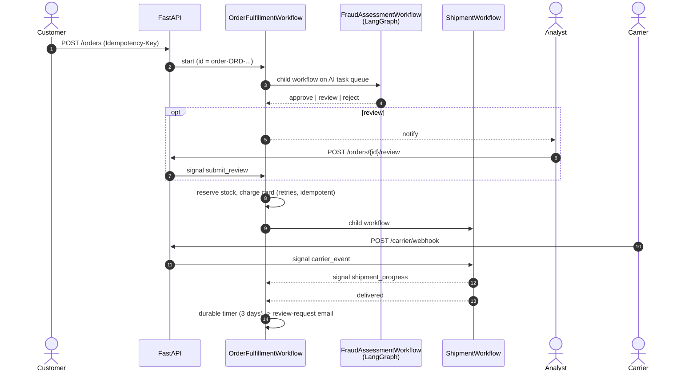

| Scenario | What Temporal feature makes it work |
|---|---|
| Card gateway returns 503 twice | activity retry policy with backoff |
| Card declined after stock was reserved | saga compensation releases the stock |
| New customer orders a laptop | LangGraph fraud graph → human review with a 24 h deadline |
| Customer cancels while order is in review | signal, checked at defined points |
| Customer changes address | update with a validator (rejected once shipped) |
| Worker killed mid-order | replay on another worker; exactly one charge |
| Parcel never arrives | SLA timers in a child workflow → refund, stock stays shipped |
| "Where is my order?" | query, plus searchable `OrderStatus` attribute |
| Customer asks the AI agent for a refund | Deep Agent: LLM + tool calls as activities, `interrupt_on` pauses for a supervisor |
| Hourly restocking | Temporal Schedule |

## Quick start

```bash
# 1. the Temporal CLI (includes a dev server + UI)
brew install temporal          # or download from github.com/temporalio/cli/releases

# 2. the project
python -m venv .venv && source .venv/bin/activate
make install

# 3. four terminals
make server          # Temporal dev server, UI at http://localhost:8233
make worker-orders   # order saga, shipments, replenishment
make worker-ai       # fraud graph + support agent
make api             # http://localhost:8000/docs

# 4. watch it all happen
make demo
```

Or `docker compose up --build`, then `python scripts/demo.py`.

No API key is needed: the default `LLM_MODEL=fake:retail` is a rule-based
chat model that drives the real agent loop offline. Set
`LLM_MODEL=openai:gpt-4.1-mini` (or `anthropic:claude-sonnet-4-5`) plus the
matching key to use a real model.

## Tests

```bash
make test
```

20 tests: 18 end-to-end against a real Temporal dev server (started for you)
plus 2 activity unit tests. They cover every scenario in the table, a worker
crash mid-order, and a replay of every history the run produces to prove the
code is deterministic. If your network blocks the automatic CLI download,
set `TEMPORAL_CLI_PATH=/path/to/temporal`.

## Architecture

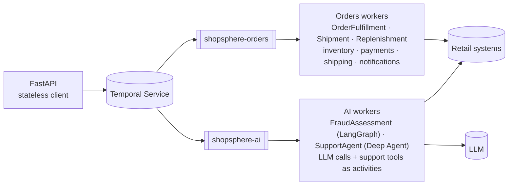

Two worker pools on two task queues: the order fleet is cheap and always on;
the AI fleet holds the LLM keys, is rate limited to the provider, and can be
deployed independently. If the AI fleet is down for ten minutes, orders fall
back to manual review instead of failing.

## Layout

```
src/shopsphere/
  workflows/   order_workflow.py (start here), shipment, fraud, support, replenishment
  activities/  every side effect, each one idempotent
  ai/          fraud_graph.py (LangGraph), support_agent.py (Deep Agent), llm.py
  api/         FastAPI endpoints: start, signal, update, query, list
  worker.py    worker pools and plugin wiring
tests/         20 tests on a real Temporal server
docs/          the zero-to-hero guide (15 chapters + appendix)
scripts/       demo.py, create_schedule.py
```

## API

| Method | Path | Temporal operation |
|---|---|---|
| `POST` | `/orders` | start workflow (Idempotency-Key → workflow ID) |
| `GET` | `/orders/{id}` | query `get_status` |
| `GET` | `/orders?status=&customer_id=` | visibility list with search attributes |
| `POST` | `/orders/{id}/cancel` | signal `cancel` |
| `POST` | `/orders/{id}/review` | signal `submit_review` |
| `PUT` | `/orders/{id}/shipping-address` | update `update_shipping_address` (validated) |
| `POST` | `/carrier/webhook` | signal `carrier_event` on the shipment child |
| `POST` | `/support/sessions` | start `SupportAgentWorkflow` |
| `POST` | `/support/sessions/{id}/messages` | update `chat` |
| `POST` | `/support/sessions/{id}/decision` | update `decide` (supervisor) |
| `GET` | `/support/sessions/{id}` | query `get_session` |

## Versions

Built and tested in October 2026 with Python 3.13, temporalio 1.34.0
(Temporal CLI 1.5.1 / server 1.29.1), deepagents 0.7.23, langgraph 1.2.14,
langchain 1.4.4 and FastAPI 0.143. The Temporal LangGraph and Deep Agents
plugins are marked experimental, so `requirements.txt` pins exact versions.

## The guide

Start at [docs/README.md](docs/README.md). Chapters:

01 Why durable execution · 02 Core concepts · 03 Architecture · 04 Running it ·
05 Determinism and replay · 06 The order workflow line by line ·
07 Activities, retries, timeouts, idempotency · 08 Sagas ·
09 Signals, queries, updates · 10 Timers, children, continue-as-new, schedules ·
11 Versioning · 12 AI agents on Temporal · 13 Testing · 14 Production ·
15 Hero checklist · A Real event histories


# Temporal Zero to Hero — the complete ShopSphere deep dive

All chapters of the guide in one file. The same content lives chapter by chapter in the docs/ folder.

## Contents

- [01 — Why durable execution exists](#01--why-durable-execution-exists)
- [02 — Core concepts](#02--core-concepts)
- [03 — Architecture: what actually happens](#03--architecture-what-actually-happens)
- [04 — Running it](#04--running-it)
- [05 — Determinism and replay](#05--determinism-and-replay)
- [06 — The order workflow, line by line](#06--the-order-workflow-line-by-line)
- [07 — Activities, retries, timeouts and idempotency](#07--activities-retries-timeouts-and-idempotency)
- [08 — The saga pattern](#08--the-saga-pattern)
- [09 — Signals, queries and updates](#09--signals-queries-and-updates)
- [10 — Timers, child workflows, continue-as-new, schedules](#10--timers-child-workflows-continue-as-new-schedules)
- [11 — Versioning: changing code while workflows run](#11--versioning-changing-code-while-workflows-run)
- [12 — AI agents on Temporal: LangGraph, LangChain and Deep Agents](#12--ai-agents-on-temporal-langgraph-langchain-and-deep-agents)
- [13 — Testing](#13--testing)
- [14 — Production](#14--production)
- [15 — Hero checklist](#15--hero-checklist)
- [Appendix A — Real event histories](#appendix-a--real-event-histories)


---

# 01 — Why durable execution exists

## A Tuesday afternoon order

Alice clicks "Place order" for a pair of $199.99 headphones. Here is what has
to happen, in order:

1. Check the order for fraud.
2. Reserve one unit of stock so nobody else buys the last pair.
3. Charge her card.
4. Send a confirmation email.
5. Buy a shipping label and hand the box to the carrier.
6. Wait for the carrier to tell us it was delivered. Could be two days, could be nine.
7. Three days after delivery, email her asking for a review.

Written as plain Python, that's about fifteen lines:

```python
async def place_order(order):
    risk = await fraud_service.check(order)
    if risk == "reject":
        return "rejected"
    await inventory.reserve(order)
    await payments.charge(order)
    await email.send(order, "confirmed")
    label = await carrier.buy_label(order)
    await wait_for_delivery(label)          # days
    await asyncio.sleep(3 * 24 * 3600)      # three more days
    await email.send(order, "review_request")
```

It reads beautifully and it is wrong in at least a dozen ways. Let's break it.

## Ten ways the simple version fails

**The process restarts.** You deploy on Thursday. Every order sitting at line
8 or 9 (waiting for delivery, waiting three days) is gone. Nothing in memory
survives a restart, and in production something restarts every day: deploys,
autoscaling, OOM kills, spot instance reclamation, kernel patches.

**The payment gateway returns a 503.** Now you need a retry. How many times?
With what backoff? What if it's a 402 "card declined" instead — retrying that
is pointless, and retrying it 50 times might get the merchant account flagged.

**The charge succeeds but the response is lost.** The network drops after
Stripe captured the money but before your code saw the 200. Your retry charges
Alice twice.

**Stock was reserved, then the card was declined.** The headphones stay
reserved forever unless someone writes the "release" code and makes sure it
runs even if the process dies right after the decline.

**The carrier webhook arrives while the process is down.** Who receives it?
Where does it go? How does the right in-flight order find out?

**Alice wants to cancel.** She clicks Cancel at minute four. The order is at
"charging card." How does a request from the outside world reach this
particular running function, safely, without a race with the charge?

**An analyst needs to look at a suspicious order.** The function has to pause
for hours until a human decides, and must give up and reject the order if
nobody decides within a day.

**Support asks "where is order ORD-1001?"** The only accurate answer lives in
the local variables of some coroutine on some machine.

**You fix a bug in step 5.** There are 40,000 orders currently somewhere
between step 1 and step 7. Which version of the code do they continue with?

**A three-day sleep.** `asyncio.sleep(259200)` on a pod that gets rescheduled
every few hours is a sleep that never ends.

## What teams usually build instead

Nobody ships the fifteen-line version. They ship something like this:

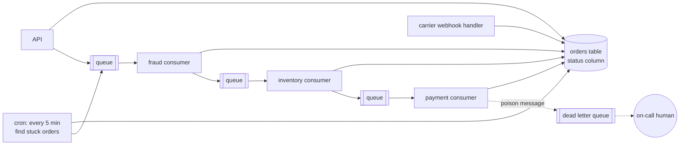

The business logic is now smeared across a state column, five consumers, a
cron job, retry configuration in three different places, and a dead letter
queue that someone checks when a customer complains. Every step has to:

* load state from the database,
* check it's in the right status,
* do its thing,
* write the new status,
* publish the next message,
* and get the ordering of those last two right, or you need an outbox table.

The original fifteen lines of intent are still in there somewhere, but you
can't read them anymore. Ask "what happens to an order after it's paid?" and
the answer is "grep for `status = 'PAID'`."

This is the most common architecture in the industry, and it works. It's also
where most of the bugs live.

## Durable execution, in one sentence

> Write the fifteen-line version, and have a runtime guarantee that it runs to
> completion, exactly as written, no matter what crashes along the way.

That's the whole idea. The function is still a function. Its local variables
still hold the order state. `await asyncio.sleep(3 days)` still means three
days. But now:

* Every step that touches the outside world is recorded in a durable log
  before the function moves past it.
* If the machine dies, another machine rebuilds the function's state from the
  log and continues from the exact line it was on.
* Retries, timeouts and backoff are declared next to each call, and the
  runtime enforces them.
* The outside world can send messages into the running function, and ask it
  questions, by its ID.

Temporal is the most widely used implementation of this idea. It started as
Cadence at Uber (2017), where it ran things like trip and payment workflows,
and was forked into Temporal in 2019 by the same engineers. It's open source
(MIT), runs as a self-hosted cluster or as Temporal Cloud, and has SDKs for Go,
Java, Python, TypeScript, .NET, PHP and Ruby.

## What the order looks like on Temporal

Here's the shape of `OrderFulfillmentWorkflow.run` from this project, with
the error handling stripped out so you can see the skeleton:

```python
@workflow.run
async def run(self, order: OrderInput) -> OrderView:
    await self._fraud_check()            # child workflow, may wait for a human
    await self._reserve_inventory()      # activity + registers its undo
    await self._charge_payment()         # activity + registers its undo
    await self._notify("order_confirmed", ...)
    await self._ship()                   # child workflow, waits for carrier signals
    await workflow.sleep(timedelta(days=3))
    await self._notify("review_request", ...)
```

It's the fifteen-line version. The difference is everything that's no longer
your problem:

| Problem from above | Who handles it now |
|---|---|
| Process restarts | Temporal replays history on another worker and continues |
| 503 from the gateway | `RetryPolicy` on the activity, exponential backoff, enforced by the server |
| Card declined | `ApplicationError(non_retryable=True)` stops retries immediately |
| Lost response after a charge | The activity is retried; your idempotency key makes the retry safe (chapter 07) |
| Releasing stock after a decline | Saga compensation in an `except` block — it runs even if a worker dies mid-way (chapter 08) |
| Carrier webhook | A Signal to `shipment-{order_id}` — buffered in history even if no worker is running |
| Cancel | A Signal; the workflow checks it at defined points |
| Human review with deadline | `workflow.wait_condition(..., timeout=24h)` |
| "Where is my order?" | A Query, answered from the workflow's live state |
| Bug fix with 40k orders in flight | Versioning with `workflow.patched()` (chapter 11) |
| Three-day sleep | A durable timer stored on the server |

## What durable execution is not

It's worth being precise, because the marketing version ("your code can't
fail!") sets people up for confusion.

**It is not exactly-once execution of side effects.** Activities run *at least
once*. If a worker charges a card and dies before reporting back, Temporal
will run the activity again. Temporal guarantees the *workflow logic* sees
each activity's result exactly once; making the *side effect* idempotent is
your job. Chapter 07 is all about this.

**It is not a database.** Workflow state lives in event histories that are
deleted after the namespace's retention period. If other systems need to read
order data, write it somewhere (this project's `save_order_snapshot`).

**It is not a message queue.** It uses queues internally, and it can replace a
lot of queue-based choreography, but it's not where you'd put a high-volume
event stream. Kafka and Temporal are friends: a Kafka consumer is often what
starts or signals workflows.

**It is not free.** Every step writes to a durable store. A workflow is heavier
than a function call; it's in the same cost class as a database transaction.
That's fine for orders, payments, onboarding, AI agent runs and data
pipelines. It's silly for "add two numbers."

**It does not make your code deterministic for you.** Workflow code has rules
(chapter 05). Break them and replay fails.

## When to reach for it

Good fits — long-lived, multi-step, must-finish processes that cross systems:

* order fulfillment, payments, refunds, chargebacks
* onboarding / KYC flows with human steps
* infrastructure provisioning and deploys
* data and ML pipelines (each stage as an activity)
* AI agents: every LLM call and tool call becomes a durable, retried step,
  and a human approval can pause the agent for days (chapter 12)
* anything you're currently doing with "status column + cron + queue"

Poor fits:

* request/response handlers that finish in 50 ms and can just be retried by
  the client
* very high-throughput stream processing (millions of tiny events per second)
* pure computation with no external calls and no need to survive a crash

## Where to go next

Chapter 02 gives you the vocabulary: workflow, activity, worker, task queue,
event history. Chapter 03 then opens the hood and shows exactly what the
server and your worker say to each other — that's the chapter that makes
everything else click.

---

# 02 — Core concepts

Temporal has a small core vocabulary. Learn these ten words well and the rest
of the docs become easy to read.

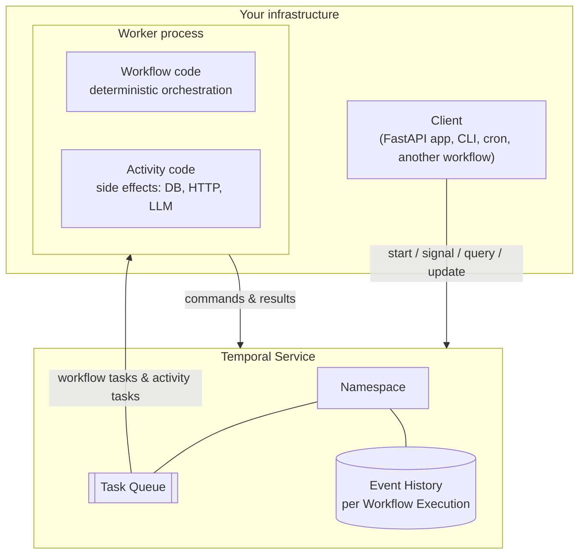

## 1. Workflow

A **workflow** is a function that orchestrates work. In Python it's a class
with `@workflow.defn`, and one method marked `@workflow.run`:

```python
@workflow.defn
class OrderFulfillmentWorkflow:
    @workflow.run
    async def run(self, order: OrderInput) -> OrderView:
        ...
```

Two different things share the word:

* the **workflow definition** — the code above, and its **workflow type**
  (the name, `OrderFulfillmentWorkflow` by default);
* a **workflow execution** — one running instance of it. Alice's order is one
  execution, Bob's is another.

Each execution has a **workflow ID** that you choose (`order-ORD-1001`) and a
**run ID** that Temporal generates. The workflow ID is your business key and
the thing you'll use to find, signal and query the execution. Temporal
guarantees that at most one *open* execution exists per workflow ID in a
namespace, which is a powerful deduplication tool: the API in this project
derives the workflow ID from the client's Idempotency-Key, so a retried POST
can't create a second order.

Workflow code has one big rule: **it must be deterministic**. Given the same
inputs and the same history of results, it must make the same decisions in
the same order. No reading the clock, no random numbers, no network calls, no
threads. Anything like that goes into an activity. Chapter 05 explains why in
depth; for now, think of workflow code as the conductor who never plays an
instrument.

A workflow can live for milliseconds or for years. It can sleep, wait for
messages, start child workflows and call activities.

## 2. Activity

An **activity** is a normal function that does one thing that touches the
outside world: write to a database, call Stripe, send an email, call an LLM.

```python
@activity.defn
async def charge_payment(req: ChargeRequest) -> PaymentReceipt:
    ...
```

Activities can do anything normal Python can do. In exchange, Temporal
treats them as unreliable: they can time out, fail, and be retried, and the
workflow declares how:

```python
receipt = await workflow.execute_activity(
    charge_payment,
    ChargeRequest(...),
    start_to_close_timeout=timedelta(seconds=30),
    retry_policy=PAYMENT_RETRY,
)
```

When the activity succeeds, its result is written to the workflow's history.
After that, no matter how many times the workflow is replayed, it will never
run that activity again — it reads the recorded result.

Activities run **at least once**. Make them idempotent. (Chapter 07.)

## 3. Worker

A **worker** is a process you run (on your laptop, in Kubernetes, on ECS — it's
just a Python process) that hosts your workflow and activity code. It
connects *out* to the Temporal service and long-polls for work.

```python
Worker(
    client,
    task_queue="shopsphere-orders",
    workflows=[OrderFulfillmentWorkflow, ShipmentWorkflow],
    activities=[reserve_inventory, charge_payment, ...],
)
```

Three things surprise people:

1. **The Temporal server never runs your code.** It stores histories and hands
   out tasks. Your code runs only in your workers. This is why Temporal can't
   leak your secrets: API keys live in the worker's environment.
2. **Workers are stateless and disposable.** Kill one at any time. Another
   worker on the same task queue picks up its work. Our test
   `test_worker_crash_mid_order_is_invisible_to_the_customer` does exactly this.
3. **Workers connect outbound only.** No inbound ports to open, no load
   balancer in front of them. Scale by running more copies.

## 4. Task queue

A **task queue** is a named, lightweight queue inside Temporal that workers
poll. You don't create them; they spring into existence when someone polls or
schedules onto them.

Task queues are how you route work. This project uses two:

* `shopsphere-orders` — the order saga, shipments, replenishment. Cheap, fast,
  must always be up.
* `shopsphere-ai` — fraud scoring and the support agent. Holds the LLM API
  keys, rate limited by the provider, deployed more often.

The order workflow calls the fraud workflow *by name* on the AI queue:

```python
await workflow.execute_child_workflow(
    "FraudAssessmentWorkflow", fraud_input,
    task_queue=order.ai_task_queue, ...
)
```

so the orders worker never imports LangChain, and you can scale or redeploy
the AI fleet without touching order processing.

Every worker polling a given task queue must be able to run every workflow
and activity type that gets scheduled on it. If an activity is scheduled on a
queue whose workers don't register it, the task fails with "activity type not
registered" and retries until a capable worker shows up.

## 5. Event history

Every workflow execution has an **event history**: an append-only log of
everything that happened to it. This is the heart of Temporal. Here are the
first events of a real order from this project (full version in appendix A):

```
   1  WORKFLOW_EXECUTION_STARTED           OrderFulfillmentWorkflow
   2  WORKFLOW_TASK_SCHEDULED
   3  WORKFLOW_TASK_STARTED
   4  WORKFLOW_TASK_COMPLETED
   5  UPSERT_WORKFLOW_SEARCH_ATTRIBUTES
   6  UPSERT_WORKFLOW_SEARCH_ATTRIBUTES
   7  ACTIVITY_TASK_SCHEDULED              save_order_snapshot
   8  ACTIVITY_TASK_STARTED
   9  ACTIVITY_TASK_COMPLETED
  ...
  20  START_CHILD_WORKFLOW_EXECUTION_INITIATED   FraudAssessmentWorkflow
  ...
  42  ACTIVITY_TASK_SCHEDULED              charge_payment
  43  ACTIVITY_TASK_STARTED
  44  ACTIVITY_TASK_COMPLETED
```

The history *is* the state. There's no separate "current state" record that
can drift out of sync with it. To know where a workflow is, replay its
history through the workflow code.

## 6. Commands and events

When your workflow code calls `execute_activity`, it doesn't call anything.
It produces a **command** ("please schedule activity charge_payment with this
input"). The worker sends the batch of commands to the server at the end of a
**workflow task**; the server turns each into an **event**
(`ACTIVITY_TASK_SCHEDULED`) and acts on it.

| Your code does | Command sent | Event(s) recorded |
|---|---|---|
| `execute_activity(...)` | ScheduleActivityTask | ActivityTaskScheduled → Started → Completed / Failed / TimedOut |
| `workflow.sleep(d)` | StartTimer | TimerStarted → TimerFired |
| `execute_child_workflow(...)` | StartChildWorkflowExecution | StartChildWorkflowExecutionInitiated → ChildWorkflowExecutionStarted → …Completed |
| `upsert_search_attributes(...)` | UpsertWorkflowSearchAttributes | UpsertWorkflowSearchAttributes |
| `workflow.patched("x")` (first time) | RecordMarker | MarkerRecorded |
| `return value` | CompleteWorkflowExecution | WorkflowExecutionCompleted |
| `workflow.continue_as_new(...)` | ContinueAsNewWorkflowExecution | WorkflowExecutionContinuedAsNew |

Things that come from the outside produce events without a command: a signal
becomes `WorkflowExecutionSignaled`, an update becomes
`WorkflowExecutionUpdateAccepted` and later `…UpdateCompleted`, a cancel
request becomes `WorkflowExecutionCancelRequested`.

## 7. Workflow task and activity task

The server hands workers two kinds of task:

* a **workflow task** says: "something happened to workflow X (an activity
  finished, a timer fired, a signal arrived). Run the workflow code forward
  until it's blocked again, and tell me what commands it produced." Workflow
  tasks are short — they're just your orchestration code running until the
  next `await` that can't be satisfied yet. Default timeout: 10 seconds.
* an **activity task** says: "run activity Y with this input and tell me the
  result." These can take as long as you allow.

The repeated `WORKFLOW_TASK_SCHEDULED / STARTED / COMPLETED` triplets in the
history above are workflow tasks. Each one is a moment where your workflow
code woke up, made progress, and went back to sleep.

## 8. Messages: signals, queries, updates

Running workflows can be talked to:

* **Signal** — fire-and-forget message that may change state. Recorded in
  history. The carrier webhook signals `carrier_event` into the shipment
  workflow.
* **Query** — read-only question, answered from the workflow's in-memory
  state. Not recorded. `GET /orders/{id}` is a query.
* **Update** — a request that may change state *and* returns a result, with
  an optional validator that can reject it before anything is recorded. The
  address change and every support chat message are updates.

Chapter 09 goes deep, including when to pick which.

## 9. Namespace

A **namespace** is the unit of isolation inside a Temporal service: workflow
IDs are unique per namespace, task queues are per namespace, and retention
(how long closed histories are kept), access control, archival and custom
search attributes are configured per namespace. Typical setups use one
namespace per environment per team, like `orders-prod` and `orders-staging`.
The dev server comes with `default`.

## 10. Temporal Service, client, and SDK

* The **Temporal Service** (often still called "the server" or "the cluster")
  is the backend: a set of Go services plus a database. You run it yourself or
  use Temporal Cloud. Chapter 03 opens it up.
* A **client** is anything that talks to the service through the SDK's
  `Client`: starts workflows, sends signals, runs queries. The FastAPI app is
  a client. Workers also contain a client.
* The **SDK** (`temporalio` on PyPI) is the library your code uses. The Python
  SDK is built on a shared Rust core (`sdk-core`) that also powers the
  TypeScript, .NET and Ruby SDKs, which handles the state machines and
  networking; the Python layer gives you the decorators and asyncio integration.

## Supporting concepts you'll meet soon

**Timer** — `await workflow.sleep(...)` or a `timeout=` on `wait_condition`.
Stored on the server, so a three-day timer costs nothing while it waits.

**Child workflow** — a workflow started by another workflow. Has its own ID
and history. `FraudAssessmentWorkflow` and `ShipmentWorkflow` are children of
the order workflow.

**Continue-as-new** — atomically finish this run and start a fresh run of the
same workflow ID with new input. How long-lived workflows keep their history
short. The support session uses it.

**Schedule** — Temporal's cron, with pause, backfill, overlap policies and a
UI. The replenishment job runs on one.

**Search attributes** — indexed key/value pairs on an execution that you can
query with SQL-like filters: `OrderStatus='PENDING_REVIEW' AND CustomerId='CUST-BOB'`.
Requires the attributes to be registered on the namespace first.

**Data converter** — how your Python objects become bytes in history. The
default handles JSON-able types and dataclasses. You can add a codec to
compress or encrypt every payload.

**Retry policy** — initial interval, backoff coefficient, maximum interval,
maximum attempts, and a list of non-retryable error types. Applies to
activities by default; workflows don't retry unless you ask them to.

## A mental model that holds up

Picture each workflow execution as a **tape** (the history) and your workflow
code as a **deterministic player** that can play the tape back from the start
at any time and arrive at exactly the same place. Workers are the machines
that hold the player. Machines can be swapped at any moment; the tape lives on
the server. Activities are the only part of the system that talks to the real
world, and their outcomes get spliced onto the tape so the player never needs
to talk to the world twice.

Keep that picture in mind for the next chapter, where we watch the tape being
recorded.

---

# 03 — Architecture: what actually happens

This chapter follows one order through the system at the level of RPCs and
database writes. Once you've seen it, the rules in later chapters stop
feeling arbitrary.

## The big picture

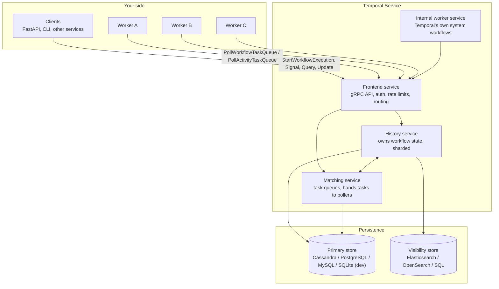

### Frontend

The only door in. Every SDK call — start, signal, query, poll — is a gRPC
request to the frontend. It authenticates, applies per-namespace rate limits,
validates, and routes to the right history shard or matching partition. It's
stateless; you run several behind a load balancer.

### History service

Where workflow state actually lives. History is **sharded**: each workflow
execution is assigned to one of N shards by hashing its namespace and
workflow ID, and each shard is owned by exactly one history host at a time.
That gives Temporal single-writer semantics per workflow without distributed
locks — every change to Alice's order goes through one shard owner, in order.

For each execution the history service keeps:

* the **event history** (append-only), and
* **mutable state**: a compact summary of what's pending right now (which
  activities are outstanding, which timers are set, what the next event ID
  is). It's derived from the history and kept alongside it so the server
  doesn't need to read the whole history to make a decision.

It also owns durable internal queues per shard — a *transfer queue* for
"push this task to matching" and a *timer queue* for "wake this up at time T".
Your three-day `workflow.sleep` is a row in a timer queue, and a 30-second
activity timeout is too.

The number of shards is fixed when the cluster is created (the dev server uses
a small number; production clusters typically use hundreds to thousands) and
cannot be changed later without migrating. It's the main knob of how far a
self-hosted cluster can scale.

### Matching service

Manages task queues. When history says "schedule activity `charge_payment`
on `shopsphere-orders`", matching is what holds that task until a worker
polls for it. Busy task queues are split into partitions spread across
matching hosts.

If a worker is already waiting in a long poll when a task arrives, matching
hands it over directly in memory ("sync match"). If not, the task is
persisted to the backlog and delivered when a poller shows up. A growing
backlog with a steadily rising schedule-to-start latency is the classic sign
you need more workers.

### Internal worker service

Temporal uses itself. Some features are implemented as system workflows that
run inside the cluster's own worker service: things like batch operations
(bulk signal / cancel / terminate), archival and, in many versions, the
machinery behind Schedules. You don't interact with it directly.

### Persistence

Two stores:

* the **primary store** holds histories, mutable state, task queues and timer
  queues. Supported: Cassandra, PostgreSQL, MySQL; SQLite for the dev server.
  This is the source of truth.
* the **visibility store** holds the searchable index of executions —
  workflow type, status, start/close time and your custom search attributes.
  It backs "list workflows" and the UI's search box. Elasticsearch/OpenSearch
  or SQL. It's eventually consistent with the primary store, which is why the
  visibility test in this project polls for a moment before asserting.

## The life of an order, step by step

Here is what happens when the API places Alice's order, up to the point where
the first activity completes. The event IDs match the real history in
appendix A.

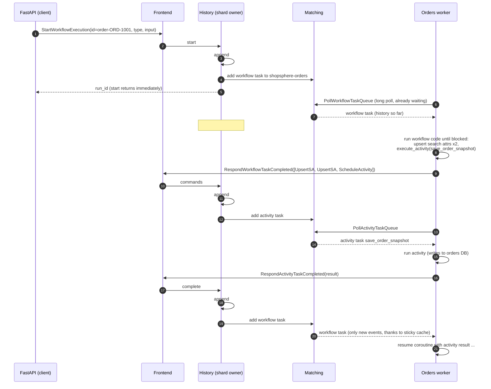

Some details worth staring at:

**Starting a workflow does not run it.** The API gets the run ID back as soon
as events #1 and #2 are durable. Whether a worker is up or not doesn't matter
for the caller. If every worker is down for an hour, the workflow simply
starts an hour later.

**Workflow code produces commands, not effects.** In step 7 the worker ran the
workflow code from the top until it hit an `await` that couldn't resolve
(waiting for the snapshot activity). Everything it wanted to do in the
meantime was collected as commands and sent in one batch. Then the coroutine
was suspended.

**`ACTIVITY_TASK_STARTED` is written late.** Look at the history: started and
completed appear together. Temporal doesn't write the "started" event when the
worker picks up the task; it writes it when the attempt finishes (or the
activity finally fails after all retries). That keeps retries from bloating
history: an activity that took 7 attempts still produces three events. The
attempt number is recorded on the started event. You can see an extreme case
in the shipment child's history, where `ACTIVITY_TASK_SCHEDULED` is event 5,
three signals arrive (events 6–17), and only then do 18/19 started/completed
appear.

**Long polling.** Workers sit in a poll request for up to about a minute. When
work arrives it's delivered instantly; when the poll times out, the worker
simply polls again. That's why there's no added latency and no inbound
connection to the worker.

## Sticky execution and the workflow cache

Rebuilding a workflow by replaying its full history on every workflow task
would be wasteful. So workers keep recently used workflows in memory (the
**workflow cache**, `max_cached_workflows` on the Worker), suspended at their
`await`.

After a worker completes a workflow task, the server routes the *next*
workflow task for that execution to a worker-specific **sticky queue**.
If that same worker picks it up, it sends just the new events and the worker
resumes the cached coroutine — no replay.

If the worker doesn't pick up the sticky task within a few seconds (it
crashed, or it's overloaded), the server moves the task back to the normal
queue. Any worker can take it — but that worker has no cached state, so the
server sends the full history and the worker **replays** the workflow from
the beginning to rebuild it. This fallback is the whole durability story in
one move.

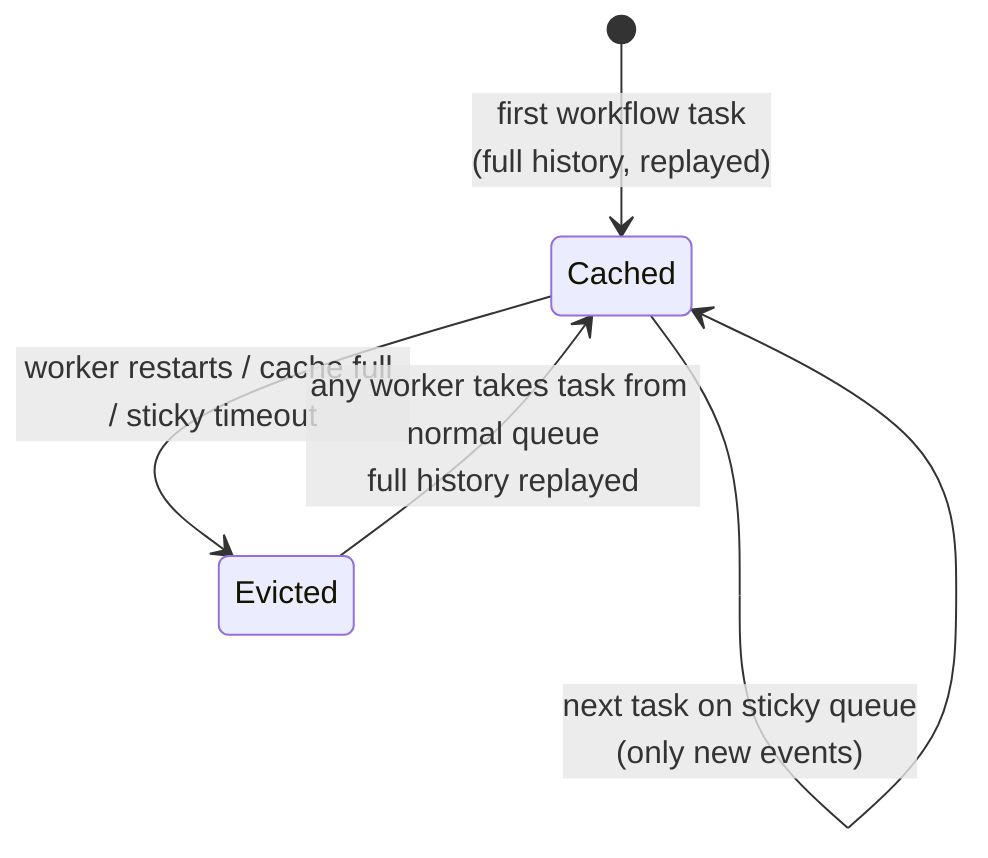

## Replay, concretely

Replay is the mechanism behind everything, so let's do one by hand. Suppose
the orders worker that was running Alice's order crashes right after the
charge succeeded. The history at that moment ends with:

```
  42  ACTIVITY_TASK_SCHEDULED     charge_payment
  43  ACTIVITY_TASK_STARTED
  44  ACTIVITY_TASK_COMPLETED     result: {"payment_id": "PAY-ORD-1001", ...}
  45  WORKFLOW_TASK_SCHEDULED
```

Event 45 means "a worker needs to process the activity result". The crashed
worker never responded, so after the workflow task timeout another worker
gets it, with the full history. It creates a fresh `OrderFulfillmentWorkflow`
instance and runs `run()` from the top, in **replay mode**:

| Workflow code | Replay engine |
|---|---|
| `upsert_search_attributes(...)` | matches recorded event #5 — no-op |
| `_set_status(RECEIVED)` → `execute_activity(save_order_snapshot)` | matches #7; result taken from #9; activity **not** executed |
| `execute_child_workflow("FraudAssessmentWorkflow")` | matches #20; result from #25; child **not** restarted |
| `execute_activity(reserve_inventory)` | matches #29; result from #31; stock **not** touched again |
| `execute_activity(charge_payment)` | matches #42; result from #44; card **not** charged again |
| `_notify("order_confirmed")` → `execute_activity(send_notification)` | **no matching event** — this is new. Replay ends; the worker is now live and emits a ScheduleActivityTask command |

By the time the engine reaches the end of history, the fresh instance has
exactly the same local variables (`self._status`, `self._compensations`,
`self._fraud`...) as the one that died. Including the lambdas in the
compensation list — they were re-created by the replayed code, not
deserialized. That's why workflow state doesn't need to be serializable: it's
re-derived.

This only works if the code makes the *same calls in the same order* when it
sees the same history. If during replay the code tried to schedule
`reserve_inventory` where the history says `charge_payment` was scheduled, the
SDK can't line them up and raises a **non-determinism error**. That's the
subject of chapter 05.

## What happens when things fail

| Failure | What Temporal sees | What happens |
|---|---|---|
| Worker dies while running a workflow task | No response within the workflow task timeout (10 s default) | Task re-dispatched; another worker replays and continues |
| Worker dies while running an activity | No response within `start_to_close_timeout` — or no heartbeat within `heartbeat_timeout` | Activity attempt marked timed out, retried per `RetryPolicy` |
| Activity raises an exception | `RespondActivityTaskFailed` | Retried per policy unless the error type is non-retryable; after the last attempt the workflow's `await` raises `ActivityError` |
| No worker polling the queue | Tasks pile up in matching | Nothing breaks; work resumes when a worker appears. Monitor schedule-to-start latency |
| Workflow code throws an unexpected Python exception | Workflow task failure | The **workflow task** is retried (not the workflow failed) — you can deploy a fix and it resumes. Only `ApplicationError` (and some Temporal errors) fail the workflow |
| Non-determinism detected | Workflow task failure | Same — retried until you deploy compatible code or reset the workflow |
| A history shard host dies | Shard ownership moves to another host | Brief latency blip; no data loss (state is in the DB) |
| The database is unavailable | Frontend returns errors | SDKs retry; workers back off. Nothing progresses until the DB is back |

The fifth row deserves emphasis because it's different from most frameworks:
a bug in workflow code (say, a `KeyError`) does **not** fail the workflow. The
workflow task fails and is retried, and the workflow sits there, showing the
error in the UI, until you ship a fix. Then it carries on as if nothing
happened. Workflow *failure* is something you ask for explicitly by raising
`ApplicationError`. (You can change this per workflow with
`failure_exception_types` if you prefer to fail fast.)

## Inside the Python worker

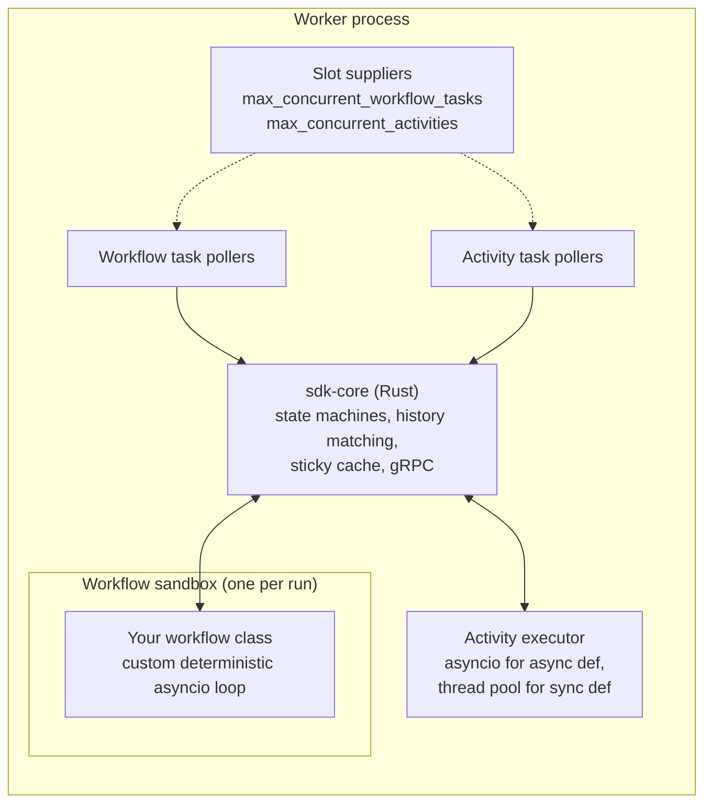

* **Pollers** hold open long-poll requests. Only as many tasks are polled as
  there are free **slots**, so a worker never takes more work than it can do.
  This is how `max_concurrent_activities=8` on the AI worker protects the LLM
  provider's rate limit: the 9th fraud check waits in Temporal's queue, not in
  a 429 retry loop.
* **sdk-core** is shared Rust code that does the hard parts: matching
  commands to history during replay, deciding when replay is over, managing
  the sticky cache.
* **The workflow sandbox** runs each workflow in a fresh module namespace with
  restricted imports and a custom event loop. The loop only advances when
  sdk-core feeds it events, which is what makes `asyncio` usable in
  deterministic code. More in chapter 05.
* **Activities** run on the worker's normal asyncio loop (async def) or a
  thread pool you provide (plain def). They're unrestricted.

## Visibility and search

Every execution's type, status, timestamps and search attributes are copied
into the visibility store. That's what powers:

```python
client.list_workflows("WorkflowType='OrderFulfillmentWorkflow' AND OrderStatus='PENDING_REVIEW'")
```

and the same query typed into the UI. This project registers two custom
keyword attributes — `OrderStatus` and `CustomerId` — and upserts them from
the workflow (`ORDER_STATUS_KEY.value_set(...)`). The dev server registers them
with `--search-attribute OrderStatus=Keyword`; on a real cluster you'd run
`temporal operator search-attribute create`.

Two rules of thumb:

* Visibility is **eventually consistent**. Don't use it as the source of
  truth for a decision; query the workflow, or keep your own read model.
* Search attributes are for **finding** workflows, not storing data. Keep them
  few and small.

## Temporal Cloud vs self-hosted

The programming model is identical. The difference is who operates the four
services and the two databases. With Temporal Cloud you get a namespace
endpoint and mTLS or API-key credentials; your workers run in your own
infrastructure either way, so your code and secrets never leave it. Chapter
14 covers both.

## Recap

* The server stores histories and hands out tasks. Your code only runs in your
  workers.
* Workflow code runs in short bursts (workflow tasks) and emits commands; the
  server records them as events.
* Workers cache workflows; when a cache is lost, replay rebuilds the exact
  state from history.
* Replay skips completed activities by reading their recorded results. That's
  why activities run once (per success) and workflow code must be
  deterministic.
* A bug in workflow code pauses the workflow rather than failing it.

---

# 04 — Running it

## What you need

* Python 3.11 or newer (the LangGraph and Deep Agents plugins rely on
  asyncio context propagation that older versions lack)
* the Temporal CLI, which includes a single-binary dev server with the Web UI
* optionally Docker, if you prefer `docker compose up`
* optionally an OpenAI or Anthropic API key. Everything works offline without one.

## Install the Temporal CLI

```bash
# macOS
brew install temporal

# Linux / Windows: download from the GitHub releases page
# https://github.com/temporalio/cli/releases  -> temporal_cli_<version>_<os>_<arch>.tar.gz
tar xzf temporal_cli_*.tar.gz && sudo mv temporal /usr/local/bin/

temporal --version
```

## Option A: four terminals (best for learning)

```bash
unzip shopsphere-temporal.zip && cd shopsphere-temporal
python -m venv .venv && source .venv/bin/activate
make install            # pip install -e ".[dev,openai,anthropic]" and copies .env.example -> .env
```

Then:

```bash
# terminal 1 - Temporal dev server + UI on http://localhost:8233
make server

# terminal 2 - orders worker
make worker-orders

# terminal 3 - AI worker (fraud graph + support agent)
make worker-ai

# terminal 4 - API on http://localhost:8000/docs
make api
```

and in a fifth:

```bash
make demo
```

The demo plays every scenario: happy path with an idempotent retried POST,
flaky payment gateway, declined card with compensation, fraud rejection, human
review with an address change, a customer cancel, and a support conversation
that ends in a supervisor-approved refund.

Running each worker in its own terminal is deliberate. Try these while the
demo runs:

* `Ctrl-C` the orders worker in the middle of the demo, wait ten seconds,
  start it again. Watch the demo carry on.
* Stop the AI worker, place an order with `curl`, and look at it in the UI: it
  sits in `FRAUD_CHECK` with a pending child workflow. Start the worker and it
  continues.

## Option B: Docker Compose

```bash
cp .env.example .env
docker compose up --build
python scripts/demo.py     # from your host, needs: pip install httpx
```

Compose runs the dev server with both search attributes registered, two
replicas of the orders worker, one AI worker and the API. Kill a worker with
`docker compose kill worker-orders` and see that nothing is lost.

## Option C: just the tests

```bash
make test
```

The tests start their own Temporal dev server (the SDK downloads the CLI the
first time; set `TEMPORAL_CLI_PATH=/path/to/temporal` if your network blocks
that) and run 18 end-to-end scenarios against it (plus 2 activity unit tests), including a worker crash
mid-order and a replay check of every history they produce.

## Using a real LLM

```bash
pip install -e ".[openai]"          # or [anthropic]
export LLM_MODEL=openai:gpt-4.1-mini
export OPENAI_API_KEY=sk-...
make worker-ai                      # restart the AI worker (and the API, which passes the model name in)
```

Any model string LangChain's `init_chat_model` understands works. Only the AI
worker needs the key. The model *name* is passed to workflows in their input;
the *key* never leaves the worker's environment and never appears in history.

## Talking to the API by hand

```bash
# place an order
curl -s localhost:8000/orders -H 'content-type: application/json' \
  -H 'Idempotency-Key: my-first-order' -d '{
    "customer_id": "CUST-BOB", "email": "bob@example.com",
    "items": [{"sku": "SKU-LAPTOP", "quantity": 1}],
    "shipping_address": {"name":"Bob","line1":"1 Main St","city":"Austin","state":"TX","postal_code":"78701"},
    "payment_token": "tok_visa"}'

# it's a new customer buying a laptop -> PENDING_REVIEW
curl -s localhost:8000/orders/ORD-MY-FIRST-ORD | jq .status

# approve it as an analyst
curl -s localhost:8000/orders/ORD-MY-FIRST-ORD/review -H 'content-type: application/json' \
  -d '{"approved": true, "reviewer": "me"}'

# play the carrier
for s in IN_TRANSIT OUT_FOR_DELIVERY DELIVERED; do
  curl -s localhost:8000/carrier/webhook -H 'content-type: application/json' \
    -d "{\"order_id\":\"ORD-MY-FIRST-ORD\",\"status\":\"$s\"}"; done
```

Seeded test data:

| Customer | Profile | What happens |
|---|---|---|
| `CUST-ALICE` | 900-day-old account, 42 orders, no chargebacks | Approved instantly |
| `CUST-BOB` | 1-day-old account | Small orders pass; orders over $1,000 go to human review |
| `CUST-MALLORY` | 2 prior chargebacks | Rejected by the fraud graph |

| Payment token | Behaviour |
|---|---|
| `tok_visa` | Succeeds |
| `tok_flaky` | Fails with a 503 twice, succeeds on attempt 3 |
| `tok_decline` | Declined; non-retryable; triggers compensation |

| SKU | Notes |
|---|---|
| `SKU-TV` | Only 3 in stock — order 5 to see `OutOfStock` |
| `SKU-SOCKS` | Final sale (not returnable); below its reorder point, so replenishment picks it up |

## A tour of the Web UI (http://localhost:8233)

Open the UI and click any `order-ORD-...` workflow.

* **Summary** — status, start/close time, task queue, input and result.
  Click the input to see exactly what the API sent.
* **Event History** — the timeline view shows activities as bars; the
  compact/JSON views show every event. Click `ACTIVITY_TASK_SCHEDULED` for
  `charge_payment` on a `tok_flaky` order: the started event shows
  `attempt: 3`, and the "last failure" shows the 503 from attempt 2.
* **Relationships** — parent/child links. An order has two children: the
  fraud workflow (on the AI queue) and the shipment workflow.
* **Queries** — the UI can run `get_status` for you and show the live view.
* **Pending activities** — while something is retrying, this shows the
  attempt count, the last error, and when the next attempt is due. This panel
  is the first place to look when a workflow seems stuck.
* **Workers** — which worker identities are polling the task queue right now.

In the workflow list, try the query box:

```
WorkflowType = 'OrderFulfillmentWorkflow' AND OrderStatus = 'PENDING_REVIEW'
CustomerId = 'CUST-BOB'
ExecutionStatus = 'Running' AND StartTime > '2026-10-01T00:00:00Z'
```

## The CLI you'll actually use

```bash
# list and inspect
temporal workflow list --query "OrderStatus='PENDING_REVIEW'"
temporal workflow describe -w order-ORD-XXXX
temporal workflow show -w order-ORD-XXXX            # event history
temporal workflow show -w order-ORD-XXXX -o json > history.json   # for replay tests

# talk to a running workflow
temporal workflow query  -w order-ORD-XXXX --type get_status
temporal workflow signal -w order-ORD-XXXX --name cancel --input '{"reason":"cli test"}'
temporal workflow update execute -w order-ORD-XXXX --name update_shipping_address \
  --input '{"name":"A","line1":"2 St","city":"Boston","state":"MA","postal_code":"02108"}'

# start one directly, bypassing the API
temporal workflow start --task-queue shopsphere-orders --type InventoryReplenishmentWorkflow \
  -w replenish-manual --input '{"reorder_quantity": 25}'

# stop things
temporal workflow cancel    -w order-ORD-XXXX   # graceful: your code's CancelledError handler runs
temporal workflow terminate -w order-ORD-XXXX   # hard stop: no code runs, no compensation

# rewind time (see chapter 11)
temporal workflow reset -w order-ORD-XXXX --type LastWorkflowTask

# schedules
python scripts/create_schedule.py --every 2m
temporal schedule list
temporal schedule trigger --schedule-id inventory-replenishment
temporal schedule toggle  --schedule-id inventory-replenishment --pause --reason "inventory audit"

# task queue health
temporal task-queue describe --task-queue shopsphere-ai
```

Cancel versus terminate is worth remembering. **Cancel** is a request: it
raises `asyncio.CancelledError` inside the workflow at its current `await`, and
the order workflow catches it, runs compensations and records `CANCELLED`.
**Terminate** kills the execution on the server without running any of your
code. Use terminate only when the code itself is broken beyond repair.

## Project layout

```
shopsphere-temporal/
├── src/shopsphere/
│   ├── config.py                 env-driven settings (never read inside workflows)
│   ├── models.py                 dataclass payloads for every workflow/activity
│   ├── worker.py                 orders + AI worker pools, plugins wired here
│   ├── api/                      FastAPI: thin Temporal client
│   ├── workflows/
│   │   ├── order_workflow.py     the saga — start here
│   │   ├── shipment_workflow.py  child workflow, signals, SLA timers
│   │   ├── fraud_workflow.py     runs the LangGraph graph durably
│   │   ├── support_workflow.py   long-lived Deep Agent session, updates, HITL
│   │   └── replenishment_workflow.py   scheduled job
│   ├── activities/               every side effect, all idempotent
│   ├── ai/
│   │   ├── fraud_graph.py        LangGraph StateGraph with execute_in per node
│   │   ├── support_agent.py      Deep Agent: tools-as-activities, sub-agent, interrupt_on
│   │   └── llm.py                model provider + offline fake model
│   └── services/db.py            SQLite stand-in for downstream systems
├── tests/                        17 end-to-end tests on a real Temporal server
├── scripts/                      demo.py, create_schedule.py
├── docs/                         you are here
├── docker-compose.yml, Dockerfile, Makefile, .env.example
```

---

# 05 — Determinism and replay

Every Temporal course has this chapter and every Temporal user has to learn
it once, usually after a production incident. Let's do it before.

## The rule

> Workflow code, given the same input and the same sequence of recorded
> events, must issue the same commands in the same order.

That's it. Everything else in this chapter is a consequence.

Why? Because of replay (chapter 03). When a worker rebuilds a workflow, it
runs your code from the top and checks each command against history. Event
#42 says "activity `charge_payment` was scheduled". If on replay the code
asks to schedule `refund_payment` at that point, the SDK has two incompatible
versions of the past and no way to reconcile them. It stops and raises a
**non-determinism error** (NDE).

## What actually gets compared

It's narrower than people fear. Replay compares the **sequence of commands**:
schedule activity X, start timer, start child Y, signal external Z, record
marker, upsert search attributes, complete. It checks the *type* and *identity*
(activity type, child workflow type, timer, and so on) in order.

What does **not** need to match:

* log lines (`workflow.logger` is even replay-aware: it doesn't log during
  replay by default)
* local variables and in-memory computations
* the input *arguments* to activities, for the most part — changing a
  timeout or an argument value is tolerated by the matcher, though changing
  behaviour this way on in-flight workflows is still risky
* query handlers (they never produce commands)

So "deterministic" really means: **the decisions about what to do next must
be a pure function of the workflow input and the recorded results.**

## What breaks it

### 1. Reading the outside world in workflow code

```python
# BAD - different on replay
if datetime.now().hour > 17:
    await workflow.execute_activity(send_after_hours_notice, ...)

# GOOD - workflow.now() returns the time of the current workflow task, from history
if workflow.now().hour > 17:
    ...
```

Same story for random numbers, UUIDs, environment variables, files, HTTP
calls, database reads. The Python SDK's sandbox catches most of these. Here is
what it actually did when we probed it with SDK 1.34 (you can rerun this
yourself; the probe is described at the end of the chapter):

| Call inside workflow code | Result |
|---|---|
| `datetime.datetime.now()` | **blocked** — `RestrictedWorkflowAccessError` |
| `datetime.date.today()` | **blocked** |
| `time.time()` | **blocked** |
| `random.random()` | **blocked** |
| `uuid.uuid4()` | **blocked** |
| `open(...)` | **blocked** |
| `os.environ.get(...)`, `os.getenv(...)` | **blocked** |
| `threading.Thread(...).start()` | **blocked** |
| `await asyncio.to_thread(...)` | **fails** — `NotImplementedError` (no executor in the workflow loop) |
| `await asyncio.sleep(...)` | allowed — becomes a durable timer |
| `workflow.now()` | allowed — deterministic time |
| `workflow.random()` | allowed — seeded from history |
| `workflow.uuid4()` | allowed — derived from that seeded random |

The deterministic replacements:

| Instead of | Use |
|---|---|
| `datetime.now()` | `workflow.now()` |
| `time.time()` | `workflow.time()` |
| `random.*` | `workflow.random()` |
| `uuid.uuid4()` | `workflow.uuid4()` |
| `time.sleep()` / long `asyncio.sleep` | `await workflow.sleep(timedelta(...))` (or `asyncio.sleep`, which maps to the same timer) |
| reading env/config | pass it in the workflow input (see `OrderInput.ai_model`) |
| reading the DB / calling an API | an activity |
| threads, `run_in_executor` | an activity |

### 2. Iterating over something unordered

```python
# risky: set ordering of strings varies between processes (hash randomization)
for sku in set(skus):
    await workflow.execute_activity(reserve_one, sku, ...)

# fine
for sku in sorted(set(skus)):
    ...
```

Dicts preserve insertion order in Python, so they're fine as long as you
build them deterministically.

### 3. Non-deterministic concurrency

`asyncio.gather` of activities is fine: the commands are issued in the order
you wrote them. What isn't fine is racing on wall-clock time or on
`asyncio.wait(..., return_when=FIRST_COMPLETED)` with real-world inputs
outside the workflow's control. Inside the workflow, asyncio is deterministic
because the SDK runs its own event loop that only advances when history says
something happened.

### 4. Changing the code while workflows are running

This is the one that actually bites teams, because the code is fine — it's
just *different* from the code that recorded the history.

Say v1 of the order workflow went `reserve -> charge -> ship`, and you deploy
v2 that goes `reserve -> charge -> award_loyalty_points -> ship`. An order
that was at "ship" when you deployed has a history with `charge_payment`
followed by `StartChildWorkflowExecution(ShipmentWorkflow)`. Replaying it with
v2, the code wants to schedule `award_loyalty_points` where history has the
child workflow. NDE.

The fix is versioning — chapter 11. This project's order workflow already
contains one example:

```python
if workflow.patched("loyalty-points-v2"):
    points = await workflow.execute_activity(award_loyalty_points, ...)
```

On new executions `patched()` returns `True` and records a marker (the
`MARKER_RECORDED core_patch` event you can see at #61 in the real history).
On replay of an old execution that has no such marker at that point, it
returns `False`, so the old path is followed.

### 5. Sync code that wants a thread

This one is specific and worth a story, because it happened while building
this project. LangGraph runs synchronous node functions — and synchronous
conditional-edge routers — in a thread pool via `run_in_executor`. The fraud
graph originally had:

```python
def score_rules(state): ...          # pure, deterministic, runs in the workflow
def route_after_rules(state): ...    # also runs in the workflow
```

The first test run failed with:

```
File ".../langchain_core/runnables/config.py", in run_in_executor
    return await asyncio.get_running_loop().run_in_executor(
File ".../asyncio/events.py", in run_in_executor
    raise NotImplementedError
During task with name 'score_rules'
```

The functions were perfectly deterministic. The problem was *how* they were
called: the workflow's event loop has no thread pool, on purpose. The fix was
to make them `async def`. The rule generalises: anything that runs inside a
workflow must stay on the workflow's own event loop.

## The Python sandbox

The Python SDK runs each workflow in a **sandbox** to catch mistakes early:

* Your workflow module is re-imported in an isolated environment per workflow
  run, so module-level globals can't leak state between workflows (or between
  the original run and a replay).
* Known non-deterministic functions are wrapped to raise
  `RestrictedWorkflowAccessError` (the table above).
* Modules you mark as **passthrough** are imported once, normally, and shared.
  You want that for heavy libraries that are deterministic in how you use them
  (Pydantic models, your dataclasses, LangChain message classes) — reimporting
  them per workflow is slow and can break `isinstance` checks.

That's why every workflow file in this project imports its dependencies like
this:

```python
with workflow.unsafe.imports_passed_through():
    from shopsphere.activities.payments import charge_payment, refund_payment
    from shopsphere.models import OrderInput, OrderView
```

The activity *functions* are imported so you get type-safe references to pass
to `execute_activity`; they're never called inside the workflow. The
LangGraph and Deep Agents plugins add `langgraph`, `langchain` and
`deepagents` to the passthrough list for you, which is why `support_workflow.py`
can import `langgraph.types.Command` without ceremony.

If the sandbox gets in your way for a legitimate reason, you have escape hatches:

* `with workflow.unsafe.sandbox_unrestricted():` for a specific block
* `SandboxedWorkflowRunner(restrictions=...)` to customise restrictions
* `UnsandboxedWorkflowRunner()` to turn it off for a worker (not recommended;
  you lose the safety net)

The sandbox is a seatbelt, not a proof. It can't catch everything — for
example, iterating a `set` or calling a third-party library that reads the
clock internally through some path the sandbox doesn't wrap.

## Where the boundary goes, in practice

A good habit is to ask of each line in a workflow: "if I run this twice with
the same history, could the answer differ?" If yes, it's an activity.

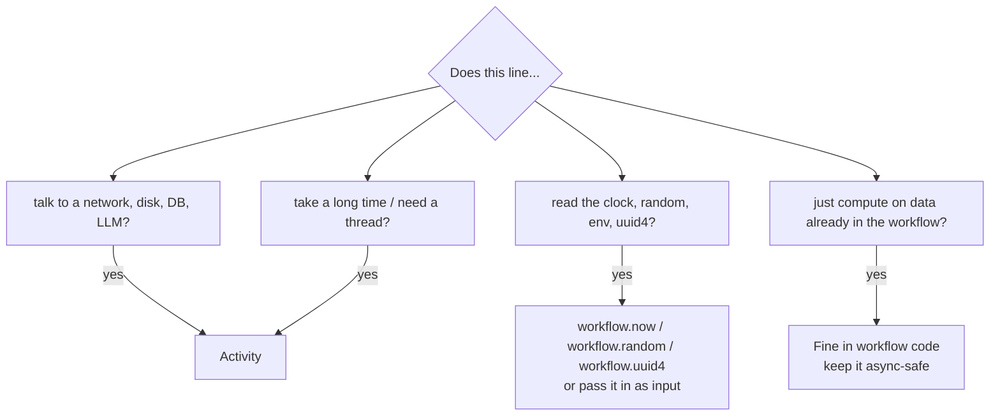

In this project:

| Logic | Lives in | Why |
|---|---|---|
| Fraud rule scoring | workflow (`score_rules`, `execute_in="workflow"`) | pure function of state |
| Fetching customer history | activity (`collect_signals`) | DB read |
| LLM fraud opinion | activity (`llm_review`) | non-deterministic, slow, costs money |
| Deep Agent planning (`write_todos`) | workflow | pure agent state |
| Every LLM call of the support agent | activity (`deepagents.invoke_model`) | non-deterministic |
| Every support tool | activity (`activity_as_tool`) | DB / payment I/O |
| Saga bookkeeping | workflow | pure control flow |
| Timeline timestamps | workflow, via `workflow.now()` | deterministic clock |

## LLMs are the ultimate non-determinism

An LLM given the same prompt twice can return different answers. That's
not a problem for Temporal as long as the call is an activity: the *first*
answer is recorded in history, and on replay the workflow reads that recorded
answer instead of calling the model again. The agent's subsequent decisions
are therefore replayed exactly. This is the core reason agent frameworks
integrate with Temporal at the "one model call per activity" level, which is
exactly what the Deep Agents plugin does. Chapter 12 goes further.

## Testing for determinism

You don't have to wait for production to find NDEs. Temporal's `Replayer`
replays saved histories against your current code and fails if they
disagree. This project's `tests/test_durability.py` collects every completed
history from the test run and replays it:

```python
order_replayer = Replayer(workflows=[OrderFulfillmentWorkflow, ShipmentWorkflow])
for h in order_histories:
    await order_replayer.replay_workflow(h)  # raises on non-determinism
```

In a real team, export a sample of production histories regularly
(`temporal workflow show -o json`), commit them to a test fixtures folder, and
replay them in CI on every pull request that touches workflow code. That
single test catches the large majority of versioning mistakes before deploy.

## When an NDE happens anyway

1. The workflow doesn't fail. Its workflow task fails and keeps retrying. The
   UI shows a "Workflow Task Failed" with a non-determinism message. Customers
   see a stuck order, not a corrupted one.
2. Roll back the deploy (the old code replays fine) — or deploy a fix that
   uses `workflow.patched()` to restore the old path for old executions.
3. For executions you can't fix by code, `temporal workflow reset` rewinds to
   an earlier workflow task and re-runs from there with current code.
   Activities after the reset point run again, so make sure they're idempotent.

## Re-running the sandbox probe

The table at the top came from running a tiny workflow that tries each call
and catches the exception:

```python
@workflow.defn
class Probe:
    @workflow.run
    async def run(self, what: str) -> str:
        import datetime
        try:
            if what == "datetime.now":
                datetime.datetime.now()
            # ... one branch per call ...
            return "allowed"
        except BaseException as e:
            return f"BLOCKED: {type(e).__name__}"
```

Try adding your favourite library's calls to it. It's a quick way to find out
what's safe before you put it in a workflow.

---

# 06 — The order workflow, line by line

Open `src/shopsphere/workflows/order_workflow.py` next to this chapter. We'll
walk it top to bottom and line each step up with the real event history of
order `ORD-1001` (the full history is in appendix A).

## The state machine you didn't have to write

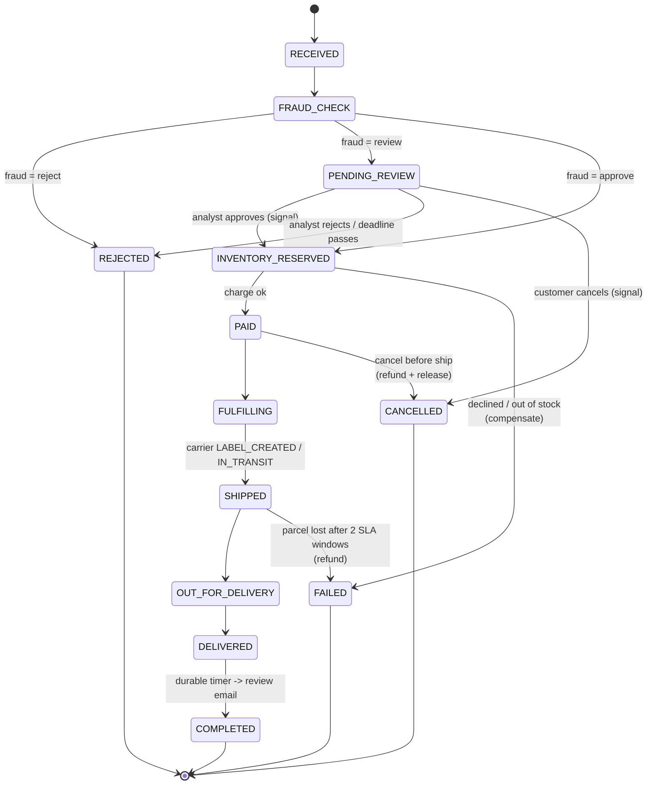

In the queue-and-status-column world, every arrow in this diagram is a
consumer, a status check and a cron job looking for stuck rows. Here every
arrow is a line of Python, and the "current state" is simply where the
coroutine is suspended.

## `@workflow.init`: state before anything else

```python
@workflow.defn
class OrderFulfillmentWorkflow:
    @workflow.init
    def __init__(self, order: OrderInput) -> None:
        self._order = order
        self._status = OrderStatus.RECEIVED
        self._address = order.shipping_address
        ...
        self._compensations: list[_Compensation] = []
```

`@workflow.init` makes the constructor receive the same input as `run`, and
guarantees it runs before any handler. That matters because a signal can be
delivered in the very first workflow task, together with the start event
(signal-with-start does exactly that). Without `@workflow.init` a signal
handler could run before `run()` has set up the fields it touches.

Notice what's stored: plain Python attributes. No database. When a worker
replays this workflow, these get rebuilt by running the same code over the
same history.

## The run method

```python
@workflow.run
async def run(self, order: OrderInput) -> OrderView:
    if order.use_search_attributes:
        workflow.upsert_search_attributes([CUSTOMER_ID_KEY.value_set(order.customer_id)])
    await self._set_status(OrderStatus.RECEIVED, f"Order for ${order.total():.2f} received")
```

History:

```
   1  WORKFLOW_EXECUTION_STARTED           OrderFulfillmentWorkflow
   2  WORKFLOW_TASK_SCHEDULED
   3  WORKFLOW_TASK_STARTED
   4  WORKFLOW_TASK_COMPLETED
   5  UPSERT_WORKFLOW_SEARCH_ATTRIBUTES     <- CustomerId
   6  UPSERT_WORKFLOW_SEARCH_ATTRIBUTES     <- OrderStatus=RECEIVED (inside _set_status)
   7  ACTIVITY_TASK_SCHEDULED              save_order_snapshot
   8  ACTIVITY_TASK_STARTED
   9  ACTIVITY_TASK_COMPLETED
```

Event 1 carries the full `OrderInput` as its payload. Events 2–4 are the first
workflow task: the worker ran `run()` until it hit the `await` inside
`_snapshot()`, and returned three commands (two upserts and one schedule
activity) which became events 5, 6 and 7.

`_set_status` is a small helper used everywhere:

```python
async def _set_status(self, status: OrderStatus, detail: str) -> None:
    self._status = status
    self._event(status, detail)          # timeline entry, timestamped with workflow.now()
    self._upsert_status()                # search attribute for Visibility
    await self._snapshot()               # activity: write the read model
```

The snapshot activity writes the order to the `orders` table. The workflow is
the source of truth while the order is live; the table is a **read model** for
systems that shouldn't need Temporal to answer "what's in order X" — like the
support agent's `get_order_details` tool.

## Fraud check: a child workflow on another task queue

```python
self._fraud = await workflow.execute_child_workflow(
    "FraudAssessmentWorkflow",
    FraudInput(...),
    id=f"fraud-{order.order_id}",
    task_queue=order.ai_task_queue,
    result_type=FraudResult,
    execution_timeout=timedelta(minutes=10),
)
```

```
  20  START_CHILD_WORKFLOW_EXECUTION_INITIATED   FraudAssessmentWorkflow
  21  CHILD_WORKFLOW_EXECUTION_STARTED           FraudAssessmentWorkflow
  ...
  25  CHILD_WORKFLOW_EXECUTION_COMPLETED         FraudAssessmentWorkflow
```

Design decisions packed into this call:

* **By name, not by class.** `"FraudAssessmentWorkflow"` is a string, and
  `result_type=FraudResult` tells the SDK how to deserialize the result. The
  orders worker therefore never imports LangGraph. Different teams can own the
  two sides.
* **Deterministic child ID.** `fraud-{order_id}`. If anything retries, there
  can never be two fraud checks for one order.
* **Bounded wait.** `execution_timeout` of ten minutes. If the AI fleet is down
  longer than that, the child times out and the `except ChildWorkflowError`
  branch routes the order to manual review instead of losing the sale:

```python
except ChildWorkflowError as err:
    self._fraud = FraudResult("review", 0.5, [f"fraud service unavailable: {_root_cause(err)}"])
```

That's **graceful degradation written as an `except`**, which is the kind of
thing that's very hard to do cleanly with queues.

### Waiting for a human, with a deadline

```python
if fraud.decision == "review":
    await self._set_status(OrderStatus.PENDING_REVIEW, "Waiting for a fraud analyst")
    await self._notify("ops_review_needed", {...})
    try:
        await workflow.wait_condition(
            lambda: self._review is not None or self._cancel is not None,
            timeout=timedelta(seconds=order.review_timeout_seconds),
        )
    except TimeoutError:
        raise OrderRejected("No analyst decision before the review deadline")
```

`wait_condition` blocks until the lambda is true. The lambda is re-evaluated
every time the workflow wakes up — which happens when a signal arrives
(`submit_review` or `cancel` set the fields). The `timeout` is a durable timer;
you can see it in the history of the operator-cancelled order:

```
  42  TIMER_STARTED                        timer 30s
  43  WORKFLOW_EXECUTION_CANCEL_REQUESTED
  ...
  47  TIMER_CANCELED
```

In production that timeout would be 24 hours. While it waits, the order uses
no worker memory at all once it's evicted from the cache — it's one timer row
in the database.

## Reserve, then register the undo

```python
await workflow.execute_activity(
    reserve_inventory,
    ReserveRequest(order.order_id, order.items),
    start_to_close_timeout=timedelta(seconds=15),
    retry_policy=INVENTORY_RETRY,
)
self._compensations.append(_Compensation("release_inventory", lambda: workflow.execute_activity(release_inventory, ...)))
```

```
  29  ACTIVITY_TASK_SCHEDULED     reserve_inventory
  30  ACTIVITY_TASK_STARTED
  31  ACTIVITY_TASK_COMPLETED
```

`INVENTORY_RETRY` lists `OutOfStock` and `UnknownSku` as non-retryable: if
we're out of stock, retrying won't create stock, so the activity fails
immediately and the workflow moves to compensation. Chapter 08 discusses why
the inventory undo is registered *after* the reservation but the payment undo
is registered *before* the charge.

## Charge the card

```python
receipt = await workflow.execute_activity(
    charge_payment,
    ChargeRequest(order.order_id, order.customer_id, order.total(), order.payment_token),
    start_to_close_timeout=timedelta(seconds=30),
    retry_policy=PAYMENT_RETRY,
)
```

```python
PAYMENT_RETRY = RetryPolicy(
    initial_interval=timedelta(seconds=1),
    backoff_coefficient=2.0,
    maximum_interval=timedelta(seconds=30),
    maximum_attempts=8,
    non_retryable_error_types=["PaymentDeclined"],
)
```

With `tok_flaky`, attempts 1 and 2 raise `GatewayUnavailable` (a plain
exception, so retryable) and attempt 3 succeeds. In history you still see
exactly three events for the charge, with `attempt: 3` on the started event.
The workflow code has no retry loop and never even sees the first two
failures. That's the point: retry *policy* is configuration, not code.

With `tok_decline` the activity raises
`ApplicationError(type="PaymentDeclined", non_retryable=True)`, there's one
attempt, and the workflow's `await` raises `ActivityError` wrapping it.

## Versioned step: loyalty points

```python
if workflow.patched("loyalty-points-v2"):
    points = await workflow.execute_activity(award_loyalty_points, ...)
```

```
  61  MARKER_RECORDED                      core_patch
  62  UPSERT_WORKFLOW_SEARCH_ATTRIBUTES    <- TemporalChangeVersion
  63  ACTIVITY_TASK_SCHEDULED              award_loyalty_points
```

Event 61 is the patch marker. Event 62 is Temporal automatically adding
`loyalty-points-v2` to the built-in `TemporalChangeVersion` search attribute,
which lets you list which running executions are on which code path:
`TemporalChangeVersion = 'loyalty-points-v2'`. Chapter 11 is about this.

## Ship: a child that signals its parent

```python
self._shipment_started = True
self._compensations = [c for c in self._compensations if c.name != "release_inventory"]

result = await workflow.execute_child_workflow(
    ShipmentWorkflow.run,
    ShipmentInput(..., address=self._address, ...),
    id=f"shipment-{order.order_id}",
    task_queue=workflow.info().task_queue,
    parent_close_policy=ParentClosePolicy.ABANDON,
)
```

Three details:

1. `_shipment_started = True` closes the window for cancellation and address
   changes. The cancel signal handler and the update validator both check it.
2. The inventory compensation is removed. Once the box is on a truck,
   "release the reservation" is no longer a valid undo — releasing it would
   let us sell stock we no longer have. This is the saga's **pivot point**.
3. `ParentClosePolicy.ABANDON`: if someone terminates the order workflow, the
   shipment child keeps running. The parcel exists in the physical world; its
   tracking shouldn't die with a bookkeeping workflow. The default
   (`TERMINATE`) would kill it.

While the child runs, it forwards each carrier scan to the parent with a
signal through an external workflow handle:

```python
# shipment_workflow.py
handle = workflow.get_external_workflow_handle(parent.workflow_id, run_id=parent.run_id)
await handle.signal("shipment_progress", event)
```

Parent history:

```
  76  START_CHILD_WORKFLOW_EXECUTION_INITIATED   ShipmentWorkflow
  77  CHILD_WORKFLOW_EXECUTION_STARTED           ShipmentWorkflow
  81  WORKFLOW_EXECUTION_SIGNALED                shipment_progress   (LABEL_CREATED)
  86  WORKFLOW_EXECUTION_SIGNALED                shipment_progress   (IN_TRANSIT)
  91  WORKFLOW_EXECUTION_SIGNALED                shipment_progress   (OUT_FOR_DELIVERY)
  96  WORKFLOW_EXECUTION_SIGNALED                shipment_progress   (DELIVERED)
 100  CHILD_WORKFLOW_EXECUTION_COMPLETED         ShipmentWorkflow
```

The parent's `shipment_progress` handler updates `self._status` and the
`OrderStatus` search attribute so `GET /orders/{id}` shows `OUT_FOR_DELIVERY`
in real time, even though the parent itself is just waiting on the child.

## The three-day timer

```python
await workflow.sleep(timedelta(seconds=order.review_request_delay_seconds))
await self._notify("review_request", {"tracking": self._tracking})
await self._set_status(OrderStatus.COMPLETED, "Review request sent, order closed")
```

```
 117  TIMER_STARTED      timer 1s     (3 days in production)
 118  TIMER_FIRED
 ...
 122  ACTIVITY_TASK_SCHEDULED   send_notification
 ...
 135  WORKFLOW_EXECUTION_COMPLETED
```

Between 117 and 118 the worker can be redeployed any number of times. When
the timer fires, the server schedules a workflow task; whichever worker gets
it replays (or resumes from cache) and sends the email.

## Error handling: four kinds of ending

```python
try:
    ...
except OrderCancelled:          # customer cancel signal, checked at checkpoints
    await self._compensate()
    await self._set_status(OrderStatus.CANCELLED, ...)
except OrderRejected as rej:    # fraud reject, analyst reject, review deadline
    await self._compensate()
    await self._set_status(OrderStatus.REJECTED, str(rej))
except (ActivityError, ChildWorkflowError) as err:   # declined, out of stock, parcel lost
    self._failure = _root_cause(err)
    await self._compensate()
    await self._set_status(OrderStatus.FAILED, self._failure)
except asyncio.CancelledError:  # operator ran `temporal workflow cancel`
    await self._compensate()
    await self._set_status(OrderStatus.CANCELLED, "Cancelled by operator")
    raise
```

Things to notice:

* A declined card is a **business outcome**, not a workflow failure. The
  workflow completes normally with `status=FAILED` and a reason. In the
  Temporal UI it shows as *Completed*. Reserve Temporal-level failure for
  "this execution could not do its job and a human should look at it."
* `OrderCancelled` and `OrderRejected` are internal Python exceptions used for
  control flow. They never leave the workflow. That's fine — they're ordinary
  exceptions caught by ordinary `except` blocks during ordinary (replayable)
  execution.
* The operator-cancel branch re-raises `CancelledError` so the execution ends
  as *Canceled* in Temporal, which is accurate. Compensation activities still
  run inside the handler, because once the cancellation has been delivered to
  the workflow, new activities can be scheduled normally.
* `_root_cause` walks `ActivityError -> ApplicationError` to produce
  `"PaymentDeclined: Card was declined by the issuer"` for humans.

The declined-card history shows compensation in action:

```
  42  ACTIVITY_TASK_SCHEDULED     charge_payment
  43  ACTIVITY_TASK_STARTED
  44  ACTIVITY_TASK_FAILED                          <- PaymentDeclined, non-retryable
  ...
  48  ACTIVITY_TASK_SCHEDULED     refund_payment    <- registered before the charge; a no-op here
  54  ACTIVITY_TASK_SCHEDULED     release_inventory
  61  ACTIVITY_TASK_SCHEDULED     save_order_snapshot   (FAILED)
  67  ACTIVITY_TASK_SCHEDULED     send_notification     (order_failed)
  73  WORKFLOW_EXECUTION_COMPLETED
```

## Handlers

```python
@workflow.signal
def cancel(self, req: CancelRequest) -> None: ...

@workflow.signal
def submit_review(self, decision: ReviewDecision) -> None: ...

@workflow.signal
def shipment_progress(self, event: CarrierEvent) -> None: ...

@workflow.update
async def update_shipping_address(self, address: Address) -> OrderView: ...

@update_shipping_address.validator
def _validate_address(self, address: Address) -> None: ...

@workflow.query
def get_status(self) -> OrderView: ...
```

Signal handlers here are synchronous and tiny: record the message, let
`run()` react. That's the recommended style. The update handler is async and
even runs an activity (`_snapshot`). Chapter 09 explains the semantics and
the concurrency gotchas.

## The last line

```python
await workflow.wait_condition(workflow.all_handlers_finished)
return self._view()
```

If an update handler is in the middle of its `_snapshot()` activity when
`run()` reaches the end, returning would complete the workflow and the
update's caller would get an error. Waiting for `all_handlers_finished`
avoids that. The SDK warns you at runtime if a workflow finishes with
unfinished handlers.

## What you didn't see

There's no state table, no status column checks, no outbox, no message
broker, no cron job, no "find stuck orders" script, no retry loops, no
distributed lock. The order workflow is about 450 lines including comments,
and it covers fraud, human review with deadlines, cancellations, address
changes, retries, compensation, a pivot point, child workflows, live status,
search, versioning, and a multi-day timer.

---

# 07 — Activities, retries, timeouts and idempotency

Workflows decide. Activities do. This chapter is about doing things in an
unreliable world without doing them twice.

## Anatomy of an activity

```python
@activity.defn
async def charge_payment(req: ChargeRequest) -> PaymentReceipt:
    info = activity.info()                       # attempt, workflow_id, activity_id, heartbeat details...
    activity.logger.info("Charging ... attempt %d", info.attempt)
    if req.payment_token == "tok_decline":
        raise ApplicationError("Card was declined", type="PaymentDeclined", non_retryable=True)
    ...
    return PaymentReceipt(...)
```

* **One dataclass argument.** Temporal supports several positional
  arguments, but one dataclass is far easier to evolve: adding a field with a
  default is backwards compatible with histories already recorded.
* **`async def` or plain `def`.** Async activities run on the worker's event
  loop, so they must never block it — that's why this project wraps every
  SQLite call in `asyncio.to_thread`. Sync activities run in a thread pool you
  pass as `activity_executor=` to the Worker; that's often simpler for code
  that uses blocking client libraries.
* **Return plain data.** The result goes into history. Small is good; history
  has limits (chapter 14).
* **`activity.info()`** gives you the attempt number, the workflow ID and run
  ID, the activity ID, the task queue and any heartbeat details from a
  previous attempt. These are the raw material for idempotency keys.

## The four timeouts

```mermaid
gantt
    dateFormat ss
    axisFormat %S s
    title One activity, two attempts
    section Schedule-to-close (whole thing, all attempts)
    total budget                :a0, 00, 40s
    section Attempt 1
    waiting in queue (schedule-to-start) :a1, 00, 3s
    running (start-to-close)             :a2, 03, 12s
    backoff                              :a3, 15, 2s
    section Attempt 2
    waiting in queue                     :b1, 17, 2s
    running (start-to-close)             :b2, 19, 9s
```

| Timeout | Measures | Use it to |
|---|---|---|
| **start_to_close** | one attempt, from a worker picking it up to finishing | detect a crashed or hung worker. **Always set this.** Make it a bit longer than the slowest legitimate attempt |
| **schedule_to_close** | the whole activity, all attempts and backoff included | cap the total time you're willing to wait ("give up on the gateway after 10 minutes") |
| **schedule_to_start** | time spent waiting in the task queue before a worker takes it | rarely useful; it fires when there are no workers, and retrying onto the same queue doesn't help. Monitor the latency metric instead |
| **heartbeat** | max gap between heartbeats from a running attempt | detect a dead worker quickly on long activities without a huge start_to_close |

You must set at least `start_to_close_timeout` or `schedule_to_close_timeout`.
The SDK raises if you set neither.

A common mistake is setting only `schedule_to_close` to something long like an
hour. If a worker crashes mid-attempt, nobody notices for that full hour,
because there's no per-attempt limit. Set `start_to_close` too.

## Retry policy

```python
RetryPolicy(
    initial_interval=timedelta(seconds=1),     # first backoff
    backoff_coefficient=2.0,                   # 1s, 2s, 4s, 8s ...
    maximum_interval=timedelta(seconds=30),    # ... capped at 30s
    maximum_attempts=8,                        # 0 = unlimited
    non_retryable_error_types=["PaymentDeclined"],
)
```

Defaults if you pass nothing: initial 1 s, coefficient 2.0, maximum interval
100 × initial, **unlimited attempts**. Unlimited is less scary than it sounds
when combined with `schedule_to_close_timeout`, and it's what you want for
things that must eventually succeed, like compensations
(`COMPENSATION_RETRY` in this project).

### Classifying errors

This is where you encode business knowledge:

| Error | Retry? | How this project signals it |
|---|---|---|
| Gateway 503, connection reset, timeout | yes | any plain exception (`GatewayUnavailable`) |
| Card declined | no | `ApplicationError(type="PaymentDeclined", non_retryable=True)` |
| Out of stock | no | `ApplicationError(type="OutOfStock", non_retryable=True)` |
| Unknown SKU (bad input) | no | `ApplicationError(type="UnknownSku", non_retryable=True)` |
| Rate limited (429) with Retry-After | yes, later | `ApplicationError(..., next_retry_delay=timedelta(seconds=retry_after))` |

Two ways to make an error non-retryable, and they compose:

* the **activity** raises `ApplicationError(non_retryable=True)` — the
  activity author knows this can never succeed;
* the **workflow** lists the error `type` in `non_retryable_error_types` — the
  caller decides, for this call site, not to retry it.

The order workflow does both for `PaymentDeclined`, which is belt and braces.

### What the workflow sees

During retries, nothing. The `await` stays pending. When the activity finally
succeeds, the workflow gets the result. When it finally fails (non-retryable
error, attempts exhausted, or schedule-to-close hit), the `await` raises
`ActivityError`, whose `.cause` is the underlying `ApplicationError`,
`TimeoutError` or `CancelledError`. This project's `_root_cause` helper walks
that chain.

## Heartbeating

`create_shipping_label` simulates a slow, multi-step carrier call:

```python
@activity.defn
async def create_shipping_label(inp: ShipmentInput) -> ShippingLabel:
    steps = ["rate-shop", "validate-address", "purchase-label", "schedule-pickup"]
    done = 0
    details = activity.info().heartbeat_details
    if details:
        done = int(details[0])            # resume where the last attempt got to
    for idx in range(done, len(steps)):
        await asyncio.sleep(0.3)
        activity.heartbeat(idx + 1)       # "I'm alive, and I've finished step idx+1"
    ...
```

and the workflow calls it with:

```python
start_to_close_timeout=timedelta(minutes=2),
heartbeat_timeout=timedelta(seconds=10),
```

Heartbeats do three things:

1. **Fast failure detection.** If the worker dies at step 2, Temporal notices
   within 10 seconds (heartbeat timeout) instead of 2 minutes.
2. **Progress checkpointing.** The value passed to `heartbeat()` is saved and
   given to the next attempt as `heartbeat_details`. Long jobs — processing
   10,000 rows, downloading a large file — resume instead of restarting.
3. **Cancellation delivery.** An activity only learns that it has been
   cancelled when it heartbeats. If your workflow might cancel a long
   activity, the activity must heartbeat or it will run to completion.

Heartbeats are throttled by the SDK (it won't send one per call if you call it
in a tight loop), so call it as often as is convenient.

## Idempotency: the part that's actually your job

Temporal guarantees that once an activity's **success** is recorded, the
workflow never runs it again. It cannot guarantee that the side effect
happened only once, because of this timeline:

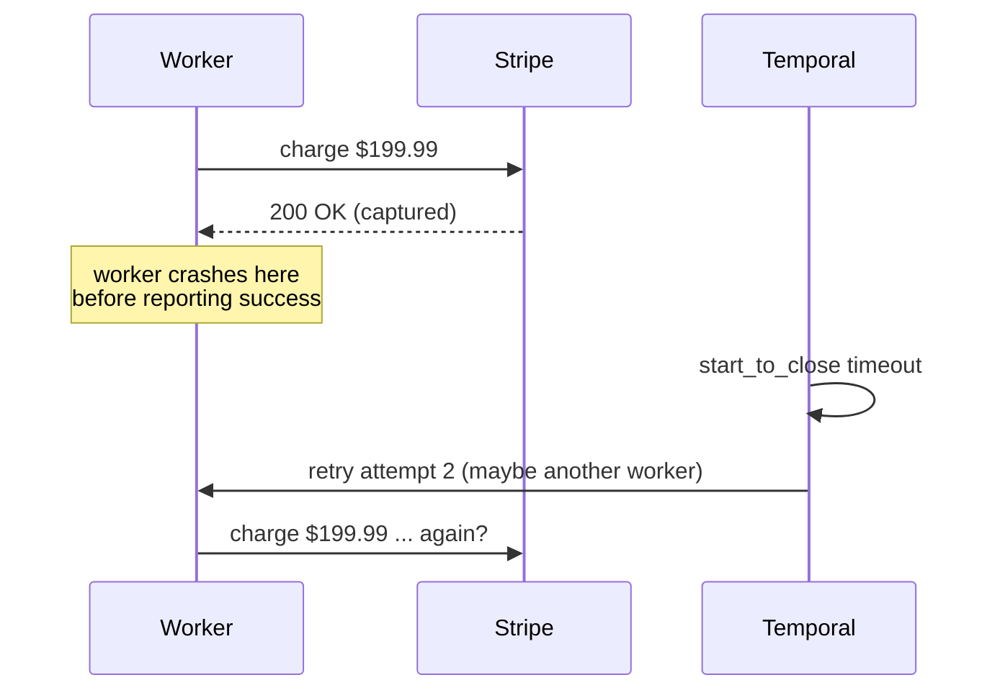

There is no general solution to this at the infrastructure level — it's the
two generals problem. The solution is that the *receiving* side recognises a
duplicate. Every activity in this project is written that way:

| Activity | Idempotency key | Mechanism |
|---|---|---|
| `reserve_inventory` | `order_id` | reservations table has `order_id` as primary key; a second call sees `RESERVED` and returns |
| `release_inventory` | `order_id` | only releases if status is `RESERVED`; second call is a no-op |
| `charge_payment` | `order_id` | `payments.order_id UNIQUE`; second call returns the existing payment |
| `refund_payment` | `order_id` | `refunds.order_id UNIQUE`; second call returns `already_refunded=True` |
| `create_shipping_label` | `order_id` | existing label returned |
| `send_notification` | `workflow_id + run_id + activity_id` | `INSERT OR IGNORE` on that key |
| `save_order_snapshot` | `order_id` | upsert — naturally idempotent |
| `award_loyalty_points` | `order_id` | ledger keyed by order; points only added on first insert |
| `create_purchase_orders` | `run_id + sku` | deterministic PO id |

With a real payment provider you'd pass the key to the provider: Stripe's
`Idempotency-Key` header, Adyen's `idempotencyKey`. Good keys are
**deterministic** (the same on every retry) and **specific** (different for
genuinely different operations). Typical sources:

* a business ID that already exists (`order_id`) — best, because it also
  dedupes across workflow re-runs;
* `activity.info().workflow_id + activity_id` — unique per activity call in a
  workflow run, stable across its retries;
* never `uuid4()` generated inside the activity — that's different on every
  attempt, which defeats the point.

Our `test_worker_crash_mid_order_is_invisible_to_the_customer` asserts exactly
one payment row after two different workers worked on the same order.

## Local activities

```python
await workflow.execute_local_activity(fn, arg, start_to_close_timeout=timedelta(seconds=5))
```

A local activity runs in the same worker as the workflow, without a round
trip through the task queue. Its result is recorded as a marker event. They
cut latency for short, cheap operations (a cache read, a quick computation
you can't do in the workflow).

The trade-offs: no heartbeats, retries happen inside the workflow task (long
retries extend it), and they can't be routed to other workers. Use them for
things that take milliseconds. This project doesn't use them — every activity
here either talks to a "remote" system or is slow on purpose.

## Asynchronous completion

Sometimes the work finishes outside the worker: a human clicks a link in an
email, a partner system calls back hours later. An activity can say "I'm not
done, someone else will report the result":

```python
@activity.defn
async def request_manager_signoff(req) -> str:
    token = activity.info().task_token
    await email_manager(req, callback_token=token)
    activity.raise_complete_async()
```

and later, anywhere:

```python
await client.get_async_activity_handle(task_token=token).complete("approved")
```

In practice a signal to the workflow (this project's review flow) is usually
simpler and easier to observe. Async completion is handy when you want the
retry and timeout semantics of an activity around the external callback.

## Activity cancellation

When a workflow cancels an activity (or the workflow itself is cancelled), the
activity sees `asyncio.CancelledError` at its next heartbeat or await. Choose
the cancellation type on the call:

* `TRY_CANCEL` (default) — request cancellation, and the workflow immediately
  treats the activity as cancelled;
* `WAIT_CANCELLATION_COMPLETED` — wait for the activity to acknowledge, so you
  know cleanup finished;
* `ABANDON` — don't even tell the activity.

## Rate limiting and concurrency

Three knobs, at three scopes:

* `max_concurrent_activities` on a Worker — how many run at once in that
  process. The AI worker uses 8 to stay under the LLM provider's limits.
* `max_activities_per_second` on a Worker — per-worker rate.
* `max_task_queue_activities_per_second` — a limit across *all* workers on the
  task queue, enforced by the server. This is the one for "Stripe allows 100
  requests per second in total".

Excess work simply waits in the task queue. No 429s, no retry storms, and the
backlog is visible in metrics.

## Checklist for every new activity

* [ ] One dataclass argument, plain-data return
* [ ] `start_to_close_timeout` set to slightly more than the slowest normal run
* [ ] Retry policy considered; business errors are non-retryable
* [ ] Idempotency key chosen and used
* [ ] Heartbeats if it can run longer than ~30 s or needs cancellation
* [ ] No blocking calls inside `async def`
* [ ] Client libraries' own retries turned off or kept small (Temporal is
      already retrying; nested retries multiply)

---

# 08 — The saga pattern

An order touches three systems that don't share a transaction: inventory,
payments and the carrier. If step 3 fails, steps 1 and 2 have already
happened in the real world. You can't roll them back; you can only perform
new actions that undo their effects. A **saga** is a sequence of steps where
each step that changes the world has a matching **compensation**, and on
failure you run the compensations for completed steps in reverse order.

The idea dates from a 1987 database paper. What Temporal adds is that the
saga's own bookkeeping — "which steps have I done, which undos do I owe?" —
is durable for free, because it's just a Python list in a workflow.

## The project's saga

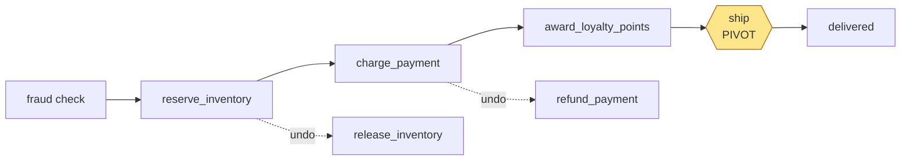

```python
@dataclass
class _Compensation:
    name: str
    fn: Callable[[], Awaitable[object]]

self._compensations: list[_Compensation] = []

async def _compensate(self) -> None:
    for comp in reversed(self._compensations):
        try:
            await comp.fn()
            self._event(self._status, f"Compensated: {comp.name}")
        except ActivityError as err:
            workflow.logger.error("Compensation %s failed: %s", comp.name, err)
            self._event(self._status, f"COMPENSATION FAILED: {comp.name} - needs manual action")
    self._compensations.clear()
```

Every `except` branch in `run()` calls `_compensate()`. Because the list lives
in workflow memory and workflow memory is rebuilt by replay, a worker crash
in the middle of compensating is harmless: the next worker replays, sees which
compensation activities already completed (they're in history), and runs the
rest.

## Register before or after?

Look carefully at the two steps:

```python
# inventory: register AFTER the step succeeds
await workflow.execute_activity(reserve_inventory, ...)
self._compensations.append(_Compensation("release_inventory", ...))

# payment: register BEFORE the step runs
self._compensations.append(_Compensation("refund_payment", ...))
receipt = await workflow.execute_activity(charge_payment, ...)
```

Why the difference? Think about what you know when each activity *fails*.

`reserve_inventory` is a single local transaction that fails cleanly: if it
raises, nothing was reserved. Registering afterwards is precise.

`charge_payment` talks to a remote gateway. If it times out, you genuinely
don't know whether the card was charged — maybe the response was lost. If you
only register the refund after success, a timeout followed by exhausted
retries leaves the customer possibly charged with no refund scheduled. So the
refund is registered first, and `refund_payment` is written to be a no-op
when there's no payment:

```python
if payment is None:
    # Nothing was ever charged - refund is a no-op, not an error.
    return RefundReceipt("NONE", req.order_id, 0.0, already_refunded=True)
```

You can see the result in the declined-card history: `refund_payment` runs
(and does nothing) before `release_inventory`. Slightly wasteful, always
correct. The general rule:

> If a step can fail in a way that leaves its outcome unknown, register its
> compensation before the step and make the compensation safe to run when the
> step didn't happen.

## The pivot point

Some steps can't be undone. Once the parcel is on a truck, "release the
reservation" would put stock back on the shelf that isn't on the shelf.
That step is the **pivot**: before it, the saga can be rolled back; after it,
the saga can only go forward (or be fixed with a different kind of
compensation, like a refund).

```python
async def _ship(self) -> None:
    self._shipment_started = True
    # Stock has physically left the building: releasing it is no longer a valid undo.
    self._compensations = [c for c in self._compensations if c.name != "release_inventory"]
    ...
    result = await workflow.execute_child_workflow(ShipmentWorkflow.run, ...)
    self._compensations.clear()  # delivered: nothing left to undo
```

After the pivot, the only remaining compensation is the refund. If the
shipment child fails with `ShipmentLost`, the customer gets their money back
and the stock stays decremented — which is correct, because the box is gone.

Also notice that the pivot closes other doors: the `cancel` signal handler and
the address update validator both check `_shipment_started`. Designing the
pivot explicitly is the most useful thing you can do when modelling a saga.

## Compensations must eventually succeed

A compensation that gives up is worse than useless: it leaves the system in a
half-state and nobody knows. So compensations here use:

```python
COMPENSATION_RETRY = RetryPolicy(initial_interval=timedelta(seconds=1), maximum_interval=timedelta(minutes=1))
```

with no `maximum_attempts`, meaning retry forever with backoff capped at a
minute. If the payment provider is down for six hours, the refund lands six
hours later, automatically, and the UI shows the pending activity with its
attempt count the whole time.

What about a compensation that can *never* succeed — say a non-retryable
error from a bug? The loop records `COMPENSATION FAILED ... needs manual
action` in the timeline and keeps unwinding the others. In production you'd
also emit an alert (an activity that pages someone), or block in a
`wait_condition` for an operator signal that says "I fixed it manually,
continue."

## Semantic vs exact undo

Compensations are rarely exact inverses:

| Step | Compensation | Not quite the inverse because... |
|---|---|---|
| reserve stock | release stock | someone may have looked at "only 1 left!" in between |
| charge card | refund | the customer sees two lines on their statement; fees may not come back |
| send "order confirmed" email | send "order cancelled" email | you can't unsend an email |
| ship parcel | (none — pivot) | physics |

That's fine. A saga promises **eventual business consistency**, not
isolation. Design compensations with the customer's experience in mind, not
just the database's.

## Parallel steps

If steps are independent you can run them concurrently and still compensate
correctly:

```python
reserve = workflow.start_activity(reserve_inventory, ..., start_to_close_timeout=...)
fraud = workflow.start_child_workflow("FraudAssessmentWorkflow", ...)
results = await asyncio.gather(reserve, fraud, return_exceptions=True)
# register compensations only for the ones that succeeded,
# then raise if any failed so the except block unwinds them
```

`asyncio.gather` is deterministic inside a workflow, because the commands are
issued in source order and results are delivered from history.

## Orchestration vs choreography

There are two ways to build sagas:

* **Choreography** — each service listens for events and reacts ("payment
  service hears OrderReserved, charges, emits PaymentCaptured"). No central
  brain. Compensation logic is spread across services, each listening for
  failure events.
* **Orchestration** — one coordinator tells each service what to do and
  handles failures centrally.

Temporal is an orchestrator. The order workflow is the single place where
the whole saga, including every failure path, can be read top to bottom.
Choreography still has its place (loosely coupled teams, broadcast events),
and the two mix well: a Kafka event can start a workflow, and an activity can
publish an event.

## Testing a saga

Each failure path deserves a test. This project has:

* `test_declined_card_runs_compensation` — failure after reservation; asserts
  stock returns to its previous level and the timeline shows the
  compensation;
* `test_out_of_stock_fails_fast` — failure *at* reservation; nothing to
  compensate;
* `test_fraud_reject_never_touches_money` — failure before any step;
* `test_customer_cancel_while_in_review` — cancel path;
* `test_lost_parcel_refunds_but_keeps_stock_decremented` — failure *after*
  the pivot: the shipment child fails with `ShipmentLost` (tiny
  `delivery_sla_seconds`, no carrier scans), the refund runs, and stock is
  deliberately *not* released.

A good exercise: add a test where the customer cancels *after* payment but
before shipping, and assert both compensations ran in the right order.

---

# 09 — Signals, queries and updates

A running workflow isn't a sealed box. The outside world needs to tell it
things ("the customer cancelled"), ask it things ("where's my order?") and
ask it to do things and wait for the answer ("change the address — did that
work?"). Temporal has one primitive for each.

## Side by side

| | Signal | Query | Update |
|---|---|---|---|
| Direction | in | out | in, then out |
| Changes state? | yes | **never** | yes |
| Caller waits for | the server to accept it | the answer | the handler to finish (or just acceptance) |
| Returns a value | no | yes | yes |
| Recorded in history | yes (`WorkflowExecutionSignaled`) | no | yes (`UpdateAccepted`, `UpdateCompleted`) |
| Can be rejected before recording | no | n/a | **yes, with a validator** |
| Handler may `await` activities/timers | yes (async handler) | no | yes |
| Works when no worker is running | yes — buffered in history | no — needs a worker | accepted only when a worker runs the validator |
| Used in this project for | cancel, analyst review, carrier scans, child→parent progress, closing a chat | order status, support session state | address change, every chat message, supervisor decision |

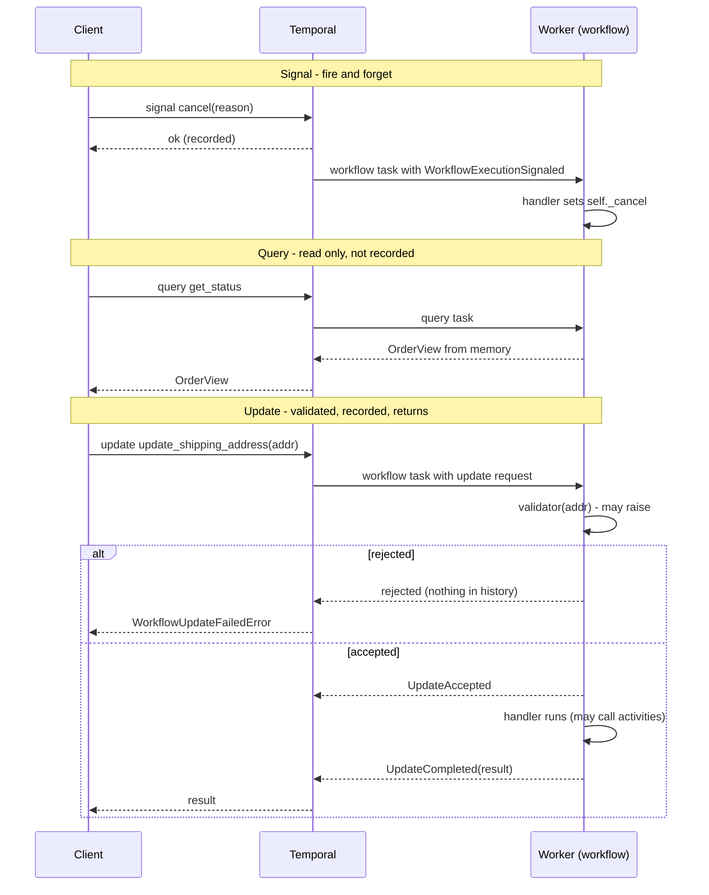

## Signals

```python
@workflow.signal
def cancel(self, req: CancelRequest) -> None:
    if self._shipment_started or self._status in TERMINAL_STATUSES:
        self._event(self._status, f"Cancel ignored (already {self._status.value}): {req.reason}")
        return
    self._cancel = req
```

Client side:

```python
await client.get_workflow_handle(f"order-{order_id}").signal(
    OrderFulfillmentWorkflow.cancel, CancelRequest(body.reason)
)
```

Properties that matter:

* **Durable and ordered.** A signal is written to history before the client
  call returns. Signals from one sender arrive in order.
* **Delivered even when nothing is running.** The crash test signals the
  approval while no worker exists; it's picked up when one starts.
* **No result.** The client only learns that the signal was *recorded*, not
  what the workflow did with it. That's why the API returns `202 Accepted` for
  cancel. If you need to know the outcome, use an update.

### Keep signal handlers small

The pattern used throughout this project: the handler records the message,
and `run()` reacts at well-defined points.

```python
@workflow.signal
def carrier_event(self, event: CarrierEvent) -> None:
    self._inbox.append(event)     # that's all

# in run():
await workflow.wait_condition(lambda: len(self._inbox) > 0, timeout=sla)
while self._inbox:
    event = self._inbox.pop(0)
    ...
```

This keeps all the decision logic in one place and avoids handlers racing
with the main flow. You can see why it matters in the shipment history:
three carrier signals arrived *while* `create_shipping_label` was still
running. They queued up in `_inbox` and were processed in order once the label
existed.

### Signal-with-start

"Send this signal to workflow X, and start X first if it isn't running" in
one atomic call:

```python
await client.start_workflow(
    CartWorkflow.run, cart_input, id=f"cart-{customer_id}", task_queue=...,
    start_signal="add_item", start_signal_args=[item],
)
```

Perfect for entity workflows like a shopping cart where the first
interaction creates the entity.

## Queries

```python
@workflow.query
def get_status(self) -> OrderView:
    return self._view()
```

Queries are answered by a worker running the handler against the workflow's
current in-memory state (after replaying if it's not cached). They're cheap,
not recorded, and can be called as often as you like.

Rules:

* **Must not mutate state.** No assignments to `self`, no activities, no
  timers. A query that changed state would make the workflow's state depend
  on whether someone happened to query it, which breaks replay.
* **Must be fast.** Keep it to building a view from fields you already have.
* **Need a worker.** If no worker is polling the queue, queries fail (or time
  out). For a dashboard that must work even during a worker outage, either
  publish state to a read model (`save_order_snapshot`) or use search
  attributes and memos, which live on the server.

## Updates

Updates are the newest of the three and the most useful for request/response
APIs. The address change:

```python
@workflow.update
async def update_shipping_address(self, address: Address) -> OrderView:
    old = self._address
    self._address = address
    self._event(self._status, f"Address changed from {old.city} to {address.city}")
    await self._snapshot()        # handlers can run activities
    return self._view()

@update_shipping_address.validator
def _validate_address(self, address: Address) -> None:
    if self._shipment_started or self._status in TERMINAL_STATUSES:
        raise ValueError(f"Too late to change the address: order is {self._status.value}")
    if not address.postal_code.strip():
        raise ValueError("postal_code is required")
```

and in the API:

```python
try:
    view = await handle.execute_update(OrderFulfillmentWorkflow.update_shipping_address, Address(...))
except WorkflowUpdateFailedError as err:
    raise HTTPException(409, str(err.cause.message))
```

### Validators

The validator runs first. If it raises, the update is **rejected** and leaves
no trace in history — the demo's "late address update -> 409" is exactly that.
Validators must be synchronous, fast, and must not change state. They're
your guard clause.

If the validator passes, the update is **accepted** (recorded), and the
handler runs. If the *handler* raises an `ApplicationError` after acceptance,
the caller gets a failure, but the acceptance is in history.

### Wait stages

`execute_update` waits for completion. `start_update(...,
wait_for_stage=WorkflowUpdateStage.ACCEPTED)` returns once accepted, giving
you a handle to fetch the result later. Use it when the handler is slow
(the support agent's chat handler calls an LLM several times).

### Update-with-start

Like signal-with-start but with a result: "start this workflow if needed,
send it this update, give me the update's result." The SDK exposes it as
`client.execute_update_with_start_workflow(...)` with a
`WithStartWorkflowOperation`. It's the natural fit for "add to cart and return
the new cart total" or "open a support session and return the first reply"
in one round trip.

### Updates as RPC into an entity

The support session is a workflow whose entire public API is updates:

```python
@workflow.update
async def chat(self, turn: ChatTurn) -> ChatReply: ...

@chat.validator
def _validate_chat(self, turn: ChatTurn) -> None:
    if self._closed:
        raise ValueError("Session is closed")
    if self._pending is not None:
        raise ValueError("A supervisor decision is pending; try again once it's resolved")

@workflow.update
async def decide(self, decision: ApprovalDecision) -> ChatReply: ...
```

The validator enforces a protocol: you can't chat while a refund is waiting
for approval, and you can't approve when nothing is pending. Those are
business rules expressed as validators, and rejected calls don't pollute
history. `test_refund_requires_supervisor_approval` checks the rejection.

## Handler concurrency

Handlers interleave with `run()` and with each other at every `await`. If two
chat messages arrive together, both `chat` handlers could be inside
`agent.ainvoke(...)` at once, interleaving their LLM calls. The support
workflow prevents that with a lock:

```python
self._lock = asyncio.Lock()       # created in @workflow.init

@workflow.update
async def chat(self, turn: ChatTurn) -> ChatReply:
    async with self._lock:
        ...
```

`asyncio.Lock` is deterministic inside a workflow, so this is safe. Two other
tools:

* `workflow.wait_condition(workflow.all_handlers_finished)` before returning
  from `run()` — don't complete while a handler is mid-flight.
* `@workflow.update(unfinished_policy=...)` / `@workflow.signal(unfinished_policy=...)`
  to change the warning the SDK emits if a workflow does finish with handlers
  still running.

## Messages to workflows from workflows

Inside a workflow you can signal another workflow with
`workflow.get_external_workflow_handle(id).signal(...)`. The shipment child
uses it to report progress to its parent. (Queries and updates are client-side
operations; workflow-to-workflow request/response is usually done with a
signal each way, or with child workflows and their results.)

## Choosing

* The caller needs to know the outcome → **update**.
* The caller doesn't care, or the sender is a webhook that must return
  instantly → **signal**.
* Reading state → **query** (or a read model if it must work without workers).
* The workflow might not exist yet → **signal-with-start** or
  **update-with-start**.
* High-frequency streaming of tokens or progress → none of these alone;
  see Workflow Streams in chapter 12.

## A note on history size

Every signal and update is an event. An entity workflow that receives
thousands of messages will hit history limits eventually. That's what
continue-as-new is for — next chapter.

---

# 10 — Timers, child workflows, continue-as-new, schedules

These four features are what let a workflow live for days or years, and stay
organised while it does.

## Durable timers

```python
await workflow.sleep(timedelta(days=3))
```

That line produces a `StartTimer` command. The server stores the timer in the
shard's timer queue and, when it fires, appends `TimerFired` and schedules a
workflow task. While it's waiting:

* no worker holds any resources for it (once evicted from cache)
* deploys, restarts and scaling events don't matter
* a million sleeping orders cost a million small rows, nothing more

`asyncio.sleep` inside a workflow maps to the same timer, so either works.

### Timeouts on waits

The most common timer isn't a sleep, it's a deadline:

```python
try:
    await workflow.wait_condition(lambda: self._review is not None, timeout=timedelta(hours=24))
except TimeoutError:
    raise OrderRejected("No analyst decision before the review deadline")
```

Under the hood that's a timer racing the condition. If the condition wins,
the timer is cancelled (`TIMER_CANCELED` in history). You saw this in the
operator-cancelled order and in the support session, which restarts its idle
timer every time a message arrives:

```
   9  TIMER_STARTED      timer 1800s     <- idle timeout armed
  ...
  51  TIMER_CANCELED                     <- activity in the session
  52  TIMER_STARTED      timer 1800s     <- re-armed
```

### Racing a timer against an activity

```python
charge = workflow.start_activity(charge_payment, ..., start_to_close_timeout=timedelta(seconds=30))
nudge = asyncio.ensure_future(workflow.sleep(timedelta(seconds=10)))
done, _ = await workflow.wait([charge, nudge], return_when=asyncio.FIRST_COMPLETED)
if nudge in done:
    await self._notify("payment_taking_longer", {})
receipt = await charge
```

Deterministic, because which one "wins" is decided by the order of events in
history. Use `workflow.wait` (the SDK's deterministic version of
`asyncio.wait`) for this.

## Child workflows

The order workflow starts two children:

| Child | Why a child and not an activity |
|---|---|
| `FraudAssessmentWorkflow` on `shopsphere-ai` | It's itself a multi-step graph with its own retries per node; it runs on a different worker fleet; it has its own history you can inspect in isolation |
| `ShipmentWorkflow` on the same queue | It lives for days, receives its own signals (carrier webhooks address `shipment-{order_id}` directly), and has its own SLA logic |

Reasons to reach for a child workflow:

* **Separation of concerns and ownership.** Another team can own the child
  and deploy it independently, as long as the input/output contract holds.
* **Its own history.** Each child gets a fresh event history and its own
  limits. A parent fanning out 1,000 shipments would otherwise put all their
  events in one history.
* **Its own identity.** You can signal, query, cancel or reset the child by
  ID without touching the parent.
* **Different task queue.** Route to specialised workers.

Reasons not to: a child costs more events than an activity, and for "call one
API" it's overkill. Start with activities; promote to a child when one of the
reasons above appears.

### Parent close policy

What happens to a running child when the parent closes?

| Policy | Effect | Used here |
|---|---|---|
| `TERMINATE` (default) | child is terminated | fraud child — no point checking fraud for a dead order |
| `REQUEST_CANCEL` | child gets a cancellation request and can clean up | good for children that hold resources |
| `ABANDON` | child keeps running on its own | shipment child — the parcel exists regardless |

### Fan-out

```python
handles = [
    await workflow.start_child_workflow(ShipmentWorkflow.run, part, id=f"shipment-{order_id}-{i}")
    for i, part in enumerate(split_order(order))
]
results = await asyncio.gather(*handles)
```

For very large fan-outs (thousands), batch children into groups or use a
tree of children so no single history grows too big.

## Continue-as-new

Histories have limits: by default Temporal warns at about 10,000 events and
terminates a workflow whose history exceeds 51,200 events or 50 MB. A support
session that stays open for weeks, a subscription workflow that runs for
years, a loop polling something every hour — all of these will hit the limit
eventually.

**Continue-as-new** ends the current run and atomically starts a new run of
the same workflow ID with fresh input and an empty history. The workflow ID
doesn't change, so signals and queries addressed to it keep working.

```python
@workflow.run
async def run(self, inp: SupportSessionInput) -> SupportView:
    while not self._closed:
        ...
        if workflow.info().is_continue_as_new_suggested() and self._pending is None and not self._lock.locked():
            await workflow.wait_condition(workflow.all_handlers_finished)
            workflow.continue_as_new(
                SupportSessionInput(
                    session_id=inp.session_id,
                    customer_id=inp.customer_id,
                    ai_model=inp.ai_model,
                    idle_timeout_seconds=inp.idle_timeout_seconds,
                    history=self._history,      # carry the conversation forward
                    turn=self._turn,
                )
            )
```

Points to get right:

* **Carry the state you need in the input.** Here: the transcript and the
  turn counter. Everything else is rebuilt.
* **Use `is_continue_as_new_suggested()`.** The server sets it when history is
  getting long *or* large, so you don't need to count events yourself.
* **Don't continue-as-new in the middle of something.** The session waits
  until no approval is pending and no handler is running. Otherwise an
  in-flight update would be lost.
* **Signals can arrive during the switch.** Temporal moves unhandled signals
  to the new run, but it's another reason to drain handlers first.
* **Pick your carry-over format carefully.** The new run's input is a
  payload, so it's subject to payload size limits. A transcript of 10,000
  messages would itself be too big; real systems summarise or store the
  transcript externally and pass a reference.

## Schedules

Temporal Schedules replace cron. `scripts/create_schedule.py`:

```python
schedule = Schedule(
    action=ScheduleActionStartWorkflow(
        InventoryReplenishmentWorkflow.run,
        ReplenishmentInput(reorder_quantity=50),
        id="replenishment",
        task_queue=s.orders_task_queue,
    ),
    spec=ScheduleSpec(intervals=[ScheduleIntervalSpec(every=timedelta(hours=1))]),
    policy=SchedulePolicy(overlap=ScheduleOverlapPolicy.SKIP),
)
await client.create_schedule("inventory-replenishment", schedule)
```

What you get over a cron job:

* **Overlap policies** — `SKIP`, `BUFFER_ONE`, `BUFFER_ALL`, `CANCEL_OTHER`,
  `TERMINATE_OTHER`, `ALLOW_ALL`. Decide explicitly what happens when the
  previous run is still going.
* **Catch-up** — if the cluster was down, missed runs within a catch-up window
  are run when it comes back.
* **Pause/unpause with a note** — "paused during inventory audit, ask Dana".
* **Backfill** — run the schedule for a past time range ("re-run last week's
  nightly jobs").
* **Every run is a real workflow** — retries, history, visibility and the UI
  all apply. Each run gets a workflow ID made of the schedule's ID plus the
  scheduled time, so runs are naturally deduplicated.
* **Calendar specs** — `ScheduleCalendarSpec(hour=[2], day_of_week=[...])`
  and time zones, besides simple intervals and cron strings.

The replenishment workflow is idempotent per run: purchase order IDs are
derived from `workflow.info().run_id` and the SKU, so a retried activity can't
create duplicate POs.

There's also an older `cron_schedule=` option on `start_workflow`. Prefer
Schedules for anything new.

## Timers vs schedules vs a loop

| Need | Use |
|---|---|
| "Do X three days after Y, for this order" | `workflow.sleep` inside the order workflow |
| "Every hour, do X" for the whole system | a Schedule |
| "Every hour, check on *this* subscription, forever" | a loop with `workflow.sleep` in an entity workflow, with continue-as-new |
| "At 9am in the customer's time zone" | compute the delta from `workflow.now()` and sleep, or a per-entity schedule |

---

# 11 — Versioning: changing code while workflows run

On a normal web service, a deploy replaces old code with new code and every
request after that uses the new code. On Temporal, a deploy replaces the code
that will *replay* workflows that started under the old code. Orders that
began on Monday will be replayed by Thursday's code. If Thursday's code makes
different decisions given Monday's history, you get non-determinism errors
(chapter 05).

So you need a versioning strategy. There are four, and teams typically use
a mix.

## Do you even need to version?

Many changes are safe without any versioning:

| Change | Safe? |
|---|---|
| Change an **activity's implementation** (new SQL, new API endpoint, bug fix) | **yes** — activity code isn't replayed |
| Change activity timeouts or retry policy | yes for the matcher; new values apply to new schedules |
| Add a new signal/query/update handler | yes |
| Add a field with a default to an input dataclass | yes |
| Change log messages, comments, variable names | yes |
| Add, remove or reorder **activities, timers or child workflows** in workflow code | **no** |
| Change a condition that decides which of those run | **no**, if any in-flight workflow could take a different path |
| Rename an activity or workflow type | **no** |

The rule of thumb: if the change could alter the sequence of commands for a
workflow that's already running, you need versioning.

## Strategy 1: patching

The SDK's built-in branch-on-version. This project's order workflow has one:

```python
if workflow.patched("loyalty-points-v2"):
    points = await workflow.execute_activity(award_loyalty_points, ...)
```

How `patched(id)` decides:

* **Not replaying** (fresh execution, or past the end of history): records a
  marker `core_patch` with the id, returns `True`. New code path.
* **Replaying, and history has the marker here**: returns `True`.
* **Replaying, and history has no marker here**: this execution started before
  the patch existed → returns `False`. Old code path.

It also adds the patch id to the `TemporalChangeVersion` search attribute (we
confirmed this in the real history: event 62), so you can find executions by
path:

```
TemporalChangeVersion = 'loyalty-points-v2'                         -- on the new path
ExecutionStatus = 'Running' AND TemporalChangeVersion IS NULL       -- still on the old path
```

### The full lifecycle of a patch

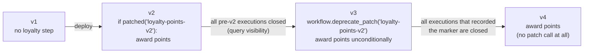

1. **Patch**: wrap the new code in `if workflow.patched(...)`, keep the old
   behaviour in the `else`.
2. **Wait** until no execution that started before the patch is still running
   (and none needs to be replayed — mind your retention window and any replay
   tests that use old histories).
3. **Deprecate**: replace with `workflow.deprecate_patch("loyalty-points-v2")`
   followed by the new code unconditionally. This keeps replay of
   marker-carrying histories working.
4. **Remove** the deprecate call once those are gone too.

Patching is precise and works on any server. Its cost is code clutter: a
workflow with five live patches is hard to read. Clean up.

## Strategy 2: Worker Versioning

Patching handles compatibility *inside* the code. Worker Versioning handles it
in *routing*: each worker declares which version of the code it runs, and
the server makes sure an execution is processed by a compatible worker.

The current model is built around **Worker Deployments**. A worker declares a
deployment name and build ID:

```python
from temporalio.common import WorkerDeploymentVersion, VersioningBehavior
from temporalio.worker import Worker, WorkerDeploymentConfig

Worker(
    client,
    task_queue="shopsphere-orders",
    workflows=[OrderFulfillmentWorkflow],
    activities=ORDER_ACTIVITIES,
    deployment_config=WorkerDeploymentConfig(
        version=WorkerDeploymentVersion(deployment_name="shopsphere-orders", build_id="2026.10.10-a1b2c3"),
        use_worker_versioning=True,
        default_versioning_behavior=VersioningBehavior.PINNED,
    ),
)
```

and each workflow type chooses a behaviour (here via the default, or per
workflow with `@workflow.defn(versioning_behavior=...)`):

* **PINNED** — an execution stays on the build it started on until it
  finishes. You run old and new workers side by side ("rainbow deploy") and
  retire old ones once their workflows drain. No patches needed for
  short-to-medium-lived workflows. Ideal for the order workflow, which lives
  for days.
* **AUTO_UPGRADE** — an execution moves to the current version on its next
  workflow task. Use for long-lived entity workflows (the support session, a
  subscription), which then still need patching for incompatible changes, or
  continue-as-new onto the new version.

You then promote versions with the CLI (`temporal worker deployment ...`) —
set a new version as current, or ramp a percentage of new executions to it.

Worker Versioning is newer than patching and has evolved over several
server releases (an earlier "build ID compatibility sets" API is deprecated),
so check the docs for your server or Temporal Cloud version before relying on
a specific feature. The ideas — pin short workflows, auto-upgrade and patch
long ones — are stable.

## Strategy 3: new workflow type or new task queue

The bluntest tool. Copy the workflow to `OrderFulfillmentWorkflowV2`, start
new orders on it, and leave the old type running until its executions drain.
Or keep the type name but put the new version on a new task queue
(`shopsphere-orders-v2`) and point new starts there.

Simple to reason about, needs no special server support, and good for large
rewrites. Costs: duplicated code during the transition, and every caller that
starts or signals the workflow must know which one to use.

## Strategy 4: reset

When a bug has already done damage — say a bad deploy made some orders take a
wrong branch — `temporal workflow reset` rewinds an execution to an earlier
workflow task. Everything after that point is discarded from the new run's
history, and the workflow re-executes from there with the current code.

```bash
temporal workflow reset -w order-ORD-1001 --event-id 41 --reason "re-run after fix #1234"
# batch: every order that hit the bug
temporal workflow reset --query "OrderStatus='FAILED' AND StartTime > '2026-10-09T00:00:00Z'" \
    --type LastWorkflowTask --reason "fix #1234"
```

Activities after the reset point run again — idempotency (chapter 07) is
what makes reset safe to use.

## Make it testable

Whatever strategy you use, the safety net is the same: **replay real
histories against new code in CI**.

```python
# tests/test_replay_production.py
@pytest.mark.parametrize("path", glob("tests/histories/*.json"))
async def test_replay(path):
    history = WorkflowHistory.from_json("order", open(path).read())
    await Replayer(workflows=[OrderFulfillmentWorkflow, ShipmentWorkflow]).replay_workflow(history)
```

Refresh the fixture folder periodically with
`temporal workflow show -w <id> -o json` from production, choosing executions
that cover each code path (approved, reviewed, cancelled, failed, compensated).
This project's `test_histories_replay_deterministically` does the same with
histories produced during the test run.

## A practical playbook

* Order workflow (lives days): Worker Versioning with PINNED, or patches if
  you can't use Worker Versioning yet.
* Support session (lives weeks, continues-as-new): AUTO_UPGRADE plus patches;
  continue-as-new is a natural point to move onto new code.
* Replenishment (lives seconds, started by a schedule): no versioning needed
  in practice — just deploy; in-flight runs finish within moments.
* Activities: change freely, keep inputs backwards compatible.
* Always: replay tests in CI, and dashboards for non-determinism errors
  (`temporal_workflow_task_execution_failed` metrics with the NDE cause).

---

# 12 — AI agents on Temporal: LangGraph, LangChain and Deep Agents

An AI agent is a loop: ask the model what to do, do it, show the model the
result, repeat until done. Written down, that's a workflow. This chapter is
about taking that observation seriously.

## Why agents need durable execution

Agents have every property that made the order workflow hard:

* **They're long.** A research or support agent might make 20–100 model calls
  and run for minutes. A coding agent can run for hours.
* **Every step is expensive.** A crash at step 37 of a plain Python agent
  means paying for steps 1–36 again, and possibly getting different answers
  the second time.
* **Their tools have side effects.** `issue_refund` moved money. If the agent
  process dies after the refund but before recording it, a naive restart
  refunds twice.
* **They fail in new ways.** Rate limits (429), overloaded models (529),
  timeouts on long generations, malformed tool calls.
* **They need humans.** "A supervisor must approve refunds over $X" means
  pausing the agent for minutes or days, across deploys.
* **They're non-deterministic by nature.** Same prompt, different answer.

Here's the mapping that makes it all fit:

| Agent concept | Temporal concept |
|---|---|
| The agent loop / graph traversal | workflow code (deterministic *given* recorded model outputs) |
| One LLM call | one activity — its output is recorded in history |
| A tool that does I/O | an activity — retried, timed out, idempotent |
| A tool that only changes agent state (planning, scratchpad) | workflow code — free, replayed |
| Waiting for human approval | `wait_condition` + signal/update |
| Agent memory within a run | workflow state |
| A very long conversation | continue-as-new with a carried-over transcript |
| Token streaming to a UI | Workflow Streams (activity → workflow → subscriber) |
| A sub-agent | the same workflow (Deep Agents) or a child workflow |

The key insight from chapter 05: an LLM call is the most non-deterministic
thing there is, and that's *fine*, because it's an activity. Its first answer
is written to history. On replay the workflow reads that answer instead of
calling the model, so every decision the agent made downstream replays
identically. Durability for agents falls out of the same mechanism that makes
the card charge happen once.

## The two official integrations

Temporal's Python SDK (1.34) ships two experimental plugins this project uses:

* `temporalio.contrib.langgraph.LangGraphPlugin` — runs a LangGraph
  `StateGraph` (or Functional API `@entrypoint`/`@task`) inside a workflow,
  with each node executed either as an activity or inline in the workflow,
  your choice per node.
* `temporalio.contrib.deepagents.DeepAgentsPlugin` — makes a LangChain Deep
  Agent durable: every model call and every I/O tool call becomes an
  activity; the agent's control loop, planning, sub-agent routing and
  human-in-the-loop interrupts run as workflow code.

Install with `pip install "temporalio[langgraph,deepagents]"`. Both are marked
experimental, so pin your versions (see `requirements.txt`).

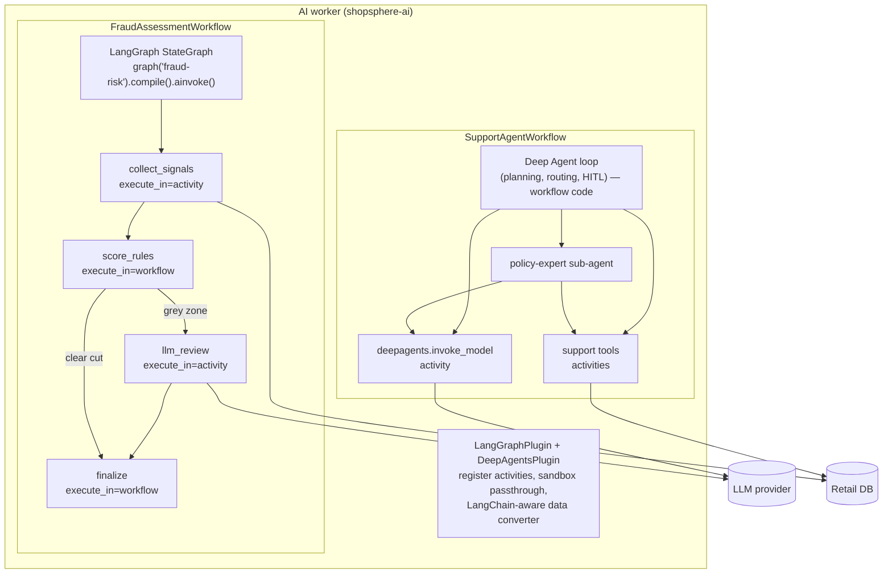

## Part 1 — LangGraph: the fraud graph

### Building the graph

```python
# ai/fraud_graph.py
g = StateGraph(FraudState)
g.add_node("collect_signals", collect_signals, metadata={
    "execute_in": "activity",
    "start_to_close_timeout": timedelta(seconds=10),
    "retry_policy": RetryPolicy(maximum_attempts=5),
    "summary": "Fetch customer risk signals",
})
g.add_node("score_rules", score_rules, metadata={"execute_in": "workflow"})
g.add_node("llm_review", llm_review, metadata={
    "execute_in": "activity",
    "start_to_close_timeout": timedelta(seconds=60),
    "retry_policy": RetryPolicy(initial_interval=timedelta(seconds=2), backoff_coefficient=2.0, maximum_attempts=4),
    "summary": "LLM fraud review",
})
g.add_node("finalize", finalize, metadata={"execute_in": "workflow"})
g.add_edge(START, "collect_signals")
g.add_edge("collect_signals", "score_rules")
g.add_conditional_edges("score_rules", route_after_rules, ["llm_review", "finalize"])
g.add_edge("llm_review", "finalize")
g.add_edge("finalize", END)
```

Every node **must** declare `execute_in`. The plugin refuses to guess, and it
can't be set as a default for all nodes — you make the call deliberately for
each node, which is the right amount of friction. Everything else in the
metadata (`start_to_close_timeout`, `retry_policy`, `heartbeat_timeout`,
`summary`...) is passed straight to `workflow.execute_activity`.

How to decide:

| Node does... | `execute_in` |
|---|---|
| DB / HTTP / file I/O | `activity` |
| an LLM call | `activity` |
| anything slow, or that needs a library that isn't sandbox-safe | `activity` |
| pure transformation of state | `workflow` |
| routing decisions | `workflow` (conditional-edge functions always run in the workflow) |

### Registering and running it

The graph is registered on the **worker**, by name:

```python
# worker.py
LangGraphPlugin(
    graphs={FRAUD_GRAPH: build_fraud_graph()},
    default_activity_options={"start_to_close_timeout": timedelta(seconds=60)},
)
```

and fetched by name in the **workflow**:

```python
# workflows/fraud_workflow.py
@workflow.defn
class FraudAssessmentWorkflow:
    @workflow.run
    async def run(self, inp: FraudInput) -> FraudResult:
        app = graph(FRAUD_GRAPH).compile()
        final = await app.ainvoke({"order": asdict(inp)})
        return FraudResult(decision=final["decision"], ...)
```

The plugin turns each activity-node into an activity type named
`<graph>.<node>`. Here are the two real histories side by side:

```
### clear cut (Alice, score 0.0)            ### grey zone (Bob, laptop, score 0.45)
 5  ACTIVITY_TASK_SCHEDULED                  5  ACTIVITY_TASK_SCHEDULED
       fraud-risk.collect_signals                  fraud-risk.collect_signals
 6  ACTIVITY_TASK_STARTED                    6  ACTIVITY_TASK_STARTED
 7  ACTIVITY_TASK_COMPLETED                  7  ACTIVITY_TASK_COMPLETED
 ...                                        ...
11  WORKFLOW_EXECUTION_COMPLETED            11  ACTIVITY_TASK_SCHEDULED
                                                   fraud-risk.llm_review
                                            12  ACTIVITY_TASK_STARTED
                                            13  ACTIVITY_TASK_COMPLETED
                                            ...
                                            17  WORKFLOW_EXECUTION_COMPLETED
```

`score_rules`, `route_after_rules` and `finalize` leave **no events at all**.
They ran inside workflow tasks, cost nothing, and will be re-run identically
on replay. Only the ambiguous orders pay for an LLM call, and if `llm_review`
gets a 429, it's retried with backoff without re-reading the customer's
history.

### The async rule (learned the hard way)

LangGraph executes synchronous functions through `run_in_executor`. That
includes nodes **and conditional-edge routers**. A workflow's event loop has
no executor, so a sync workflow-side function fails with `NotImplementedError`.
All workflow-side functions in `fraud_graph.py` are `async def` for this
reason. Activity-side nodes can be sync or async (async is used here
throughout).

### Other things to know about the LangGraph plugin

* **Checkpointers.** If you use interrupts, compile with
  `InMemorySaver()`. Temporal is the durable layer; a Postgres or Redis
  checkpointer would be doing I/O from workflow code, and is unnecessary.
* **Stores are not supported.** LangGraph `Store` objects can't cross the
  activity boundary; `runtime.store` is `None` in activity-nodes. Keep
  per-run memory in graph state or workflow state, and cross-run memory in
  your own database accessed from activities.
* **Runtime context.** `context_schema` values are passed to activity-nodes,
  so they must be serializable.
* **Streaming.** Setting `streaming_topic` on the plugin publishes
  `get_stream_writer()` output from nodes to a Workflow Stream that clients
  can subscribe to. Delivery is at-least-once per activity attempt, so
  subscribers should tolerate duplicates.
* **Summaries.** `summary` / `summary_fn` in node metadata label activities in
  the UI, which helps a lot when a graph has many similar nodes.

## Part 2 — Deep Agents: the support agent

Deep Agents (the `deepagents` package from LangChain) is an agent harness built
on LangChain's `create_agent`: a model, tools, optional planning, a virtual
filesystem, sub-agents through a `task` tool, and human-in-the-loop
interrupts. The Temporal plugin makes the whole thing durable.

### Building the agent

```python
# ai/support_agent.py
def build_support_agent(model_name: str):
    order_tool = activity_as_tool(get_order_details, start_to_close_timeout=_TOOL_TIMEOUT, retry_policy=_TOOL_RETRY)
    eligibility_tool = activity_as_tool(check_return_eligibility, ...)
    label_tool = activity_as_tool(create_return_label, ...)
    refund_tool = activity_as_tool(issue_refund, ...)
    policy_tool = activity_as_tool(lookup_return_policy, ...)

    return create_temporal_deep_agent(
        model=model_name,                          # a NAME, e.g. "openai:gpt-4.1-mini"
        system_prompt=SYSTEM_PROMPT,
        tools=[order_tool, eligibility_tool, label_tool, refund_tool],
        subagents=[{
            "name": "policy-expert",
            "description": "Answers questions about the return and refund policy.",
            "system_prompt": POLICY_EXPERT_PROMPT,
            "tools": [policy_tool],
        }],
        middleware=[TodoListMiddleware()],         # planning: write_todos
        interrupt_on={"issue_refund": True},       # human approval before money moves
        checkpointer=InMemorySaver(),
        activity_options={"start_to_close_timeout": timedelta(minutes=2), "retry_policy": ...},
    )
```

This function is called **inside the workflow**. With the plugin on the worker:

* `model="openai:gpt-4.1-mini"` is wrapped in a `TemporalModel`. The workflow
  only ships the model **name** to the `deepagents.invoke_model` activity; on
  the worker, your `model_provider` builds the real client. API keys never
  enter workflow code or history.
* `activity_as_tool(...)` turns an existing `@activity.defn` into a LangChain
  tool whose schema mirrors the activity's parameters. When the model calls
  it, the tool runs `workflow.execute_activity` with the timeout and retry
  policy you gave.
* Built-in, state-only tools (`write_todos`, the default state-backed file
  tools, the `task` tool that routes to sub-agents) run **in the workflow**.
* Sub-agents inherit the parent's model and tool wiring, so their LLM calls
  and tool calls are activities too, with no extra configuration.

A note on versions: in `deepagents` 0.7.x the default toolset is the virtual
filesystem tools plus `task`. Planning (`write_todos`) is an opt-in LangChain
middleware, which is why `TodoListMiddleware()` is passed explicitly.

### The worker side

```python
DeepAgentsPlugin(
    model_provider=model_provider,      # name -> chat model, runs inside the model activity
    model_activity_options={"start_to_close_timeout": timedelta(minutes=2)},
    tool_activity_options={"start_to_close_timeout": timedelta(seconds=30)},
)
```

```python
# ai/llm.py
def model_provider(model_name: str):
    if is_fake(model_name):
        return RetailSupportFakeModel()          # offline, deterministic, for demos and tests
    from langchain.chat_models import init_chat_model
    return init_chat_model(model_name, max_retries=0)
```

`max_retries=0` matters. LangChain's model clients retry by default. Inside a
Temporal activity that already retries, nested retries multiply: 5 Temporal
attempts × 6 client attempts = 30 calls, with backoff Temporal can't see. Let
Temporal own retries; the plugin's default provider does the same.

### What a refund conversation records

The customer writes "I want to return ORD-1001, it rattles". This is the real
history of that session (abridged; full version in appendix A), annotated:

```
   5  WORKFLOW_EXECUTION_UPDATE_ACCEPTED     chat          <- customer message (Update)
   8  ACTIVITY_TASK_SCHEDULED                deepagents.invoke_model
                                                           -> model returns write_todos(plan)
                                                           -> write_todos runs IN the workflow: no event
  15  ACTIVITY_TASK_SCHEDULED                deepagents.invoke_model
                                                           -> model calls check_return_eligibility
  21  ACTIVITY_TASK_SCHEDULED                check_return_eligibility
  27  ACTIVITY_TASK_SCHEDULED                deepagents.invoke_model
                                                           -> model calls create_return_label
  33  ACTIVITY_TASK_SCHEDULED                create_return_label
  39  ACTIVITY_TASK_SCHEDULED                deepagents.invoke_model
                                                           -> model calls issue_refund
                                                           -> interrupt_on fires: graph pauses
  45  WORKFLOW_EXECUTION_UPDATE_COMPLETED                  <- reply: "awaiting_approval"

          ... minutes or days pass; workers can restart freely ...

  49  WORKFLOW_EXECUTION_UPDATE_ACCEPTED     decide        <- supervisor approves (Update)
  50  ACTIVITY_TASK_SCHEDULED                issue_refund  <- the paused tool call now runs
  58  ACTIVITY_TASK_SCHEDULED                deepagents.invoke_model
                                                           -> model writes the final answer
  64  WORKFLOW_EXECUTION_UPDATE_COMPLETED                  <- reply: "All set. I've refunded $199.99..."
```

If the AI worker is killed at any point in that sequence, a new worker
replays: four model calls and two tool calls are read from history, the
planning step and the interrupt are re-executed in-workflow, and the session
ends up parked at exactly the same pending approval. Nothing is called twice.

### Human-in-the-loop, end to end

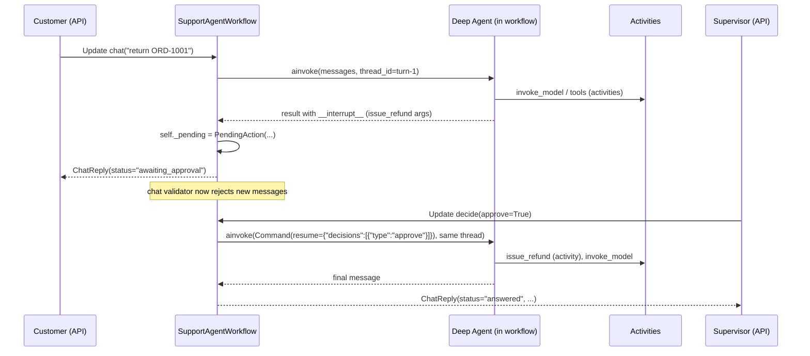

The pieces:

1. `interrupt_on={"issue_refund": True}` makes LangChain's human-in-the-loop
   middleware pause before that tool runs.
2. `ainvoke` returns normally, with the pending action under `__interrupt__`.
   The workflow stores it and answers the chat update with
   `awaiting_approval`.
3. The `decide` update resumes the same LangGraph thread with
   `Command(resume={"decisions": [...]})`. Decisions can be `approve`,
   `reject` (with a message the model sees), or `edit` (change the arguments,
   e.g. lower the amount).
4. `InMemorySaver` holds the paused graph state. It's in workflow memory, so
   it's rebuilt by replay after a crash — that's why no external checkpointer
   is needed.

A rejection reaches the model as a tool result explaining the decision, and
the model writes an apology. `test_refund_rejected_by_supervisor` covers that
path.

### Tools: activity_as_tool vs tool_as_activity

* `activity_as_tool(my_activity, ...)` — you already have (or want) a
  Temporal activity; expose it to the model. Used for every tool here, because
  the same activities could be called by other workflows too.
* `tool_as_activity(my_langchain_tool, ...)` — you already have a LangChain
  `@tool` (maybe from a toolkit); move its execution into an activity. The
  plugin registers it on the worker for you.

A non-builtin tool that you *don't* wrap runs in the workflow, and the plugin
warns when you build the agent, so you can't accidentally do I/O from
workflow code without being told.

### Long conversations

Each message, tool call and model response adds events. The support workflow
watches `workflow.info().is_continue_as_new_suggested()` and continues-as-new
with the transcript in its input when there's no pending approval (chapter
10). The plugin also provides `run_deep_agent(agent, input, state_snapshot=...)`,
which snapshots agent state and continues-as-new automatically at the end of
a turn — handy for single long autonomous runs.

Two size limits to plan around: individual payloads (default 2 MB per blob)
and total history (50 MB). LLM conversations with big tool outputs hit these
faster than you'd think. Keep tool outputs compact (return IDs and
summaries, not documents), and store large artifacts outside Temporal with a
reference in the payload.

### Streaming tokens to a UI

Set `DeepAgentsPlugin(streaming_topic="agent-stream")`. Model calls then run
through a streaming activity that publishes chunk batches to a Workflow
Stream topic; clients subscribe with `WorkflowStreamClient`. The final
aggregated message still returns to the workflow, so the durable result is the
same as without streaming. As with LangGraph streaming, delivery is
at-least-once per activity attempt.

## Part 3 — Patterns and pitfalls for agentic workflows

**Make tools idempotent.** The model may call `issue_refund` twice in a
conversation; the activity may be retried. `refunds.order_id UNIQUE` makes
both harmless. Treat every tool as an API that will be called by a
well-meaning but forgetful client.

**Put guardrails in code, not prompts.** "Never refund without approval" in
the system prompt is a suggestion. `interrupt_on` plus a validator is a
guarantee. Same for amounts: `check_return_eligibility` computes the
refundable amount; the model only passes it through.

**Budget in workflow state.** Count model calls or tokens in the workflow
(each `invoke_model` result is recorded, so the count is deterministic) and
stop or escalate to a human when a budget is exceeded.

**Rate limits are queueing, not errors.** `max_concurrent_activities=8` on the
AI worker and/or `max_task_queue_activities_per_second` on the queue turn a
burst of 500 fraud checks into a queue that drains at the provider's pace.

**Fallback models via retries.** A model activity can read
`activity.info().attempt` and switch to a backup model after N failures, all
inside one activity's retry policy. (With the plugin, do it in your
`model_provider` or a custom model wrapper.)

**Separate AI workers.** This project runs AI workflows on their own task
queue. The orders fleet keeps processing payments even when the LLM provider
is having a bad day; the order workflow degrades to manual review if the
fraud child times out.

**Keep prompts and model names in inputs or code, never read from env in
the workflow.** The model name travels in `OrderInput.ai_model` and
`SupportSessionInput.ai_model`.

**Test without a model.** `RetailSupportFakeModel` in `ai/llm.py` is a
rule-based chat model that emits real tool calls. It drives the actual Deep
Agent loop, so tests exercise planning, sub-agents, interrupts and
resumption. The plugin also ships `temporalio.contrib.deepagents.testing`
with `FakeModel`, `mock_model_provider` and `MockTool` for scripted replies.

**Observe it.** Compose either plugin with
`temporalio.contrib.langsmith` (LangSmith traces of workflows, activities and
model calls) or `temporalio.contrib.opentelemetry`.

## Part 4 — Doing it by hand (no plugins)

The plugins are conveniences. The underlying pattern is simple enough to
write yourself, and knowing it helps when debugging:

```python
@activity.defn
async def call_llm(req: LLMRequest) -> LLMResponse:
    model = init_chat_model(req.model, max_retries=0).bind_tools(req.tool_schemas)
    msg = await model.ainvoke(req.messages)
    return LLMResponse(content=msg.content, tool_calls=msg.tool_calls)

@workflow.defn
class ManualAgent:
    @workflow.run
    async def run(self, task: str) -> str:
        messages = [{"role": "user", "content": task}]
        for _ in range(20):                                   # step budget
            resp = await workflow.execute_activity(call_llm, LLMRequest(MODEL, messages, TOOL_SCHEMAS),
                                                   start_to_close_timeout=timedelta(minutes=2))
            messages.append({"role": "assistant", "content": resp.content, "tool_calls": resp.tool_calls})
            if not resp.tool_calls:
                return resp.content
            for call in resp.tool_calls:
                result = await workflow.execute_activity(TOOLS[call["name"]], call["args"],
                                                         start_to_close_timeout=timedelta(seconds=30))
                messages.append({"role": "tool", "tool_call_id": call["id"], "content": result})
        raise ApplicationError("step budget exhausted", non_retryable=True)
```

That's the whole idea: LLM call = activity, tool call = activity, loop =
workflow. The plugins add the LangChain object serialization, the
LangGraph/Deep Agents integration, interrupts, streaming and sandbox setup.

## Status and caveats

Both plugins are experimental in SDK 1.34. While building this project:

* they worked as documented, including interrupts, sub-agents and replay of
  agent histories (`test_histories_replay_deterministically` replays every
  support and fraud history);
* LangChain emits a couple of beta/deprecation warnings from the plugin's
  serializer, filtered in `pyproject.toml`;
* the LangGraph plugin's interceptor occasionally logs an "unraisable
  exception" while evicted workflows are garbage-collected at worker shutdown.
  It doesn't affect results (see chapter 13).

Pin versions, keep replay tests in CI, and read the plugin READMEs in
`temporalio/contrib/langgraph` and `temporalio/contrib/deepagents` when you
upgrade.

---

# 13 — Testing

Temporal code is unusually testable, because the hard parts — retries,
crashes, waiting — are things the test environment can simulate on demand.
This project's suite runs 18 end-to-end tests against a real Temporal server,
plus 2 activity unit tests, in under a minute.

## The three test environments

| Environment | What it is | Good for |
|---|---|---|
| `WorkflowEnvironment.start_local()` | starts the real dev server (the `temporal` CLI binary) on a random port | integration tests with real behaviour — search attributes, visibility, real timers. **This project uses it.** |
| `WorkflowEnvironment.start_time_skipping()` | a lightweight test server that fast-forwards time whenever all workflows are waiting on timers | testing "3 days later" logic in milliseconds |
| `ActivityEnvironment()` | runs a single activity function in-process with a fake `activity.info()`, heartbeat capture and cancellation | unit tests for activities |

Both server environments download a binary on first use. If your network
blocks that (corporate proxies often do), download the CLI from the GitHub
releases page and pass its path:

```python
WorkflowEnvironment.start_local(
    dev_server_existing_path=os.environ.get("TEMPORAL_CLI_PATH"),
    search_attributes=[ORDER_STATUS_KEY, CUSTOMER_ID_KEY],   # registered for you
)
```

## The fixtures

```python
# tests/conftest.py
@pytest.fixture(scope="session")
async def env():
    init_db(reset=True)
    environment = await WorkflowEnvironment.start_local(...)
    yield environment
    await environment.shutdown()

@pytest.fixture(scope="session")
async def client(env):
    async with orders_worker(env.client, settings), ai_worker(env.client, settings):
        yield env.client
```

One server and one pair of workers for the whole session, created with the
same factory functions production uses (`orders_worker`, `ai_worker`). The
tests are therefore testing the real wiring: plugins, task queues, registered
activities.

Timings are shortened through workflow *inputs*, not by patching code:

```python
OrderInput(..., review_timeout_seconds=30, review_request_delay_seconds=1, delivery_sla_seconds=30)
```

That's one more benefit of passing configuration in inputs (chapter 05).

## What's covered

```
tests/test_order_workflow.py
  test_happy_path_completes_and_awards_points
  test_flaky_gateway_is_retried_transparently        retries
  test_declined_card_runs_compensation               saga
  test_out_of_stock_fails_fast                       non-retryable errors
  test_fraud_reject_never_touches_money              LangGraph child workflow
  test_manual_review_approve_then_address_update     signals + update + validator
  test_review_deadline_auto_rejects                  wait_condition timeout
  test_customer_cancel_while_in_review               cancel signal
  test_visibility_search_by_status                   search attributes
  test_lost_parcel_refunds_but_keeps_stock_decremented   pivot point

tests/test_support_agent.py
  test_order_status_question                         Deep Agent + tool activity
  test_policy_question_goes_to_subagent              sub-agent via `task`
  test_refund_requires_supervisor_approval           interrupt_on + resume
  test_refund_rejected_by_supervisor                 reject decision
  test_final_sale_items_are_not_returnable           tool result drives answer

tests/test_durability.py
  test_worker_crash_mid_order_is_invisible_to_the_customer
  test_histories_replay_deterministically
  test_replenishment_is_idempotent_per_run

tests/test_activities.py                             no server needed
  test_label_resumes_from_last_heartbeat
  test_charge_and_refund_are_idempotent
```

## Testing a crash

The most convincing Temporal test you can write:

```python
async def test_worker_crash_mid_order_is_invisible_to_the_customer(client):
    queue = f"crash-{uuid.uuid4().hex[:6]}"
    settings = replace(S, orders_task_queue=queue)

    async with orders_worker(client, settings):              # worker #1
        handle = await client.start_workflow(OrderFulfillmentWorkflow.run, order, id=..., task_queue=queue)
        await wait_for_status(handle, OrderStatus.PENDING_REVIEW)
    # worker #1 is gone

    await handle.signal(OrderFulfillmentWorkflow.submit_review, ReviewDecision(True, "analyst-kim"))  # nobody running

    async with orders_worker(client, settings):              # worker #2, empty memory
        await deliver(client, order.order_id)
        view = await handle.result()

    assert view.status == OrderStatus.COMPLETED
    assert exactly_one_payment_row(order.order_id)
```

A dedicated task queue guarantees that only the short-lived workers can pick
the order up, so the second worker really has to replay from history.

## Testing replay

```python
async def test_histories_replay_deterministically(client):
    ... collect histories of completed workflows ...
    await Replayer(workflows=[OrderFulfillmentWorkflow, ShipmentWorkflow]).replay_workflow(h)
    await Replayer(workflows=[FraudAssessmentWorkflow, SupportAgentWorkflow], plugins=ai_plugins()).replay_workflow(h)
```

Note the `plugins=ai_plugins()` on the second replayer: AI workflows depend
on the plugins' sandbox configuration and data converter, so the replayer
needs them too.

Add saved production histories to this test (chapter 11) and it becomes your
deploy gate.

## Mocking activities

To test workflow logic without the real activity implementations, register
fakes with the *same activity name*:

```python
@activity.defn(name="charge_payment")
async def charge_payment_always_declines(req: ChargeRequest) -> PaymentReceipt:
    raise ApplicationError("declined", type="PaymentDeclined", non_retryable=True)

async with Worker(env.client, task_queue=tq, workflows=[OrderFulfillmentWorkflow],
                  activities=[charge_payment_always_declines, fake_reserve, fake_release, ...]):
    ...
```

The workflow calls activities by name, so it can't tell the difference.

## Mocking the LLM

Two options, both used in this project:

* a **rule-based fake chat model** (`RetailSupportFakeModel`) selected by the
  model name `fake:retail`. It inspects the conversation and emits real tool
  calls, so the actual agent loop runs. Best for end-to-end tests and demos.
* the plugin's **scripted helpers** in `temporalio.contrib.deepagents.testing`:
  `FakeModel([...responses...])`, `mock_model_provider([...])` and `MockTool`.
  Best for unit-testing one specific agent behaviour with exact replies.

For the LangGraph fraud graph, `llm_review` checks `is_fake(model_name)` and
uses a heuristic. In a bigger project you'd inject the model through the
graph's runtime context instead.

## Time skipping

For logic that waits days, use the time-skipping environment:

```python
async with await WorkflowEnvironment.start_time_skipping() as env:
    async with Worker(env.client, ...):
        handle = await env.client.start_workflow(..., OrderInput(review_request_delay_seconds=3 * 24 * 3600, ...))
        await deliver(...)
        view = await handle.result()   # returns almost instantly: the 3-day timer is skipped
```

Time skips automatically whenever the test is waiting on a workflow result
and every workflow is blocked on a timer. You can also skip manually with
`await env.sleep(timedelta(days=3))`. Activities still run in real time.

## Unit-testing activities

```python
from temporalio.testing import ActivityEnvironment

async def test_label_resumes_from_last_heartbeat():
    env = ActivityEnvironment()
    # Pretend attempt 1 got through two of the four steps before its worker died.
    env.info = dataclasses.replace(env.info, heartbeat_details=[2], attempt=2)
    beats = []
    env.on_heartbeat = lambda *details: beats.append(details[0])
    label = await env.run(create_shipping_label, shipment_input)
    assert beats == [3, 4]          # only the remaining steps ran

async def test_charge_and_refund_are_idempotent():
    first = await env.run(charge_payment, req)
    second = await env.run(charge_payment, req)     # a retry after a lost response
    assert first.payment_id == second.payment_id    # and exactly one payments row
```

## Known noise

* LangChain emits beta and pending-deprecation warnings from the Deep Agents
  plugin's serializer. Filtered in `pyproject.toml`.
* The experimental LangGraph plugin's interceptor runs cleanup code in a
  `finally` block that calls `workflow.info()`. When a worker shuts down at
  the end of the session, evicted workflow coroutines can be garbage-collected
  outside the workflow event loop, and that call raises inside the `finally`.
  Python reports it as an "unraisable exception". It's intermittent, happens
  only at teardown, and doesn't affect any result. The warning filter in
  `pyproject.toml` is scoped to exactly that message.
* The sandbox prints "Module X was imported after initial workflow load" for
  some lazy imports in LangChain. Harmless; filtered.

## A testing checklist for a new workflow

* [ ] happy path end to end
* [ ] each non-retryable failure → correct final status and compensations
* [ ] each signal/update in each relevant state, including validator rejections
* [ ] every timeout path (`wait_condition` timeouts, SLAs) with short inputs or time skipping
* [ ] worker crash at an interesting point
* [ ] replay of the histories the tests produced
* [ ] activity unit tests for idempotency (call twice, assert one effect)

---

# 14 — Production

Everything so far ran on a laptop. This chapter is about running the same
code for real customers: where the server lives, how to deploy and scale
workers, how to secure payloads, what to watch, and what to do at 3 a.m.

## Reference deployment

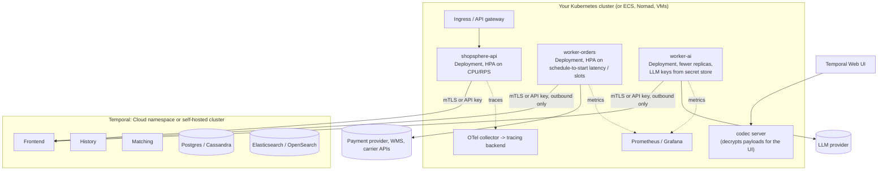

## Temporal Cloud or self-hosted?

| | Temporal Cloud | Self-hosted |
|---|---|---|
| What you run | only workers and clients | workers, clients, 4 Temporal services, a primary DB, a visibility store, upgrades |
| Scaling the service | managed (namespaces scale on demand) | you size history shards up front, then scale hosts and the database |
| Multi-region | managed replication options | your own setup (multi-cluster replication is possible but complex) |
| Security | mTLS or API keys, SSO, audit logs, private connectivity options | you configure TLS, authorizer and claim mapper plugins |
| Cost model | consumption-based (actions, storage) | infrastructure + people |
| Your code and data | runs in your infrastructure either way; payloads can be end-to-end encrypted with your own codec | same |

For most teams the honest advice is: start on Cloud unless you have a strong
reason (regulation, cost at very large scale, an existing Cassandra team).
Operating the History service and its database at scale is a real job.

If you self-host, the official Helm chart (`temporalio/helm-charts`) and the
`temporalio/docker-compose` examples are the starting points. Decide
`numHistoryShards` carefully at creation time — it can't be changed later.
Common choices are 512 or more for production clusters.

## Connecting securely

```python
# Temporal Cloud with an API key
client = await Client.connect(
    "orders-prod.a1b2c.tmprl.cloud:7233",
    namespace="orders-prod.a1b2c",
    api_key=os.environ["TEMPORAL_API_KEY"],
    tls=True,
)

# mTLS (Cloud or self-hosted)
client = await Client.connect(
    address, namespace=ns,
    tls=TLSConfig(client_cert=cert_bytes, client_private_key=key_bytes),
)
```

Put this in one helper and use it from the API, the workers and scripts.

## Encrypting payloads

By default, workflow inputs, activity results and signal payloads are stored
in plaintext JSON on the Temporal service. For customer data (addresses,
emails, card tokens) you usually want them encrypted with keys only you hold.
A **payload codec** does that transparently:

```python
class EncryptionCodec(PayloadCodec):
    async def encode(self, payloads): return [encrypt(p) for p in payloads]
    async def decode(self, payloads): return [decrypt(p) for p in payloads]

converter = dataclasses.replace(DataConverter.default, payload_codec=EncryptionCodec(key_id="k1"))
client = await Client.connect(..., data_converter=converter)
```

Everything that talks to the namespace (API, workers, scripts) must use the
same codec. To keep the Web UI usable, run a small **codec server** that the
UI calls to decode payloads for authorised users.

Note for AI workers: the Deep Agents plugin installs its own payload
converter for LangChain messages. Compose the two by setting
`payload_converter_class=DeepAgentsPayloadConverter` together with your
`payload_codec` on one `DataConverter`; the plugin refuses to silently
override a custom converter.

## Limits to design around

| Limit (defaults) | Value | What to do |
|---|---|---|
| Single payload (input, result, signal arg) | 2 MB | pass IDs and references, store blobs in S3/GCS |
| gRPC message | 4 MB | same; also don't batch hundreds of large commands |
| History length | warning at ~10k events, hard limit 51,200 | continue-as-new; split into children |
| History size | 50 MB | same |
| Pending activities / children / signals per workflow | a few thousand each | batch fan-outs, use children |
| Workflow task timeout | 10 s | keep workflow code fast; no heavy CPU in workflows |

These are server defaults; Cloud and self-hosted deployments can differ.
`workflow.info().is_continue_as_new_suggested()` and the history-size fields
on `workflow.info()` let a workflow react before it hits a wall.

## Workers in production

### Sizing and tuning

* **Slots** — `max_concurrent_activities`, `max_concurrent_workflow_tasks`,
  `max_concurrent_local_activities`. Or a resource-based `tuner` that adds
  slots while CPU and memory allow.
* **Cache** — `max_cached_workflows`. Bigger cache = fewer replays = less CPU,
  more memory. Watch the sticky cache hit rate.
* **Pollers** — usually fine at defaults; increase if schedule-to-start
  latency is high while slots are free.
* **Rate limits** — `max_task_queue_activities_per_second` for downstream
  APIs with global quotas.

### Autoscaling

Scale workers on what Temporal tells you, not just CPU:

* `temporal_workflow_task_schedule_to_start_latency` and
  `temporal_activity_schedule_to_start_latency` (SDK metrics) — tasks waiting
  for a worker. Rising = add workers.
* Free slots (`temporal_worker_task_slots_available`) — near zero = workers
  saturated.
* Task queue backlog (`temporal task-queue describe`, or the server/Cloud
  metrics for approximate backlog count).

### Deploys

* **Graceful shutdown**: set `graceful_shutdown_timeout` on the Worker so
  in-flight activities get time to finish when Kubernetes sends SIGTERM.
  Anything not finished will be retried elsewhere anyway.
* **Versioning**: chapter 11. Use Worker Versioning (pinned) for the orders
  fleet, or patches.
* **Replay tests** in CI before every deploy that touches workflow code.

### Separate fleets

This project already splits orders and AI. Other common splits: a fleet for
slow batch activities so they can't starve latency-sensitive ones; a fleet per
downstream dependency with its own rate limit; a GPU fleet for model
inference activities.

## Observability

### Metrics

```python
from temporalio.runtime import PrometheusConfig, Runtime, TelemetryConfig

runtime = Runtime(telemetry=TelemetryConfig(metrics=PrometheusConfig(bind_address="0.0.0.0:9464")))
client = await Client.connect(address, runtime=runtime)
```

Worth a dashboard:

| Metric | Alert when |
|---|---|
| `temporal_workflow_task_execution_failed` | any sustained rate — often a bug or a non-determinism error |
| `temporal_activity_execution_failed` (by activity type) | spikes; correlate with the downstream |
| `temporal_activity_schedule_to_start_latency` | p95 rising → under-provisioned workers |
| `temporal_workflow_task_schedule_to_start_latency` | same, for workflow tasks |
| `temporal_sticky_cache_hit` vs misses, `temporal_workflow_task_replay_latency` | low hit rate / lots of replay → cache too small or workers churning |
| `temporal_worker_task_slots_used` / `_available` | used ≈ max for long periods → raise slots or add workers |
| `temporal_request_failure` / `temporal_long_request_failure` | connectivity to the service |
| `temporal_workflow_endtoend_latency` (by workflow type) | business SLOs, e.g. order-to-delivery |
| your own business metrics from activities | orders stuck in PENDING_REVIEW, refunds per hour |

These names come from scraping a worker of this project. Failure counters
only appear in the scrape after they've been incremented at least once, so
don't be surprised when `..._failed` metrics are missing on a healthy worker.

### Tracing

`temporalio.contrib.opentelemetry` (install `opentelemetry-sdk`) adds an
interceptor or plugin that creates spans for starting workflows, running
activities, signals and so on, and propagates context from the API request
through the workflow into each activity. For the AI side, the LangSmith plugin
(`temporalio.contrib.langsmith`) traces model and tool calls in LangSmith with
the workflow structure preserved.

### Logs

Use `workflow.logger` and `activity.logger`. They attach workflow ID, run ID,
activity type and attempt to each record, and `workflow.logger` skips
duplicate logs during replay.

### Search

Custom search attributes (`OrderStatus`, `CustomerId`) make the UI an
operations tool: "all orders stuck in PENDING_REVIEW for more than a day"
is one query. Keep them few, small and stable.

## Retention and archival

Closed workflow histories are kept for the namespace's **retention period**
(configurable per namespace, typically days to a few weeks), then deleted.
If you need them longer — audits, disputes — enable **archival** to an object
store, or export what you need to your own systems from activities while the
workflow runs (that's another reason for `save_order_snapshot`).

## Runbook: things that go wrong

**"Orders are stuck in FRAUD_CHECK."**
Check the AI worker is running and polling `shopsphere-ai`
(`temporal task-queue describe --task-queue shopsphere-ai`). Look at a stuck
fraud child in the UI: pending activity `fraud-risk.llm_review` with attempt
count climbing → the LLM provider is failing; check the last failure message.
The order workflow will route to manual review after 10 minutes on its own.

**"A workflow shows Workflow Task Failed."**
Open it in the UI; the failure message says why. A Python exception → fix
and deploy; it resumes on its own. A non-determinism error → roll back or add
a `patched()` branch (chapter 11), or reset.

**"An activity keeps retrying forever."**
Pending activities panel → last failure. If it can never succeed (bad
input), the right fix is usually making that error type non-retryable and
deploying; for the stuck instance, cancel or reset the workflow, or fix the
data so the next attempt succeeds.

**"We deployed a bug that made 2,000 orders take the wrong branch."**
Fix forward with a patch so new runs are correct, then batch-reset affected
executions to before the bad decision:
`temporal workflow reset --query "..." --type LastWorkflowTask` (or to a
specific event). Make sure activities after that point are idempotent —
they will run again.

**"We need to stop everything now."**
Pause the schedule (`temporal schedule toggle --pause`), scale workers to
zero. Workflows don't fail when no worker runs; they simply wait. Scaling
back up resumes them. Terminate only as a last resort.

**"The payment provider was down for three hours."**
Nothing to do. Charges retried with backoff (capped at 30 s intervals,
8 attempts in this project — consider unlimited attempts plus a
`schedule_to_close_timeout` for payments), refunds retried forever. Check
for orders that failed with "attempts exhausted" and decide whether to retry
them.

## Security checklist

* [ ] mTLS or API keys for every client and worker; least-privilege namespace permissions
* [ ] payload codec for PII; codec server behind your SSO for the UI
* [ ] secrets (LLM keys, PSP keys) only in worker environments, never in workflow inputs
* [ ] separate namespaces per environment
* [ ] audit who can signal, cancel, terminate and reset in production
* [ ] activity inputs validated (the model chooses tool arguments!)
* [ ] human approval (`interrupt_on`) on any agent tool that moves money or deletes data

---

# 15 — Hero checklist

You've read the theory and run the code. This chapter is for making it stick:
exercises against this codebase, the mistakes everyone makes once, interview
questions with answers, and a one-page cheat sheet.

## Exercises

Each one changes the project. Write a test for each before you call it done.

### Level 1 — get comfortable

1. **Add a gift-wrap step.** If `OrderInput.gift_wrap` is true, call a new
   `wrap_gift` activity after payment. Make the new field default to `False`
   so old histories still deserialize. Does this need `workflow.patched()`?
   (Yes — think about orders that are mid-flight when you deploy.)
2. **Add a query** `get_timeline_since(at: str)` that returns only timeline
   events after a timestamp.
3. **Make `tok_slow` a token** whose charge sleeps 40 s. Watch it time out
   against the 30 s `start_to_close_timeout` and retry. Then make it heartbeat
   and add a `heartbeat_timeout`.
4. **Use the CLI** to find every order for `CUST-BOB` that is currently
   `PENDING_REVIEW`, approve one with `temporal workflow signal`, and inspect
   its history.

### Level 2 — patterns

5. **Cancel after payment.** Allow `cancel` until the shipment starts. Add a
   test that cancels while the order is `PAID` and asserts that both the
   refund and the stock release happened, in that order.
6. **Partial shipments.** Split an order with several SKUs into one
   `ShipmentWorkflow` child per warehouse, run them in parallel with
   `asyncio.gather`, and complete the order when all are delivered.
7. **Payment taking long.** Race the charge activity against a 10-second
   timer with `workflow.wait(..., return_when=FIRST_COMPLETED)`; if the timer
   wins, send a "still processing" email, then keep waiting for the charge.
8. **Shopping cart entity.** Write a `CartWorkflow` (one per customer) with
   `add_item` / `remove_item` updates, a `get_cart` query, an abandoned-cart
   email after 24 h of inactivity, and a `checkout` update that starts an
   `OrderFulfillmentWorkflow` and returns its order ID. Use
   update-with-start from the API.

### Level 3 — production thinking

9. **Encrypt payloads** with a codec (AES-GCM with a key from env), run the
   whole demo with it, and confirm the UI shows encrypted payloads.
10. **Replay gate.** Export five real histories with
    `temporal workflow show -o json`, commit them, write a parametrised replay
    test, then make an incompatible change to the order workflow and watch
    the test catch it. Fix it with `patched()`.
11. **Worker Versioning.** Run two builds of the orders worker with
    `WorkerDeploymentConfig` and `PINNED`; start orders on v1, promote v2,
    and confirm in-flight orders finish on v1 while new ones start on v2.
12. **Real LLM.** Switch `LLM_MODEL` to a real model. Write three tricky
    support conversations (wrong order number, two orders in one message,
    a customer trying to talk the agent into skipping approval) and see how
    the guardrails hold up. Where do prompt instructions fail and code
    guardrails save you?
13. **Agent budget.** Count model calls per support turn in workflow state
    and stop with an escalation message after 8.

## Mistakes everyone makes once

| Mistake | Symptom | Fix |
|---|---|---|
| `datetime.now()` / `random` / `uuid4()` in workflow code | `RestrictedWorkflowAccessError`, or NDE on replay | `workflow.now()`, `workflow.random()`, `workflow.uuid4()` |
| Reading env or config inside a workflow | different behaviour on different workers | pass it in the input |
| Calling an API or DB from workflow code | sandbox error, or effects repeated on replay | move it to an activity |
| Sync LangGraph node marked `execute_in="workflow"` | `NotImplementedError` from `run_in_executor` | make it `async def` |
| Only `schedule_to_close_timeout` set | dead workers noticed an hour late | always set `start_to_close_timeout` |
| Retrying business errors | "card declined" retried 50 times | `ApplicationError(non_retryable=True)` / `non_retryable_error_types` |
| `uuid4()` as an idempotency key inside an activity | duplicates on retry | business ID or `workflow_id + activity_id` |
| LLM client retries left on | 30 calls for one logical attempt | `max_retries=0`; let Temporal retry |
| Reordering activities in a deployed workflow | NDE, workflows stuck on "Workflow Task Failed" | `workflow.patched()` or Worker Versioning |
| Returning big documents from activities | payload size errors, slow histories | return IDs; store blobs elsewhere |
| Unbounded entity workflow | history limit termination after weeks | continue-as-new |
| Expecting a query to work with no workers | query timeout during an outage | read model or search attributes |
| Using signals when the caller needs the outcome | API returns 202 and the client polls forever | an update with a validator |
| `str`-mixin Enum fields in payloads | value comes back as a list of characters | keep enums internal; put `.value` on the wire |
| Workflow returns while an update handler is mid-flight | caller gets an error, SDK warns | `wait_condition(all_handlers_finished)` |
| Terminating instead of cancelling | no compensation ran | `cancel` and handle `CancelledError` |
| Business failure raised as workflow failure | alerts on every declined card | complete normally with a FAILED status |

## Interview questions (with short answers)

**What problem does Temporal solve?**
Reliable execution of long-running, multi-step processes across unreliable
systems. You write the process as ordinary code; Temporal persists every step
so the code survives crashes and resumes exactly where it was.

**How does a workflow survive a worker crash?**
Its event history is on the server. Another worker replays the code against
that history: completed activities return their recorded results instead of
running, timers and signals are re-delivered in order, and the code ends up in
the same state, then continues live.

**Why must workflow code be deterministic?**
Replay re-runs the code and matches its commands against recorded events. If
the code makes different decisions given the same history, the recorded past
and the code disagree and the SDK can't continue (non-determinism error).

**Are activities exactly-once?**
No. At-least-once. A successful result is recorded once, but an attempt can
run and have side effects without its success being recorded (e.g. worker
crash). Make activities idempotent with deterministic keys.

**Signal vs query vs update?**
Signal: async message, recorded, no result. Query: read-only, not recorded,
returns data. Update: recorded, can be validated and rejected before
recording, returns a result to the caller.

**What is continue-as-new and when do you use it?**
Atomically complete the current run and start a new run of the same workflow
ID with new input and empty history. Use it for long-lived or looping
workflows to stay under history limits.

**How do you change workflow code safely?**
Patching (`workflow.patched` → `deprecate_patch` → remove), Worker Versioning
(pin executions to the build they started on), or new workflow
types/queues. Verify with replay tests in CI.

**What's the difference between cancel and terminate?**
Cancel delivers a cancellation into the workflow, which can clean up
(compensate) and then end. Terminate stops it on the server without running
any more code.

**How would you implement a saga?**
Record a compensation for each step that changes external state (register
before steps with unknown outcomes), and on failure run them in reverse with
retries that never give up. Identify the pivot step after which rollback is
no longer possible.

**How do timeouts differ?**
Start-to-close: one attempt. Schedule-to-close: all attempts. Schedule-to-
start: time in queue. Heartbeat: max time between heartbeats. Always set
start-to-close (or schedule-to-close).

**Why would you put an LLM agent on Temporal?**
Each model call and tool call becomes a durable, retried step whose result is
recorded, so crashes don't cost tokens or duplicate side effects, human
approvals can pause the agent for days, and the agent's history is a full
audit log.

**What runs where in the Temporal LangGraph plugin?**
Nodes marked `execute_in="activity"` run as activities (I/O, LLM calls);
nodes marked `"workflow"` and routing functions run inside the workflow and
must be deterministic and async.

**How does the Temporal server scale?**
History is sharded by workflow ID across history hosts (shard count fixed at
cluster creation); matching partitions task queues; frontends are stateless;
the database is the ultimate limit. Workers scale independently, by adding
processes.

**What happens if no worker is running?**
Nothing breaks. Starts, signals and timers are recorded on the server; tasks
wait in task queues; queries fail. When workers return, work resumes.

## Cheat sheet

```python
# ---------- workflow ----------
@workflow.defn
class MyWorkflow:
    @workflow.init
    def __init__(self, inp: In) -> None: ...            # runs before any handler

    @workflow.run
    async def run(self, inp: In) -> Out:
        r = await workflow.execute_activity(act, arg,
                start_to_close_timeout=timedelta(seconds=30),
                retry_policy=RetryPolicy(maximum_attempts=5, non_retryable_error_types=["Bad"]))
        c = await workflow.execute_child_workflow(Child.run, arg, id="child-1", task_queue="q")
        await workflow.sleep(timedelta(days=1))
        await workflow.wait_condition(lambda: self.done, timeout=timedelta(hours=1))
        if workflow.patched("my-change"): ...
        if workflow.info().is_continue_as_new_suggested():
            workflow.continue_as_new(next_input)
        await workflow.wait_condition(workflow.all_handlers_finished)
        return Out(...)

    @workflow.signal
    def poke(self, x: X) -> None: ...
    @workflow.query
    def state(self) -> S: ...
    @workflow.update
    async def change(self, x: X) -> S: ...
    @change.validator
    def _check(self, x: X) -> None: ...                  # raise to reject

# deterministic helpers: workflow.now(), workflow.random(), workflow.uuid4(), workflow.logger

# ---------- activity ----------
@activity.defn
async def act(arg: In) -> Out:
    info = activity.info()                               # attempt, workflow_id, activity_id, heartbeat_details
    activity.heartbeat(progress)
    raise ApplicationError("msg", type="Bad", non_retryable=True)

# ---------- worker ----------
await Worker(client, task_queue="q", workflows=[MyWorkflow], activities=[act],
             max_concurrent_activities=50, plugins=[...]).run()

# ---------- client ----------
h = await client.start_workflow(MyWorkflow.run, inp, id="biz-key", task_queue="q",
        id_conflict_policy=WorkflowIDConflictPolicy.USE_EXISTING)
await h.signal(MyWorkflow.poke, x)
s = await h.query(MyWorkflow.state)
s = await h.execute_update(MyWorkflow.change, x)
r = await h.result()
async for wf in client.list_workflows("WorkflowType='MyWorkflow' AND ExecutionStatus='Running'"): ...
```

```bash
temporal server start-dev --search-attribute OrderStatus=Keyword
temporal workflow list|describe|show|query|signal|cancel|terminate|reset
temporal workflow update execute -w ID --name NAME --input '{...}'
temporal schedule create|list|trigger|toggle|backfill
temporal task-queue describe --task-queue q
```

## Where to go from here

* The official docs at docs.temporal.io, especially the Python SDK developer
  guide and the "Workflow message passing" and "Versioning" pages.
* The `temporalio/samples-python` repository: dozens of small, focused
  examples.
* The plugin READMEs shipped inside the SDK:
  `temporalio/contrib/langgraph/README.md` and
  `temporalio/contrib/deepagents/README.md`.
* Temporal's free courses (Temporal 101/102 and the Python-specific ones).
* Nexus, which connects workflows across namespaces and teams with typed
  service contracts — the natural next step once several teams run Temporal.

---

# Appendix A — Real event histories

These histories were captured from this project running against a Temporal
dev server (CLI 1.5.1, server 1.29.1, Python SDK 1.34.0) with the offline
`fake:retail` model. Nothing has been edited except removing payloads for
readability. Each line is: event ID, event type, and the activity, workflow,
signal, update, marker or timer it refers to.

Regenerate them yourself by running the scenarios in `tests/` and then
`temporal workflow show -w <workflow-id>`.

Things to look for:

* **Order happy path** — the rhythm of `WORKFLOW_TASK_*` triplets between
  each command; the patch marker at #61 and the `TemporalChangeVersion`
  upsert at #62; four `shipment_progress` signals from the child; the durable
  timer at #117.
* **Fraud graph** — only activity-nodes appear (`fraud-risk.collect_signals`,
  `fraud-risk.llm_review`). The workflow-side nodes leave no trace. The
  clear-cut case never calls the LLM.
* **Shipment child** — `ACTIVITY_TASK_SCHEDULED` at #5 but
  `ACTIVITY_TASK_STARTED` only at #18: the started event is written when the
  attempt finishes. Three carrier signals arrived in between and were buffered.
* **Declined card** — `ACTIVITY_TASK_FAILED` at #44 (one attempt; the error is
  non-retryable), then `refund_payment` and `release_inventory` compensations
  in reverse order, then a normal `WORKFLOW_EXECUTION_COMPLETED`: a declined
  card is a business outcome, not a workflow failure.
* **Support Deep Agent** — the chat update (#5) produces two model calls
  before the first tool (the first one planned with `write_todos`, which runs
  in-workflow), the update completes at #45 with the refund parked for
  approval, and the `decide` update (#49) resumes by running `issue_refund`.
  The idle timer is cancelled and re-armed on activity.
* **Operator-cancelled order** — `WORKFLOW_EXECUTION_CANCEL_REQUESTED` at #43
  while the review timer was running, the workflow's `CancelledError` handler
  cancels the timer and records the final status, and the execution ends as
  `WORKFLOW_EXECUTION_CANCELED`.

```text

### Order happy path (order-ORD-1001)
   1  WORKFLOW_EXECUTION_STARTED                       OrderFulfillmentWorkflow
   2  WORKFLOW_TASK_SCHEDULED                          
   3  WORKFLOW_TASK_STARTED                            
   4  WORKFLOW_TASK_COMPLETED                          
   5  UPSERT_WORKFLOW_SEARCH_ATTRIBUTES                
   6  UPSERT_WORKFLOW_SEARCH_ATTRIBUTES                
   7  ACTIVITY_TASK_SCHEDULED                          save_order_snapshot
   8  ACTIVITY_TASK_STARTED                            
   9  ACTIVITY_TASK_COMPLETED                          
  10  WORKFLOW_TASK_SCHEDULED                          
  11  WORKFLOW_TASK_STARTED                            
  12  WORKFLOW_TASK_COMPLETED                          
  13  UPSERT_WORKFLOW_SEARCH_ATTRIBUTES                
  14  ACTIVITY_TASK_SCHEDULED                          save_order_snapshot
  15  ACTIVITY_TASK_STARTED                            
  16  ACTIVITY_TASK_COMPLETED                          
  17  WORKFLOW_TASK_SCHEDULED                          
  18  WORKFLOW_TASK_STARTED                            
  19  WORKFLOW_TASK_COMPLETED                          
  20  START_CHILD_WORKFLOW_EXECUTION_INITIATED         FraudAssessmentWorkflow
  21  CHILD_WORKFLOW_EXECUTION_STARTED                 FraudAssessmentWorkflow
  22  WORKFLOW_TASK_SCHEDULED                          
  23  WORKFLOW_TASK_STARTED                            
  24  WORKFLOW_TASK_COMPLETED                          
  25  CHILD_WORKFLOW_EXECUTION_COMPLETED               FraudAssessmentWorkflow
  26  WORKFLOW_TASK_SCHEDULED                          
  27  WORKFLOW_TASK_STARTED                            
  28  WORKFLOW_TASK_COMPLETED                          
  29  ACTIVITY_TASK_SCHEDULED                          reserve_inventory
  30  ACTIVITY_TASK_STARTED                            
  31  ACTIVITY_TASK_COMPLETED                          
  32  WORKFLOW_TASK_SCHEDULED                          
  33  WORKFLOW_TASK_STARTED                            
  34  WORKFLOW_TASK_COMPLETED                          
  35  UPSERT_WORKFLOW_SEARCH_ATTRIBUTES                
  36  ACTIVITY_TASK_SCHEDULED                          save_order_snapshot
  37  ACTIVITY_TASK_STARTED                            
  38  ACTIVITY_TASK_COMPLETED                          
  39  WORKFLOW_TASK_SCHEDULED                          
  40  WORKFLOW_TASK_STARTED                            
  41  WORKFLOW_TASK_COMPLETED                          
  42  ACTIVITY_TASK_SCHEDULED                          charge_payment
  43  ACTIVITY_TASK_STARTED                            
  44  ACTIVITY_TASK_COMPLETED                          
  45  WORKFLOW_TASK_SCHEDULED                          
  46  WORKFLOW_TASK_STARTED                            
  47  WORKFLOW_TASK_COMPLETED                          
  48  UPSERT_WORKFLOW_SEARCH_ATTRIBUTES                
  49  ACTIVITY_TASK_SCHEDULED                          save_order_snapshot
  50  ACTIVITY_TASK_STARTED                            
  51  ACTIVITY_TASK_COMPLETED                          
  52  WORKFLOW_TASK_SCHEDULED                          
  53  WORKFLOW_TASK_STARTED                            
  54  WORKFLOW_TASK_COMPLETED                          
  55  ACTIVITY_TASK_SCHEDULED                          send_notification
  56  ACTIVITY_TASK_STARTED                            
  57  ACTIVITY_TASK_COMPLETED                          
  58  WORKFLOW_TASK_SCHEDULED                          
  59  WORKFLOW_TASK_STARTED                            
  60  WORKFLOW_TASK_COMPLETED                          
  61  MARKER_RECORDED                                  core_patch
  62  UPSERT_WORKFLOW_SEARCH_ATTRIBUTES                
  63  ACTIVITY_TASK_SCHEDULED                          award_loyalty_points
  64  ACTIVITY_TASK_STARTED                            
  65  ACTIVITY_TASK_COMPLETED                          
  66  WORKFLOW_TASK_SCHEDULED                          
  67  WORKFLOW_TASK_STARTED                            
  68  WORKFLOW_TASK_COMPLETED                          
  69  UPSERT_WORKFLOW_SEARCH_ATTRIBUTES                
  70  ACTIVITY_TASK_SCHEDULED                          save_order_snapshot
  71  ACTIVITY_TASK_STARTED                            
  72  ACTIVITY_TASK_COMPLETED                          
  73  WORKFLOW_TASK_SCHEDULED                          
  74  WORKFLOW_TASK_STARTED                            
  75  WORKFLOW_TASK_COMPLETED                          
  76  START_CHILD_WORKFLOW_EXECUTION_INITIATED         ShipmentWorkflow
  77  CHILD_WORKFLOW_EXECUTION_STARTED                 ShipmentWorkflow
  78  WORKFLOW_TASK_SCHEDULED                          
  79  WORKFLOW_TASK_STARTED                            
  80  WORKFLOW_TASK_COMPLETED                          
  81  WORKFLOW_EXECUTION_SIGNALED                      shipment_progress
  82  WORKFLOW_TASK_SCHEDULED                          
  83  WORKFLOW_TASK_STARTED                            
  84  WORKFLOW_TASK_COMPLETED                          
  85  UPSERT_WORKFLOW_SEARCH_ATTRIBUTES                
  86  WORKFLOW_EXECUTION_SIGNALED                      shipment_progress
  87  WORKFLOW_TASK_SCHEDULED                          
  88  WORKFLOW_TASK_STARTED                            
  89  WORKFLOW_TASK_COMPLETED                          
  90  UPSERT_WORKFLOW_SEARCH_ATTRIBUTES                
  91  WORKFLOW_EXECUTION_SIGNALED                      shipment_progress
  92  WORKFLOW_TASK_SCHEDULED                          
  93  WORKFLOW_TASK_STARTED                            
  94  WORKFLOW_TASK_COMPLETED                          
  95  UPSERT_WORKFLOW_SEARCH_ATTRIBUTES                
  96  WORKFLOW_EXECUTION_SIGNALED                      shipment_progress
  97  WORKFLOW_TASK_SCHEDULED                          
  98  WORKFLOW_TASK_STARTED                            
  99  WORKFLOW_TASK_COMPLETED                          
 100  CHILD_WORKFLOW_EXECUTION_COMPLETED               ShipmentWorkflow
 101  WORKFLOW_TASK_SCHEDULED                          
 102  WORKFLOW_TASK_STARTED                            
 103  WORKFLOW_TASK_COMPLETED                          
 104  UPSERT_WORKFLOW_SEARCH_ATTRIBUTES                
 105  ACTIVITY_TASK_SCHEDULED                          save_order_snapshot
 106  ACTIVITY_TASK_STARTED                            
 107  ACTIVITY_TASK_COMPLETED                          
 108  WORKFLOW_TASK_SCHEDULED                          
 109  WORKFLOW_TASK_STARTED                            
 110  WORKFLOW_TASK_COMPLETED                          
 111  ACTIVITY_TASK_SCHEDULED                          send_notification
 112  ACTIVITY_TASK_STARTED                            
 113  ACTIVITY_TASK_COMPLETED                          
 114  WORKFLOW_TASK_SCHEDULED                          
 115  WORKFLOW_TASK_STARTED                            
 116  WORKFLOW_TASK_COMPLETED                          
 117  TIMER_STARTED                                    timer 1s
 118  TIMER_FIRED                                      
 119  WORKFLOW_TASK_SCHEDULED                          
 120  WORKFLOW_TASK_STARTED                            
 121  WORKFLOW_TASK_COMPLETED                          
 122  ACTIVITY_TASK_SCHEDULED                          send_notification
 123  ACTIVITY_TASK_STARTED                            
 124  ACTIVITY_TASK_COMPLETED                          
 125  WORKFLOW_TASK_SCHEDULED                          
 126  WORKFLOW_TASK_STARTED                            
 127  WORKFLOW_TASK_COMPLETED                          
 128  UPSERT_WORKFLOW_SEARCH_ATTRIBUTES                
 129  ACTIVITY_TASK_SCHEDULED                          save_order_snapshot
 130  ACTIVITY_TASK_STARTED                            
 131  ACTIVITY_TASK_COMPLETED                          
 132  WORKFLOW_TASK_SCHEDULED                          
 133  WORKFLOW_TASK_STARTED                            
 134  WORKFLOW_TASK_COMPLETED                          
 135  WORKFLOW_EXECUTION_COMPLETED                     

### Fraud graph (approve, no LLM) (fraud-ORD-1001)
   1  WORKFLOW_EXECUTION_STARTED                       FraudAssessmentWorkflow
   2  WORKFLOW_TASK_SCHEDULED                          
   3  WORKFLOW_TASK_STARTED                            
   4  WORKFLOW_TASK_COMPLETED                          
   5  ACTIVITY_TASK_SCHEDULED                          fraud-risk.collect_signals
   6  ACTIVITY_TASK_STARTED                            
   7  ACTIVITY_TASK_COMPLETED                          
   8  WORKFLOW_TASK_SCHEDULED                          
   9  WORKFLOW_TASK_STARTED                            
  10  WORKFLOW_TASK_COMPLETED                          
  11  WORKFLOW_EXECUTION_COMPLETED                     

### Shipment child (shipment-ORD-1001)
   1  WORKFLOW_EXECUTION_STARTED                       ShipmentWorkflow
   2  WORKFLOW_TASK_SCHEDULED                          
   3  WORKFLOW_TASK_STARTED                            
   4  WORKFLOW_TASK_COMPLETED                          
   5  ACTIVITY_TASK_SCHEDULED                          create_shipping_label
   6  WORKFLOW_EXECUTION_SIGNALED                      carrier_event
   7  WORKFLOW_TASK_SCHEDULED                          
   8  WORKFLOW_TASK_STARTED                            
   9  WORKFLOW_TASK_COMPLETED                          
  10  WORKFLOW_EXECUTION_SIGNALED                      carrier_event
  11  WORKFLOW_EXECUTION_SIGNALED                      carrier_event
  12  WORKFLOW_TASK_SCHEDULED                          
  13  WORKFLOW_TASK_STARTED                            
  14  WORKFLOW_TASK_COMPLETED                          
  15  ACTIVITY_TASK_STARTED                            
  16  ACTIVITY_TASK_COMPLETED                          
  17  WORKFLOW_TASK_SCHEDULED                          
  18  WORKFLOW_TASK_STARTED                            
  19  WORKFLOW_TASK_COMPLETED                          
  20  SIGNAL_EXTERNAL_WORKFLOW_EXECUTION_INITIATED     shipment_progress
  21  EXTERNAL_WORKFLOW_EXECUTION_SIGNALED             
  22  WORKFLOW_TASK_SCHEDULED                          
  23  WORKFLOW_TASK_STARTED                            
  24  WORKFLOW_TASK_COMPLETED                          
  25  SIGNAL_EXTERNAL_WORKFLOW_EXECUTION_INITIATED     shipment_progress
  26  EXTERNAL_WORKFLOW_EXECUTION_SIGNALED             
  27  WORKFLOW_TASK_SCHEDULED                          
  28  WORKFLOW_TASK_STARTED                            
  29  WORKFLOW_TASK_COMPLETED                          
  30  SIGNAL_EXTERNAL_WORKFLOW_EXECUTION_INITIATED     shipment_progress
  31  EXTERNAL_WORKFLOW_EXECUTION_SIGNALED             
  32  WORKFLOW_TASK_SCHEDULED                          
  33  WORKFLOW_TASK_STARTED                            
  34  WORKFLOW_TASK_COMPLETED                          
  35  SIGNAL_EXTERNAL_WORKFLOW_EXECUTION_INITIATED     shipment_progress
  36  EXTERNAL_WORKFLOW_EXECUTION_SIGNALED             
  37  WORKFLOW_TASK_SCHEDULED                          
  38  WORKFLOW_TASK_STARTED                            
  39  WORKFLOW_TASK_COMPLETED                          
  40  WORKFLOW_EXECUTION_COMPLETED                     

### Fraud graph (grey zone -> LLM) (fraud-ORD-1002)
   1  WORKFLOW_EXECUTION_STARTED                       FraudAssessmentWorkflow
   2  WORKFLOW_TASK_SCHEDULED                          
   3  WORKFLOW_TASK_STARTED                            
   4  WORKFLOW_TASK_COMPLETED                          
   5  ACTIVITY_TASK_SCHEDULED                          fraud-risk.collect_signals
   6  ACTIVITY_TASK_STARTED                            
   7  ACTIVITY_TASK_COMPLETED                          
   8  WORKFLOW_TASK_SCHEDULED                          
   9  WORKFLOW_TASK_STARTED                            
  10  WORKFLOW_TASK_COMPLETED                          
  11  ACTIVITY_TASK_SCHEDULED                          fraud-risk.llm_review
  12  ACTIVITY_TASK_STARTED                            
  13  ACTIVITY_TASK_COMPLETED                          
  14  WORKFLOW_TASK_SCHEDULED                          
  15  WORKFLOW_TASK_STARTED                            
  16  WORKFLOW_TASK_COMPLETED                          
  17  WORKFLOW_EXECUTION_COMPLETED                     

### Declined card saga (order-ORD-1003)
   1  WORKFLOW_EXECUTION_STARTED                       OrderFulfillmentWorkflow
   2  WORKFLOW_TASK_SCHEDULED                          
   3  WORKFLOW_TASK_STARTED                            
   4  WORKFLOW_TASK_COMPLETED                          
   5  UPSERT_WORKFLOW_SEARCH_ATTRIBUTES                
   6  UPSERT_WORKFLOW_SEARCH_ATTRIBUTES                
   7  ACTIVITY_TASK_SCHEDULED                          save_order_snapshot
   8  ACTIVITY_TASK_STARTED                            
   9  ACTIVITY_TASK_COMPLETED                          
  10  WORKFLOW_TASK_SCHEDULED                          
  11  WORKFLOW_TASK_STARTED                            
  12  WORKFLOW_TASK_COMPLETED                          
  13  UPSERT_WORKFLOW_SEARCH_ATTRIBUTES                
  14  ACTIVITY_TASK_SCHEDULED                          save_order_snapshot
  15  ACTIVITY_TASK_STARTED                            
  16  ACTIVITY_TASK_COMPLETED                          
  17  WORKFLOW_TASK_SCHEDULED                          
  18  WORKFLOW_TASK_STARTED                            
  19  WORKFLOW_TASK_COMPLETED                          
  20  START_CHILD_WORKFLOW_EXECUTION_INITIATED         FraudAssessmentWorkflow
  21  CHILD_WORKFLOW_EXECUTION_STARTED                 FraudAssessmentWorkflow
  22  WORKFLOW_TASK_SCHEDULED                          
  23  WORKFLOW_TASK_STARTED                            
  24  WORKFLOW_TASK_COMPLETED                          
  25  CHILD_WORKFLOW_EXECUTION_COMPLETED               FraudAssessmentWorkflow
  26  WORKFLOW_TASK_SCHEDULED                          
  27  WORKFLOW_TASK_STARTED                            
  28  WORKFLOW_TASK_COMPLETED                          
  29  ACTIVITY_TASK_SCHEDULED                          reserve_inventory
  30  ACTIVITY_TASK_STARTED                            
  31  ACTIVITY_TASK_COMPLETED                          
  32  WORKFLOW_TASK_SCHEDULED                          
  33  WORKFLOW_TASK_STARTED                            
  34  WORKFLOW_TASK_COMPLETED                          
  35  UPSERT_WORKFLOW_SEARCH_ATTRIBUTES                
  36  ACTIVITY_TASK_SCHEDULED                          save_order_snapshot
  37  ACTIVITY_TASK_STARTED                            
  38  ACTIVITY_TASK_COMPLETED                          
  39  WORKFLOW_TASK_SCHEDULED                          
  40  WORKFLOW_TASK_STARTED                            
  41  WORKFLOW_TASK_COMPLETED                          
  42  ACTIVITY_TASK_SCHEDULED                          charge_payment
  43  ACTIVITY_TASK_STARTED                            
  44  ACTIVITY_TASK_FAILED                             
  45  WORKFLOW_TASK_SCHEDULED                          
  46  WORKFLOW_TASK_STARTED                            
  47  WORKFLOW_TASK_COMPLETED                          
  48  ACTIVITY_TASK_SCHEDULED                          refund_payment
  49  ACTIVITY_TASK_STARTED                            
  50  ACTIVITY_TASK_COMPLETED                          
  51  WORKFLOW_TASK_SCHEDULED                          
  52  WORKFLOW_TASK_STARTED                            
  53  WORKFLOW_TASK_COMPLETED                          
  54  ACTIVITY_TASK_SCHEDULED                          release_inventory
  55  ACTIVITY_TASK_STARTED                            
  56  ACTIVITY_TASK_COMPLETED                          
  57  WORKFLOW_TASK_SCHEDULED                          
  58  WORKFLOW_TASK_STARTED                            
  59  WORKFLOW_TASK_COMPLETED                          
  60  UPSERT_WORKFLOW_SEARCH_ATTRIBUTES                
  61  ACTIVITY_TASK_SCHEDULED                          save_order_snapshot
  62  ACTIVITY_TASK_STARTED                            
  63  ACTIVITY_TASK_COMPLETED                          
  64  WORKFLOW_TASK_SCHEDULED                          
  65  WORKFLOW_TASK_STARTED                            
  66  WORKFLOW_TASK_COMPLETED                          
  67  ACTIVITY_TASK_SCHEDULED                          send_notification
  68  ACTIVITY_TASK_STARTED                            
  69  ACTIVITY_TASK_COMPLETED                          
  70  WORKFLOW_TASK_SCHEDULED                          
  71  WORKFLOW_TASK_STARTED                            
  72  WORKFLOW_TASK_COMPLETED                          
  73  WORKFLOW_EXECUTION_COMPLETED                     

### Support Deep Agent refund with approval (support-demo)
   1  WORKFLOW_EXECUTION_STARTED                       SupportAgentWorkflow
   2  WORKFLOW_TASK_SCHEDULED                          
   3  WORKFLOW_TASK_STARTED                            
   4  WORKFLOW_TASK_COMPLETED                          
   5  WORKFLOW_EXECUTION_UPDATE_ACCEPTED               chat
   6  MARKER_RECORDED                                  core_patch
   7  UPSERT_WORKFLOW_SEARCH_ATTRIBUTES                
   8  ACTIVITY_TASK_SCHEDULED                          deepagents.invoke_model
   9  TIMER_STARTED                                    timer 1800s
  10  ACTIVITY_TASK_STARTED                            
  11  ACTIVITY_TASK_COMPLETED                          
  12  WORKFLOW_TASK_SCHEDULED                          
  13  WORKFLOW_TASK_STARTED                            
  14  WORKFLOW_TASK_COMPLETED                          
  15  ACTIVITY_TASK_SCHEDULED                          deepagents.invoke_model
  16  ACTIVITY_TASK_STARTED                            
  17  ACTIVITY_TASK_COMPLETED                          
  18  WORKFLOW_TASK_SCHEDULED                          
  19  WORKFLOW_TASK_STARTED                            
  20  WORKFLOW_TASK_COMPLETED                          
  21  ACTIVITY_TASK_SCHEDULED                          check_return_eligibility
  22  ACTIVITY_TASK_STARTED                            
  23  ACTIVITY_TASK_COMPLETED                          
  24  WORKFLOW_TASK_SCHEDULED                          
  25  WORKFLOW_TASK_STARTED                            
  26  WORKFLOW_TASK_COMPLETED                          
  27  ACTIVITY_TASK_SCHEDULED                          deepagents.invoke_model
  28  ACTIVITY_TASK_STARTED                            
  29  ACTIVITY_TASK_COMPLETED                          
  30  WORKFLOW_TASK_SCHEDULED                          
  31  WORKFLOW_TASK_STARTED                            
  32  WORKFLOW_TASK_COMPLETED                          
  33  ACTIVITY_TASK_SCHEDULED                          create_return_label
  34  ACTIVITY_TASK_STARTED                            
  35  ACTIVITY_TASK_COMPLETED                          
  36  WORKFLOW_TASK_SCHEDULED                          
  37  WORKFLOW_TASK_STARTED                            
  38  WORKFLOW_TASK_COMPLETED                          
  39  ACTIVITY_TASK_SCHEDULED                          deepagents.invoke_model
  40  ACTIVITY_TASK_STARTED                            
  41  ACTIVITY_TASK_COMPLETED                          
  42  WORKFLOW_TASK_SCHEDULED                          
  43  WORKFLOW_TASK_STARTED                            
  44  WORKFLOW_TASK_COMPLETED                          
  45  WORKFLOW_EXECUTION_UPDATE_COMPLETED              
  46  WORKFLOW_TASK_SCHEDULED                          
  47  WORKFLOW_TASK_STARTED                            
  48  WORKFLOW_TASK_COMPLETED                          
  49  WORKFLOW_EXECUTION_UPDATE_ACCEPTED               decide
  50  ACTIVITY_TASK_SCHEDULED                          issue_refund
  51  TIMER_CANCELED                                   
  52  TIMER_STARTED                                    timer 1800s
  53  ACTIVITY_TASK_STARTED                            
  54  ACTIVITY_TASK_COMPLETED                          
  55  WORKFLOW_TASK_SCHEDULED                          
  56  WORKFLOW_TASK_STARTED                            
  57  WORKFLOW_TASK_COMPLETED                          
  58  ACTIVITY_TASK_SCHEDULED                          deepagents.invoke_model
  59  ACTIVITY_TASK_STARTED                            
  60  ACTIVITY_TASK_COMPLETED                          
  61  WORKFLOW_TASK_SCHEDULED                          
  62  WORKFLOW_TASK_STARTED                            
  63  WORKFLOW_TASK_COMPLETED                          
  64  WORKFLOW_EXECUTION_UPDATE_COMPLETED              
  65  WORKFLOW_EXECUTION_SIGNALED                      close
  66  WORKFLOW_TASK_SCHEDULED                          
  67  WORKFLOW_TASK_STARTED                            
  68  WORKFLOW_TASK_COMPLETED                          
  69  TIMER_CANCELED                                   
  70  WORKFLOW_EXECUTION_COMPLETED                     

### Operator-cancelled order (order-ORD-1002)
   1  WORKFLOW_EXECUTION_STARTED                       OrderFulfillmentWorkflow
   2  WORKFLOW_TASK_SCHEDULED                          
   3  WORKFLOW_TASK_STARTED                            
   4  WORKFLOW_TASK_COMPLETED                          
   5  UPSERT_WORKFLOW_SEARCH_ATTRIBUTES                
   6  UPSERT_WORKFLOW_SEARCH_ATTRIBUTES                
   7  ACTIVITY_TASK_SCHEDULED                          save_order_snapshot
   8  ACTIVITY_TASK_STARTED                            
   9  ACTIVITY_TASK_COMPLETED                          
  10  WORKFLOW_TASK_SCHEDULED                          
  11  WORKFLOW_TASK_STARTED                            
  12  WORKFLOW_TASK_COMPLETED                          
  13  UPSERT_WORKFLOW_SEARCH_ATTRIBUTES                
  14  ACTIVITY_TASK_SCHEDULED                          save_order_snapshot
  15  ACTIVITY_TASK_STARTED                            
  16  ACTIVITY_TASK_COMPLETED                          
  17  WORKFLOW_TASK_SCHEDULED                          
  18  WORKFLOW_TASK_STARTED                            
  19  WORKFLOW_TASK_COMPLETED                          
  20  START_CHILD_WORKFLOW_EXECUTION_INITIATED         FraudAssessmentWorkflow
  21  CHILD_WORKFLOW_EXECUTION_STARTED                 FraudAssessmentWorkflow
  22  WORKFLOW_TASK_SCHEDULED                          
  23  WORKFLOW_TASK_STARTED                            
  24  WORKFLOW_TASK_COMPLETED                          
  25  CHILD_WORKFLOW_EXECUTION_COMPLETED               FraudAssessmentWorkflow
  26  WORKFLOW_TASK_SCHEDULED                          
  27  WORKFLOW_TASK_STARTED                            
  28  WORKFLOW_TASK_COMPLETED                          
  29  UPSERT_WORKFLOW_SEARCH_ATTRIBUTES                
  30  ACTIVITY_TASK_SCHEDULED                          save_order_snapshot
  31  ACTIVITY_TASK_STARTED                            
  32  ACTIVITY_TASK_COMPLETED                          
  33  WORKFLOW_TASK_SCHEDULED                          
  34  WORKFLOW_TASK_STARTED                            
  35  WORKFLOW_TASK_COMPLETED                          
  36  ACTIVITY_TASK_SCHEDULED                          send_notification
  37  ACTIVITY_TASK_STARTED                            
  38  ACTIVITY_TASK_COMPLETED                          
  39  WORKFLOW_TASK_SCHEDULED                          
  40  WORKFLOW_TASK_STARTED                            
  41  WORKFLOW_TASK_COMPLETED                          
  42  TIMER_STARTED                                    timer 30s
  43  WORKFLOW_EXECUTION_CANCEL_REQUESTED              
  44  WORKFLOW_TASK_SCHEDULED                          
  45  WORKFLOW_TASK_STARTED                            
  46  WORKFLOW_TASK_COMPLETED                          
  47  TIMER_CANCELED                                   
  48  UPSERT_WORKFLOW_SEARCH_ATTRIBUTES                
  49  ACTIVITY_TASK_SCHEDULED                          save_order_snapshot
  50  ACTIVITY_TASK_STARTED                            
  51  ACTIVITY_TASK_COMPLETED                          
  52  WORKFLOW_TASK_SCHEDULED                          
  53  WORKFLOW_TASK_STARTED                            
  54  WORKFLOW_TASK_COMPLETED                          
  55  WORKFLOW_EXECUTION_CANCELED                      
```
