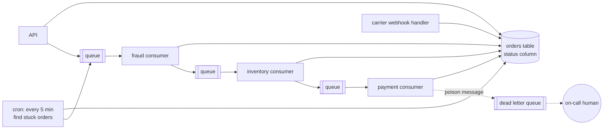

# 01 — Why durable execution exists

## A Tuesday afternoon order

Alice clicks "Place order" for a pair of $199.99 headphones. Here is what has
to happen, in order:

1. Check the order for fraud.
2. Reserve one unit of stock so nobody else buys the last pair.
3. Charge her card.
4. Send a confirmation email.
5. Buy a shipping label and hand the box to the carrier.
6. Wait for the carrier to tell us it was delivered. Could be two days, could be nine.
7. Three days after delivery, email her asking for a review.

Written as plain Python, that's about fifteen lines:

```python
async def place_order(order):
    risk = await fraud_service.check(order)
    if risk == "reject":
        return "rejected"
    await inventory.reserve(order)
    await payments.charge(order)
    await email.send(order, "confirmed")
    label = await carrier.buy_label(order)
    await wait_for_delivery(label)          # days
    await asyncio.sleep(3 * 24 * 3600)      # three more days
    await email.send(order, "review_request")
```

It reads beautifully and it is wrong in at least a dozen ways. Let's break it.

## Ten ways the simple version fails

**The process restarts.** You deploy on Thursday. Every order sitting at line
8 or 9 (waiting for delivery, waiting three days) is gone. Nothing in memory
survives a restart, and in production something restarts every day: deploys,
autoscaling, OOM kills, spot instance reclamation, kernel patches.

**The payment gateway returns a 503.** Now you need a retry. How many times?
With what backoff? What if it's a 402 "card declined" instead — retrying that
is pointless, and retrying it 50 times might get the merchant account flagged.

**The charge succeeds but the response is lost.** The network drops after
Stripe captured the money but before your code saw the 200. Your retry charges
Alice twice.

**Stock was reserved, then the card was declined.** The headphones stay
reserved forever unless someone writes the "release" code and makes sure it
runs even if the process dies right after the decline.

**The carrier webhook arrives while the process is down.** Who receives it?
Where does it go? How does the right in-flight order find out?

**Alice wants to cancel.** She clicks Cancel at minute four. The order is at
"charging card." How does a request from the outside world reach this
particular running function, safely, without a race with the charge?

**An analyst needs to look at a suspicious order.** The function has to pause
for hours until a human decides, and must give up and reject the order if
nobody decides within a day.

**Support asks "where is order ORD-1001?"** The only accurate answer lives in
the local variables of some coroutine on some machine.

**You fix a bug in step 5.** There are 40,000 orders currently somewhere
between step 1 and step 7. Which version of the code do they continue with?

**A three-day sleep.** `asyncio.sleep(259200)` on a pod that gets rescheduled
every few hours is a sleep that never ends.

## What teams usually build instead

Nobody ships the fifteen-line version. They ship something like this:



The business logic is now smeared across a state column, five consumers, a
cron job, retry configuration in three different places, and a dead letter
queue that someone checks when a customer complains. Every step has to:

* load state from the database,
* check it's in the right status,
* do its thing,
* write the new status,
* publish the next message,
* and get the ordering of those last two right, or you need an outbox table.

The original fifteen lines of intent are still in there somewhere, but you
can't read them anymore. Ask "what happens to an order after it's paid?" and
the answer is "grep for `status = 'PAID'`."

This is the most common architecture in the industry, and it works. It's also
where most of the bugs live.

## Durable execution, in one sentence

> Write the fifteen-line version, and have a runtime guarantee that it runs to
> completion, exactly as written, no matter what crashes along the way.

That's the whole idea. The function is still a function. Its local variables
still hold the order state. `await asyncio.sleep(3 days)` still means three
days. But now:

* Every step that touches the outside world is recorded in a durable log
  before the function moves past it.
* If the machine dies, another machine rebuilds the function's state from the
  log and continues from the exact line it was on.
* Retries, timeouts and backoff are declared next to each call, and the
  runtime enforces them.
* The outside world can send messages into the running function, and ask it
  questions, by its ID.

Temporal is the most widely used implementation of this idea. It started as
Cadence at Uber (2017), where it ran things like trip and payment workflows,
and was forked into Temporal in 2019 by the same engineers. It's open source
(MIT), runs as a self-hosted cluster or as Temporal Cloud, and has SDKs for Go,
Java, Python, TypeScript, .NET, PHP and Ruby.

## What the order looks like on Temporal

Here's the shape of `OrderFulfillmentWorkflow.run` from this project, with
the error handling stripped out so you can see the skeleton:

```python
@workflow.run
async def run(self, order: OrderInput) -> OrderView:
    await self._fraud_check()            # child workflow, may wait for a human
    await self._reserve_inventory()      # activity + registers its undo
    await self._charge_payment()         # activity + registers its undo
    await self._notify("order_confirmed", ...)
    await self._ship()                   # child workflow, waits for carrier signals
    await workflow.sleep(timedelta(days=3))
    await self._notify("review_request", ...)
```

It's the fifteen-line version. The difference is everything that's no longer
your problem:

| Problem from above | Who handles it now |
|---|---|
| Process restarts | Temporal replays history on another worker and continues |
| 503 from the gateway | `RetryPolicy` on the activity, exponential backoff, enforced by the server |
| Card declined | `ApplicationError(non_retryable=True)` stops retries immediately |
| Lost response after a charge | The activity is retried; your idempotency key makes the retry safe (chapter 07) |
| Releasing stock after a decline | Saga compensation in an `except` block — it runs even if a worker dies mid-way (chapter 08) |
| Carrier webhook | A Signal to `shipment-{order_id}` — buffered in history even if no worker is running |
| Cancel | A Signal; the workflow checks it at defined points |
| Human review with deadline | `workflow.wait_condition(..., timeout=24h)` |
| "Where is my order?" | A Query, answered from the workflow's live state |
| Bug fix with 40k orders in flight | Versioning with `workflow.patched()` (chapter 11) |
| Three-day sleep | A durable timer stored on the server |

## What durable execution is not

It's worth being precise, because the marketing version ("your code can't
fail!") sets people up for confusion.

**It is not exactly-once execution of side effects.** Activities run *at least
once*. If a worker charges a card and dies before reporting back, Temporal
will run the activity again. Temporal guarantees the *workflow logic* sees
each activity's result exactly once; making the *side effect* idempotent is
your job. Chapter 07 is all about this.

**It is not a database.** Workflow state lives in event histories that are
deleted after the namespace's retention period. If other systems need to read
order data, write it somewhere (this project's `save_order_snapshot`).

**It is not a message queue.** It uses queues internally, and it can replace a
lot of queue-based choreography, but it's not where you'd put a high-volume
event stream. Kafka and Temporal are friends: a Kafka consumer is often what
starts or signals workflows.

**It is not free.** Every step writes to a durable store. A workflow is heavier
than a function call; it's in the same cost class as a database transaction.
That's fine for orders, payments, onboarding, AI agent runs and data
pipelines. It's silly for "add two numbers."

**It does not make your code deterministic for you.** Workflow code has rules
(chapter 05). Break them and replay fails.

## When to reach for it

Good fits — long-lived, multi-step, must-finish processes that cross systems:

* order fulfillment, payments, refunds, chargebacks
* onboarding / KYC flows with human steps
* infrastructure provisioning and deploys
* data and ML pipelines (each stage as an activity)
* AI agents: every LLM call and tool call becomes a durable, retried step,
  and a human approval can pause the agent for days (chapter 12)
* anything you're currently doing with "status column + cron + queue"

Poor fits:

* request/response handlers that finish in 50 ms and can just be retried by
  the client
* very high-throughput stream processing (millions of tiny events per second)
* pure computation with no external calls and no need to survive a crash

## Where to go next

Chapter 02 gives you the vocabulary: workflow, activity, worker, task queue,
event history. Chapter 03 then opens the hood and shows exactly what the
server and your worker say to each other — that's the chapter that makes
everything else click.
