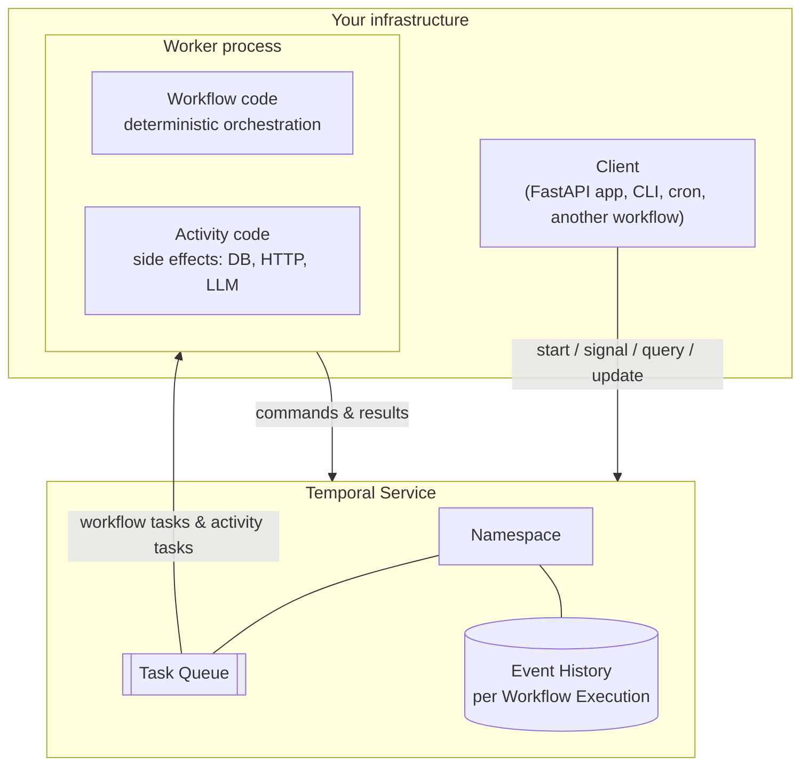

# 02 — Core concepts

Temporal has a small core vocabulary. Learn these ten words well and the rest
of the docs become easy to read.



## 1. Workflow

A **workflow** is a function that orchestrates work. In Python it's a class
with `@workflow.defn`, and one method marked `@workflow.run`:

```python
@workflow.defn
class OrderFulfillmentWorkflow:
    @workflow.run
    async def run(self, order: OrderInput) -> OrderView:
        ...
```

Two different things share the word:

* the **workflow definition** — the code above, and its **workflow type**
  (the name, `OrderFulfillmentWorkflow` by default);
* a **workflow execution** — one running instance of it. Alice's order is one
  execution, Bob's is another.

Each execution has a **workflow ID** that you choose (`order-ORD-1001`) and a
**run ID** that Temporal generates. The workflow ID is your business key and
the thing you'll use to find, signal and query the execution. Temporal
guarantees that at most one *open* execution exists per workflow ID in a
namespace, which is a powerful deduplication tool: the API in this project
derives the workflow ID from the client's Idempotency-Key, so a retried POST
can't create a second order.

Workflow code has one big rule: **it must be deterministic**. Given the same
inputs and the same history of results, it must make the same decisions in
the same order. No reading the clock, no random numbers, no network calls, no
threads. Anything like that goes into an activity. Chapter 05 explains why in
depth; for now, think of workflow code as the conductor who never plays an
instrument.

A workflow can live for milliseconds or for years. It can sleep, wait for
messages, start child workflows and call activities.

## 2. Activity

An **activity** is a normal function that does one thing that touches the
outside world: write to a database, call Stripe, send an email, call an LLM.

```python
@activity.defn
async def charge_payment(req: ChargeRequest) -> PaymentReceipt:
    ...
```

Activities can do anything normal Python can do. In exchange, Temporal
treats them as unreliable: they can time out, fail, and be retried, and the
workflow declares how:

```python
receipt = await workflow.execute_activity(
    charge_payment,
    ChargeRequest(...),
    start_to_close_timeout=timedelta(seconds=30),
    retry_policy=PAYMENT_RETRY,
)
```

When the activity succeeds, its result is written to the workflow's history.
After that, no matter how many times the workflow is replayed, it will never
run that activity again — it reads the recorded result.

Activities run **at least once**. Make them idempotent. (Chapter 07.)

## 3. Worker

A **worker** is a process you run (on your laptop, in Kubernetes, on ECS — it's
just a Python process) that hosts your workflow and activity code. It
connects *out* to the Temporal service and long-polls for work.

```python
Worker(
    client,
    task_queue="shopsphere-orders",
    workflows=[OrderFulfillmentWorkflow, ShipmentWorkflow],
    activities=[reserve_inventory, charge_payment, ...],
)
```

Three things surprise people:

1. **The Temporal server never runs your code.** It stores histories and hands
   out tasks. Your code runs only in your workers. This is why Temporal can't
   leak your secrets: API keys live in the worker's environment.
2. **Workers are stateless and disposable.** Kill one at any time. Another
   worker on the same task queue picks up its work. Our test
   `test_worker_crash_mid_order_is_invisible_to_the_customer` does exactly this.
3. **Workers connect outbound only.** No inbound ports to open, no load
   balancer in front of them. Scale by running more copies.

## 4. Task queue

A **task queue** is a named, lightweight queue inside Temporal that workers
poll. You don't create them; they spring into existence when someone polls or
schedules onto them.

Task queues are how you route work. This project uses two:

* `shopsphere-orders` — the order saga, shipments, replenishment. Cheap, fast,
  must always be up.
* `shopsphere-ai` — fraud scoring and the support agent. Holds the LLM API
  keys, rate limited by the provider, deployed more often.

The order workflow calls the fraud workflow *by name* on the AI queue:

```python
await workflow.execute_child_workflow(
    "FraudAssessmentWorkflow", fraud_input,
    task_queue=order.ai_task_queue, ...
)
```

so the orders worker never imports LangChain, and you can scale or redeploy
the AI fleet without touching order processing.

Every worker polling a given task queue must be able to run every workflow
and activity type that gets scheduled on it. If an activity is scheduled on a
queue whose workers don't register it, the task fails with "activity type not
registered" and retries until a capable worker shows up.

## 5. Event history

Every workflow execution has an **event history**: an append-only log of
everything that happened to it. This is the heart of Temporal. Here are the
first events of a real order from this project (full version in appendix A):

```
   1  WORKFLOW_EXECUTION_STARTED           OrderFulfillmentWorkflow
   2  WORKFLOW_TASK_SCHEDULED
   3  WORKFLOW_TASK_STARTED
   4  WORKFLOW_TASK_COMPLETED
   5  UPSERT_WORKFLOW_SEARCH_ATTRIBUTES
   6  UPSERT_WORKFLOW_SEARCH_ATTRIBUTES
   7  ACTIVITY_TASK_SCHEDULED              save_order_snapshot
   8  ACTIVITY_TASK_STARTED
   9  ACTIVITY_TASK_COMPLETED
  ...
  20  START_CHILD_WORKFLOW_EXECUTION_INITIATED   FraudAssessmentWorkflow
  ...
  42  ACTIVITY_TASK_SCHEDULED              charge_payment
  43  ACTIVITY_TASK_STARTED
  44  ACTIVITY_TASK_COMPLETED
```

The history *is* the state. There's no separate "current state" record that
can drift out of sync with it. To know where a workflow is, replay its
history through the workflow code.

## 6. Commands and events

When your workflow code calls `execute_activity`, it doesn't call anything.
It produces a **command** ("please schedule activity charge_payment with this
input"). The worker sends the batch of commands to the server at the end of a
**workflow task**; the server turns each into an **event**
(`ACTIVITY_TASK_SCHEDULED`) and acts on it.

| Your code does | Command sent | Event(s) recorded |
|---|---|---|
| `execute_activity(...)` | ScheduleActivityTask | ActivityTaskScheduled → Started → Completed / Failed / TimedOut |
| `workflow.sleep(d)` | StartTimer | TimerStarted → TimerFired |
| `execute_child_workflow(...)` | StartChildWorkflowExecution | StartChildWorkflowExecutionInitiated → ChildWorkflowExecutionStarted → …Completed |
| `upsert_search_attributes(...)` | UpsertWorkflowSearchAttributes | UpsertWorkflowSearchAttributes |
| `workflow.patched("x")` (first time) | RecordMarker | MarkerRecorded |
| `return value` | CompleteWorkflowExecution | WorkflowExecutionCompleted |
| `workflow.continue_as_new(...)` | ContinueAsNewWorkflowExecution | WorkflowExecutionContinuedAsNew |

Things that come from the outside produce events without a command: a signal
becomes `WorkflowExecutionSignaled`, an update becomes
`WorkflowExecutionUpdateAccepted` and later `…UpdateCompleted`, a cancel
request becomes `WorkflowExecutionCancelRequested`.

## 7. Workflow task and activity task

The server hands workers two kinds of task:

* a **workflow task** says: "something happened to workflow X (an activity
  finished, a timer fired, a signal arrived). Run the workflow code forward
  until it's blocked again, and tell me what commands it produced." Workflow
  tasks are short — they're just your orchestration code running until the
  next `await` that can't be satisfied yet. Default timeout: 10 seconds.
* an **activity task** says: "run activity Y with this input and tell me the
  result." These can take as long as you allow.

The repeated `WORKFLOW_TASK_SCHEDULED / STARTED / COMPLETED` triplets in the
history above are workflow tasks. Each one is a moment where your workflow
code woke up, made progress, and went back to sleep.

## 8. Messages: signals, queries, updates

Running workflows can be talked to:

* **Signal** — fire-and-forget message that may change state. Recorded in
  history. The carrier webhook signals `carrier_event` into the shipment
  workflow.
* **Query** — read-only question, answered from the workflow's in-memory
  state. Not recorded. `GET /orders/{id}` is a query.
* **Update** — a request that may change state *and* returns a result, with
  an optional validator that can reject it before anything is recorded. The
  address change and every support chat message are updates.

Chapter 09 goes deep, including when to pick which.

## 9. Namespace

A **namespace** is the unit of isolation inside a Temporal service: workflow
IDs are unique per namespace, task queues are per namespace, and retention
(how long closed histories are kept), access control, archival and custom
search attributes are configured per namespace. Typical setups use one
namespace per environment per team, like `orders-prod` and `orders-staging`.
The dev server comes with `default`.

## 10. Temporal Service, client, and SDK

* The **Temporal Service** (often still called "the server" or "the cluster")
  is the backend: a set of Go services plus a database. You run it yourself or
  use Temporal Cloud. Chapter 03 opens it up.
* A **client** is anything that talks to the service through the SDK's
  `Client`: starts workflows, sends signals, runs queries. The FastAPI app is
  a client. Workers also contain a client.
* The **SDK** (`temporalio` on PyPI) is the library your code uses. The Python
  SDK is built on a shared Rust core (`sdk-core`) that also powers the
  TypeScript, .NET and Ruby SDKs, which handles the state machines and
  networking; the Python layer gives you the decorators and asyncio integration.

## Supporting concepts you'll meet soon

**Timer** — `await workflow.sleep(...)` or a `timeout=` on `wait_condition`.
Stored on the server, so a three-day timer costs nothing while it waits.

**Child workflow** — a workflow started by another workflow. Has its own ID
and history. `FraudAssessmentWorkflow` and `ShipmentWorkflow` are children of
the order workflow.

**Continue-as-new** — atomically finish this run and start a fresh run of the
same workflow ID with new input. How long-lived workflows keep their history
short. The support session uses it.

**Schedule** — Temporal's cron, with pause, backfill, overlap policies and a
UI. The replenishment job runs on one.

**Search attributes** — indexed key/value pairs on an execution that you can
query with SQL-like filters: `OrderStatus='PENDING_REVIEW' AND CustomerId='CUST-BOB'`.
Requires the attributes to be registered on the namespace first.

**Data converter** — how your Python objects become bytes in history. The
default handles JSON-able types and dataclasses. You can add a codec to
compress or encrypt every payload.

**Retry policy** — initial interval, backoff coefficient, maximum interval,
maximum attempts, and a list of non-retryable error types. Applies to
activities by default; workflows don't retry unless you ask them to.

## A mental model that holds up

Picture each workflow execution as a **tape** (the history) and your workflow
code as a **deterministic player** that can play the tape back from the start
at any time and arrive at exactly the same place. Workers are the machines
that hold the player. Machines can be swapped at any moment; the tape lives on
the server. Activities are the only part of the system that talks to the real
world, and their outcomes get spliced onto the tape so the player never needs
to talk to the world twice.

Keep that picture in mind for the next chapter, where we watch the tape being
recorded.
