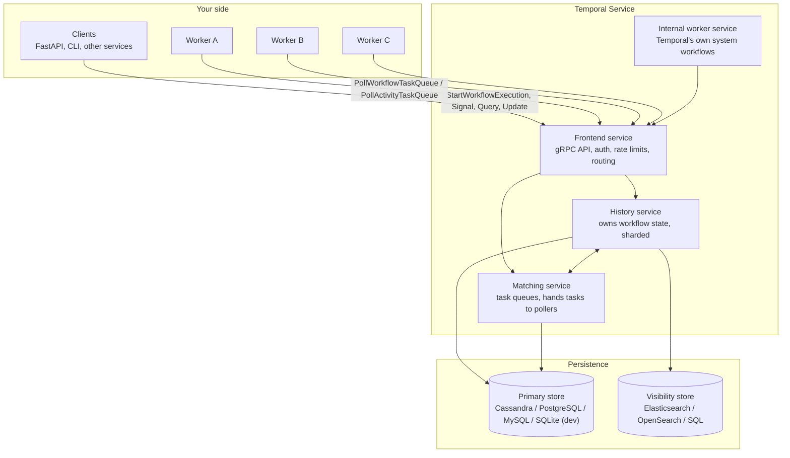
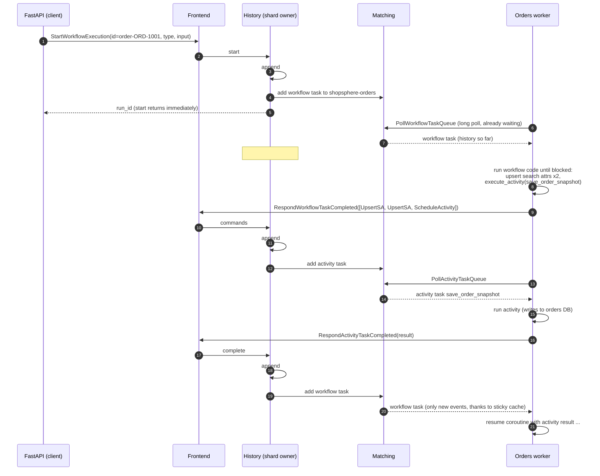
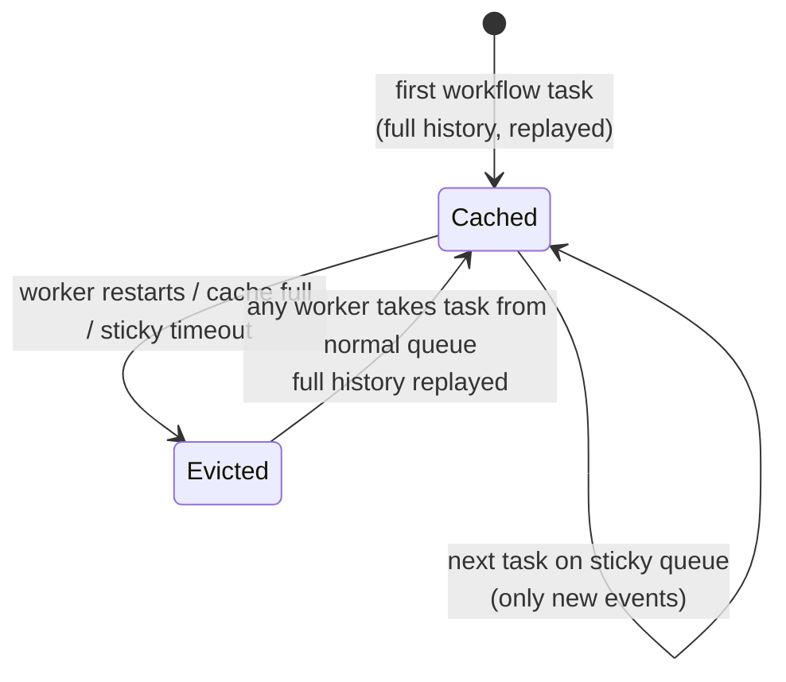
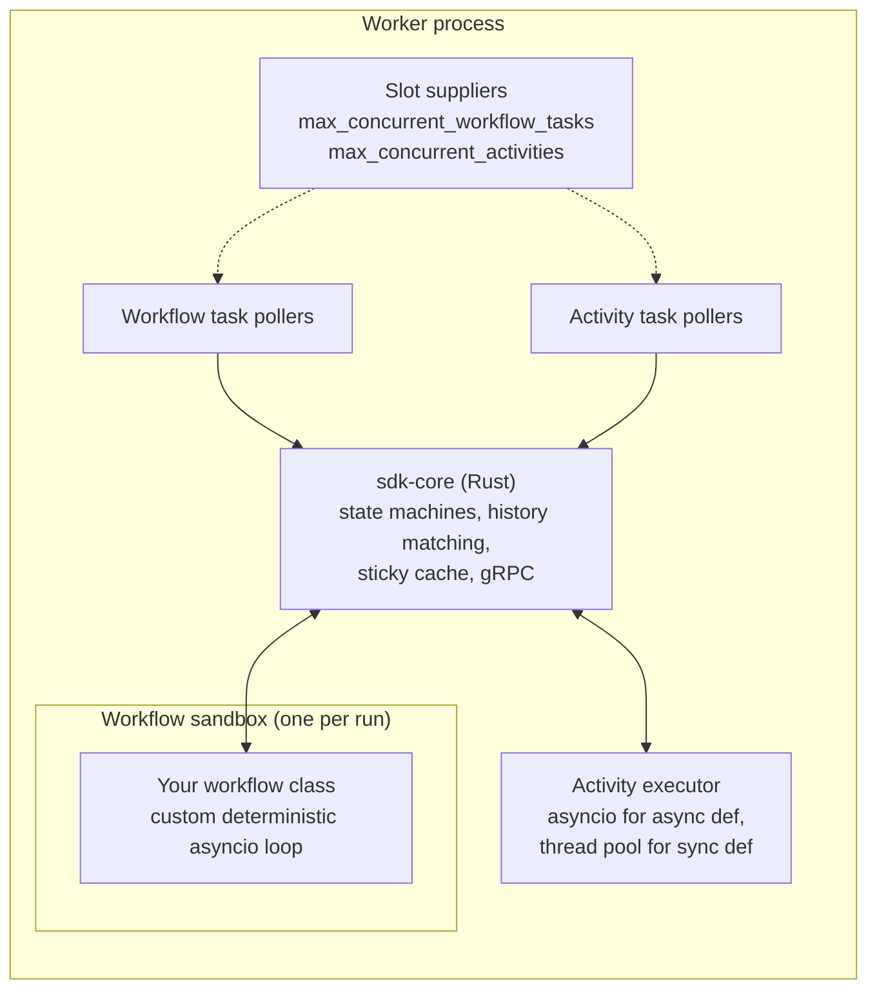

# 03 — Architecture: what actually happens

This chapter follows one order through the system at the level of RPCs and
database writes. Once you've seen it, the rules in later chapters stop
feeling arbitrary.

## The big picture



### Frontend

The only door in. Every SDK call — start, signal, query, poll — is a gRPC
request to the frontend. It authenticates, applies per-namespace rate limits,
validates, and routes to the right history shard or matching partition. It's
stateless; you run several behind a load balancer.

### History service

Where workflow state actually lives. History is **sharded**: each workflow
execution is assigned to one of N shards by hashing its namespace and
workflow ID, and each shard is owned by exactly one history host at a time.
That gives Temporal single-writer semantics per workflow without distributed
locks — every change to Alice's order goes through one shard owner, in order.

For each execution the history service keeps:

* the **event history** (append-only), and
* **mutable state**: a compact summary of what's pending right now (which
  activities are outstanding, which timers are set, what the next event ID
  is). It's derived from the history and kept alongside it so the server
  doesn't need to read the whole history to make a decision.

It also owns durable internal queues per shard — a *transfer queue* for
"push this task to matching" and a *timer queue* for "wake this up at time T".
Your three-day `workflow.sleep` is a row in a timer queue, and a 30-second
activity timeout is too.

The number of shards is fixed when the cluster is created (the dev server uses
a small number; production clusters typically use hundreds to thousands) and
cannot be changed later without migrating. It's the main knob of how far a
self-hosted cluster can scale.

### Matching service

Manages task queues. When history says "schedule activity `charge_payment`
on `shopsphere-orders`", matching is what holds that task until a worker
polls for it. Busy task queues are split into partitions spread across
matching hosts.

If a worker is already waiting in a long poll when a task arrives, matching
hands it over directly in memory ("sync match"). If not, the task is
persisted to the backlog and delivered when a poller shows up. A growing
backlog with a steadily rising schedule-to-start latency is the classic sign
you need more workers.

### Internal worker service

Temporal uses itself. Some features are implemented as system workflows that
run inside the cluster's own worker service: things like batch operations
(bulk signal / cancel / terminate), archival and, in many versions, the
machinery behind Schedules. You don't interact with it directly.

### Persistence

Two stores:

* the **primary store** holds histories, mutable state, task queues and timer
  queues. Supported: Cassandra, PostgreSQL, MySQL; SQLite for the dev server.
  This is the source of truth.
* the **visibility store** holds the searchable index of executions —
  workflow type, status, start/close time and your custom search attributes.
  It backs "list workflows" and the UI's search box. Elasticsearch/OpenSearch
  or SQL. It's eventually consistent with the primary store, which is why the
  visibility test in this project polls for a moment before asserting.

## The life of an order, step by step

Here is what happens when the API places Alice's order, up to the point where
the first activity completes. The event IDs match the real history in
appendix A.



Some details worth staring at:

**Starting a workflow does not run it.** The API gets the run ID back as soon
as events #1 and #2 are durable. Whether a worker is up or not doesn't matter
for the caller. If every worker is down for an hour, the workflow simply
starts an hour later.

**Workflow code produces commands, not effects.** In step 7 the worker ran the
workflow code from the top until it hit an `await` that couldn't resolve
(waiting for the snapshot activity). Everything it wanted to do in the
meantime was collected as commands and sent in one batch. Then the coroutine
was suspended.

**`ACTIVITY_TASK_STARTED` is written late.** Look at the history: started and
completed appear together. Temporal doesn't write the "started" event when the
worker picks up the task; it writes it when the attempt finishes (or the
activity finally fails after all retries). That keeps retries from bloating
history: an activity that took 7 attempts still produces three events. The
attempt number is recorded on the started event. You can see an extreme case
in the shipment child's history, where `ACTIVITY_TASK_SCHEDULED` is event 5,
three signals arrive (events 6–17), and only then do 18/19 started/completed
appear.

**Long polling.** Workers sit in a poll request for up to about a minute. When
work arrives it's delivered instantly; when the poll times out, the worker
simply polls again. That's why there's no added latency and no inbound
connection to the worker.

## Sticky execution and the workflow cache

Rebuilding a workflow by replaying its full history on every workflow task
would be wasteful. So workers keep recently used workflows in memory (the
**workflow cache**, `max_cached_workflows` on the Worker), suspended at their
`await`.

After a worker completes a workflow task, the server routes the *next*
workflow task for that execution to a worker-specific **sticky queue**.
If that same worker picks it up, it sends just the new events and the worker
resumes the cached coroutine — no replay.

If the worker doesn't pick up the sticky task within a few seconds (it
crashed, or it's overloaded), the server moves the task back to the normal
queue. Any worker can take it — but that worker has no cached state, so the
server sends the full history and the worker **replays** the workflow from
the beginning to rebuild it. This fallback is the whole durability story in
one move.



## Replay, concretely

Replay is the mechanism behind everything, so let's do one by hand. Suppose
the orders worker that was running Alice's order crashes right after the
charge succeeded. The history at that moment ends with:

```
  42  ACTIVITY_TASK_SCHEDULED     charge_payment
  43  ACTIVITY_TASK_STARTED
  44  ACTIVITY_TASK_COMPLETED     result: {"payment_id": "PAY-ORD-1001", ...}
  45  WORKFLOW_TASK_SCHEDULED
```

Event 45 means "a worker needs to process the activity result". The crashed
worker never responded, so after the workflow task timeout another worker
gets it, with the full history. It creates a fresh `OrderFulfillmentWorkflow`
instance and runs `run()` from the top, in **replay mode**:

| Workflow code | Replay engine |
|---|---|
| `upsert_search_attributes(...)` | matches recorded event #5 — no-op |
| `_set_status(RECEIVED)` → `execute_activity(save_order_snapshot)` | matches #7; result taken from #9; activity **not** executed |
| `execute_child_workflow("FraudAssessmentWorkflow")` | matches #20; result from #25; child **not** restarted |
| `execute_activity(reserve_inventory)` | matches #29; result from #31; stock **not** touched again |
| `execute_activity(charge_payment)` | matches #42; result from #44; card **not** charged again |
| `_notify("order_confirmed")` → `execute_activity(send_notification)` | **no matching event** — this is new. Replay ends; the worker is now live and emits a ScheduleActivityTask command |

By the time the engine reaches the end of history, the fresh instance has
exactly the same local variables (`self._status`, `self._compensations`,
`self._fraud`...) as the one that died. Including the lambdas in the
compensation list — they were re-created by the replayed code, not
deserialized. That's why workflow state doesn't need to be serializable: it's
re-derived.

This only works if the code makes the *same calls in the same order* when it
sees the same history. If during replay the code tried to schedule
`reserve_inventory` where the history says `charge_payment` was scheduled, the
SDK can't line them up and raises a **non-determinism error**. That's the
subject of chapter 05.

## What happens when things fail

| Failure | What Temporal sees | What happens |
|---|---|---|
| Worker dies while running a workflow task | No response within the workflow task timeout (10 s default) | Task re-dispatched; another worker replays and continues |
| Worker dies while running an activity | No response within `start_to_close_timeout` — or no heartbeat within `heartbeat_timeout` | Activity attempt marked timed out, retried per `RetryPolicy` |
| Activity raises an exception | `RespondActivityTaskFailed` | Retried per policy unless the error type is non-retryable; after the last attempt the workflow's `await` raises `ActivityError` |
| No worker polling the queue | Tasks pile up in matching | Nothing breaks; work resumes when a worker appears. Monitor schedule-to-start latency |
| Workflow code throws an unexpected Python exception | Workflow task failure | The **workflow task** is retried (not the workflow failed) — you can deploy a fix and it resumes. Only `ApplicationError` (and some Temporal errors) fail the workflow |
| Non-determinism detected | Workflow task failure | Same — retried until you deploy compatible code or reset the workflow |
| A history shard host dies | Shard ownership moves to another host | Brief latency blip; no data loss (state is in the DB) |
| The database is unavailable | Frontend returns errors | SDKs retry; workers back off. Nothing progresses until the DB is back |

The fifth row deserves emphasis because it's different from most frameworks:
a bug in workflow code (say, a `KeyError`) does **not** fail the workflow. The
workflow task fails and is retried, and the workflow sits there, showing the
error in the UI, until you ship a fix. Then it carries on as if nothing
happened. Workflow *failure* is something you ask for explicitly by raising
`ApplicationError`. (You can change this per workflow with
`failure_exception_types` if you prefer to fail fast.)

## Inside the Python worker



* **Pollers** hold open long-poll requests. Only as many tasks are polled as
  there are free **slots**, so a worker never takes more work than it can do.
  This is how `max_concurrent_activities=8` on the AI worker protects the LLM
  provider's rate limit: the 9th fraud check waits in Temporal's queue, not in
  a 429 retry loop.
* **sdk-core** is shared Rust code that does the hard parts: matching
  commands to history during replay, deciding when replay is over, managing
  the sticky cache.
* **The workflow sandbox** runs each workflow in a fresh module namespace with
  restricted imports and a custom event loop. The loop only advances when
  sdk-core feeds it events, which is what makes `asyncio` usable in
  deterministic code. More in chapter 05.
* **Activities** run on the worker's normal asyncio loop (async def) or a
  thread pool you provide (plain def). They're unrestricted.

## Visibility and search

Every execution's type, status, timestamps and search attributes are copied
into the visibility store. That's what powers:

```python
client.list_workflows("WorkflowType='OrderFulfillmentWorkflow' AND OrderStatus='PENDING_REVIEW'")
```

and the same query typed into the UI. This project registers two custom
keyword attributes — `OrderStatus` and `CustomerId` — and upserts them from
the workflow (`ORDER_STATUS_KEY.value_set(...)`). The dev server registers them
with `--search-attribute OrderStatus=Keyword`; on a real cluster you'd run
`temporal operator search-attribute create`.

Two rules of thumb:

* Visibility is **eventually consistent**. Don't use it as the source of
  truth for a decision; query the workflow, or keep your own read model.
* Search attributes are for **finding** workflows, not storing data. Keep them
  few and small.

## Temporal Cloud vs self-hosted

The programming model is identical. The difference is who operates the four
services and the two databases. With Temporal Cloud you get a namespace
endpoint and mTLS or API-key credentials; your workers run in your own
infrastructure either way, so your code and secrets never leave it. Chapter
14 covers both.

## Recap

* The server stores histories and hands out tasks. Your code only runs in your
  workers.
* Workflow code runs in short bursts (workflow tasks) and emits commands; the
  server records them as events.
* Workers cache workflows; when a cache is lost, replay rebuilds the exact
  state from history.
* Replay skips completed activities by reading their recorded results. That's
  why activities run once (per success) and workflow code must be
  deterministic.
* A bug in workflow code pauses the workflow rather than failing it.
