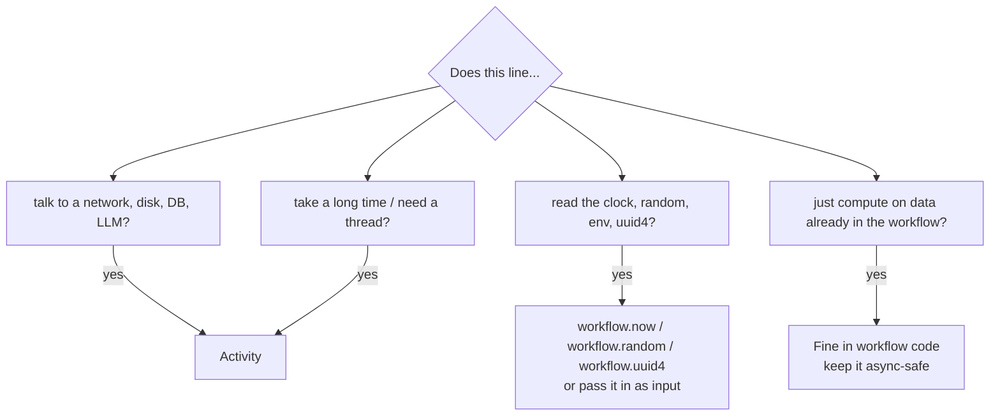

# 05 — Determinism and replay

Every Temporal course has this chapter and every Temporal user has to learn
it once, usually after a production incident. Let's do it before.

## The rule

> Workflow code, given the same input and the same sequence of recorded
> events, must issue the same commands in the same order.

That's it. Everything else in this chapter is a consequence.

Why? Because of replay (chapter 03). When a worker rebuilds a workflow, it
runs your code from the top and checks each command against history. Event
#42 says "activity `charge_payment` was scheduled". If on replay the code
asks to schedule `refund_payment` at that point, the SDK has two incompatible
versions of the past and no way to reconcile them. It stops and raises a
**non-determinism error** (NDE).

## What actually gets compared

It's narrower than people fear. Replay compares the **sequence of commands**:
schedule activity X, start timer, start child Y, signal external Z, record
marker, upsert search attributes, complete. It checks the *type* and *identity*
(activity type, child workflow type, timer, and so on) in order.

What does **not** need to match:

* log lines (`workflow.logger` is even replay-aware: it doesn't log during
  replay by default)
* local variables and in-memory computations
* the input *arguments* to activities, for the most part — changing a
  timeout or an argument value is tolerated by the matcher, though changing
  behaviour this way on in-flight workflows is still risky
* query handlers (they never produce commands)

So "deterministic" really means: **the decisions about what to do next must
be a pure function of the workflow input and the recorded results.**

## What breaks it

### 1. Reading the outside world in workflow code

```python
# BAD - different on replay
if datetime.now().hour > 17:
    await workflow.execute_activity(send_after_hours_notice, ...)

# GOOD - workflow.now() returns the time of the current workflow task, from history
if workflow.now().hour > 17:
    ...
```

Same story for random numbers, UUIDs, environment variables, files, HTTP
calls, database reads. The Python SDK's sandbox catches most of these. Here is
what it actually did when we probed it with SDK 1.34 (you can rerun this
yourself; the probe is described at the end of the chapter):

| Call inside workflow code | Result |
|---|---|
| `datetime.datetime.now()` | **blocked** — `RestrictedWorkflowAccessError` |
| `datetime.date.today()` | **blocked** |
| `time.time()` | **blocked** |
| `random.random()` | **blocked** |
| `uuid.uuid4()` | **blocked** |
| `open(...)` | **blocked** |
| `os.environ.get(...)`, `os.getenv(...)` | **blocked** |
| `threading.Thread(...).start()` | **blocked** |
| `await asyncio.to_thread(...)` | **fails** — `NotImplementedError` (no executor in the workflow loop) |
| `await asyncio.sleep(...)` | allowed — becomes a durable timer |
| `workflow.now()` | allowed — deterministic time |
| `workflow.random()` | allowed — seeded from history |
| `workflow.uuid4()` | allowed — derived from that seeded random |

The deterministic replacements:

| Instead of | Use |
|---|---|
| `datetime.now()` | `workflow.now()` |
| `time.time()` | `workflow.time()` |
| `random.*` | `workflow.random()` |
| `uuid.uuid4()` | `workflow.uuid4()` |
| `time.sleep()` / long `asyncio.sleep` | `await workflow.sleep(timedelta(...))` (or `asyncio.sleep`, which maps to the same timer) |
| reading env/config | pass it in the workflow input (see `OrderInput.ai_model`) |
| reading the DB / calling an API | an activity |
| threads, `run_in_executor` | an activity |

### 2. Iterating over something unordered

```python
# risky: set ordering of strings varies between processes (hash randomization)
for sku in set(skus):
    await workflow.execute_activity(reserve_one, sku, ...)

# fine
for sku in sorted(set(skus)):
    ...
```

Dicts preserve insertion order in Python, so they're fine as long as you
build them deterministically.

### 3. Non-deterministic concurrency

`asyncio.gather` of activities is fine: the commands are issued in the order
you wrote them. What isn't fine is racing on wall-clock time or on
`asyncio.wait(..., return_when=FIRST_COMPLETED)` with real-world inputs
outside the workflow's control. Inside the workflow, asyncio is deterministic
because the SDK runs its own event loop that only advances when history says
something happened.

### 4. Changing the code while workflows are running

This is the one that actually bites teams, because the code is fine — it's
just *different* from the code that recorded the history.

Say v1 of the order workflow went `reserve -> charge -> ship`, and you deploy
v2 that goes `reserve -> charge -> award_loyalty_points -> ship`. An order
that was at "ship" when you deployed has a history with `charge_payment`
followed by `StartChildWorkflowExecution(ShipmentWorkflow)`. Replaying it with
v2, the code wants to schedule `award_loyalty_points` where history has the
child workflow. NDE.

The fix is versioning — chapter 11. This project's order workflow already
contains one example:

```python
if workflow.patched("loyalty-points-v2"):
    points = await workflow.execute_activity(award_loyalty_points, ...)
```

On new executions `patched()` returns `True` and records a marker (the
`MARKER_RECORDED core_patch` event you can see at #61 in the real history).
On replay of an old execution that has no such marker at that point, it
returns `False`, so the old path is followed.

### 5. Sync code that wants a thread

This one is specific and worth a story, because it happened while building
this project. LangGraph runs synchronous node functions — and synchronous
conditional-edge routers — in a thread pool via `run_in_executor`. The fraud
graph originally had:

```python
def score_rules(state): ...          # pure, deterministic, runs in the workflow
def route_after_rules(state): ...    # also runs in the workflow
```

The first test run failed with:

```
File ".../langchain_core/runnables/config.py", in run_in_executor
    return await asyncio.get_running_loop().run_in_executor(
File ".../asyncio/events.py", in run_in_executor
    raise NotImplementedError
During task with name 'score_rules'
```

The functions were perfectly deterministic. The problem was *how* they were
called: the workflow's event loop has no thread pool, on purpose. The fix was
to make them `async def`. The rule generalises: anything that runs inside a
workflow must stay on the workflow's own event loop.

## The Python sandbox

The Python SDK runs each workflow in a **sandbox** to catch mistakes early:

* Your workflow module is re-imported in an isolated environment per workflow
  run, so module-level globals can't leak state between workflows (or between
  the original run and a replay).
* Known non-deterministic functions are wrapped to raise
  `RestrictedWorkflowAccessError` (the table above).
* Modules you mark as **passthrough** are imported once, normally, and shared.
  You want that for heavy libraries that are deterministic in how you use them
  (Pydantic models, your dataclasses, LangChain message classes) — reimporting
  them per workflow is slow and can break `isinstance` checks.

That's why every workflow file in this project imports its dependencies like
this:

```python
with workflow.unsafe.imports_passed_through():
    from shopsphere.activities.payments import charge_payment, refund_payment
    from shopsphere.models import OrderInput, OrderView
```

The activity *functions* are imported so you get type-safe references to pass
to `execute_activity`; they're never called inside the workflow. The
LangGraph and Deep Agents plugins add `langgraph`, `langchain` and
`deepagents` to the passthrough list for you, which is why `support_workflow.py`
can import `langgraph.types.Command` without ceremony.

If the sandbox gets in your way for a legitimate reason, you have escape hatches:

* `with workflow.unsafe.sandbox_unrestricted():` for a specific block
* `SandboxedWorkflowRunner(restrictions=...)` to customise restrictions
* `UnsandboxedWorkflowRunner()` to turn it off for a worker (not recommended;
  you lose the safety net)

The sandbox is a seatbelt, not a proof. It can't catch everything — for
example, iterating a `set` or calling a third-party library that reads the
clock internally through some path the sandbox doesn't wrap.

## Where the boundary goes, in practice

A good habit is to ask of each line in a workflow: "if I run this twice with
the same history, could the answer differ?" If yes, it's an activity.



In this project:

| Logic | Lives in | Why |
|---|---|---|
| Fraud rule scoring | workflow (`score_rules`, `execute_in="workflow"`) | pure function of state |
| Fetching customer history | activity (`collect_signals`) | DB read |
| LLM fraud opinion | activity (`llm_review`) | non-deterministic, slow, costs money |
| Deep Agent planning (`write_todos`) | workflow | pure agent state |
| Every LLM call of the support agent | activity (`deepagents.invoke_model`) | non-deterministic |
| Every support tool | activity (`activity_as_tool`) | DB / payment I/O |
| Saga bookkeeping | workflow | pure control flow |
| Timeline timestamps | workflow, via `workflow.now()` | deterministic clock |

## LLMs are the ultimate non-determinism

An LLM given the same prompt twice can return different answers. That's
not a problem for Temporal as long as the call is an activity: the *first*
answer is recorded in history, and on replay the workflow reads that recorded
answer instead of calling the model again. The agent's subsequent decisions
are therefore replayed exactly. This is the core reason agent frameworks
integrate with Temporal at the "one model call per activity" level, which is
exactly what the Deep Agents plugin does. Chapter 12 goes further.

## Testing for determinism

You don't have to wait for production to find NDEs. Temporal's `Replayer`
replays saved histories against your current code and fails if they
disagree. This project's `tests/test_durability.py` collects every completed
history from the test run and replays it:

```python
order_replayer = Replayer(workflows=[OrderFulfillmentWorkflow, ShipmentWorkflow])
for h in order_histories:
    await order_replayer.replay_workflow(h)  # raises on non-determinism
```

In a real team, export a sample of production histories regularly
(`temporal workflow show -o json`), commit them to a test fixtures folder, and
replay them in CI on every pull request that touches workflow code. That
single test catches the large majority of versioning mistakes before deploy.

## When an NDE happens anyway

1. The workflow doesn't fail. Its workflow task fails and keeps retrying. The
   UI shows a "Workflow Task Failed" with a non-determinism message. Customers
   see a stuck order, not a corrupted one.
2. Roll back the deploy (the old code replays fine) — or deploy a fix that
   uses `workflow.patched()` to restore the old path for old executions.
3. For executions you can't fix by code, `temporal workflow reset` rewinds to
   an earlier workflow task and re-runs from there with current code.
   Activities after the reset point run again, so make sure they're idempotent.

## Re-running the sandbox probe

The table at the top came from running a tiny workflow that tries each call
and catches the exception:

```python
@workflow.defn
class Probe:
    @workflow.run
    async def run(self, what: str) -> str:
        import datetime
        try:
            if what == "datetime.now":
                datetime.datetime.now()
            # ... one branch per call ...
            return "allowed"
        except BaseException as e:
            return f"BLOCKED: {type(e).__name__}"
```

Try adding your favourite library's calls to it. It's a quick way to find out
what's safe before you put it in a workflow.
