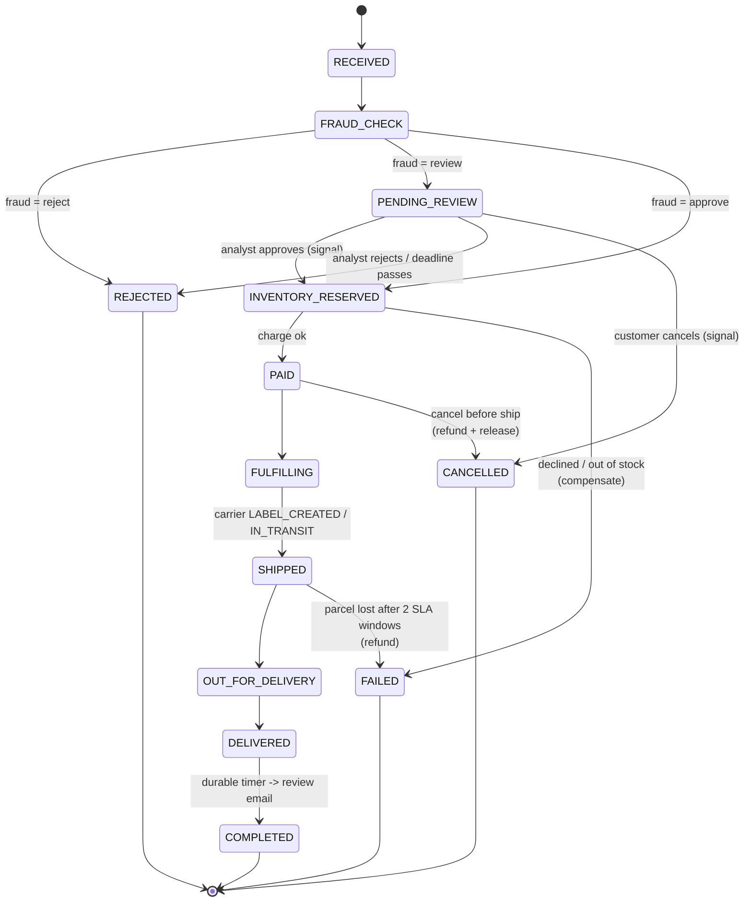

# 06 — The order workflow, line by line

Open `src/shopsphere/workflows/order_workflow.py` next to this chapter. We'll
walk it top to bottom and line each step up with the real event history of
order `ORD-1001` (the full history is in appendix A).

## The state machine you didn't have to write



In the queue-and-status-column world, every arrow in this diagram is a
consumer, a status check and a cron job looking for stuck rows. Here every
arrow is a line of Python, and the "current state" is simply where the
coroutine is suspended.

## `@workflow.init`: state before anything else

```python
@workflow.defn
class OrderFulfillmentWorkflow:
    @workflow.init
    def __init__(self, order: OrderInput) -> None:
        self._order = order
        self._status = OrderStatus.RECEIVED
        self._address = order.shipping_address
        ...
        self._compensations: list[_Compensation] = []
```

`@workflow.init` makes the constructor receive the same input as `run`, and
guarantees it runs before any handler. That matters because a signal can be
delivered in the very first workflow task, together with the start event
(signal-with-start does exactly that). Without `@workflow.init` a signal
handler could run before `run()` has set up the fields it touches.

Notice what's stored: plain Python attributes. No database. When a worker
replays this workflow, these get rebuilt by running the same code over the
same history.

## The run method

```python
@workflow.run
async def run(self, order: OrderInput) -> OrderView:
    if order.use_search_attributes:
        workflow.upsert_search_attributes([CUSTOMER_ID_KEY.value_set(order.customer_id)])
    await self._set_status(OrderStatus.RECEIVED, f"Order for ${order.total():.2f} received")
```

History:

```
   1  WORKFLOW_EXECUTION_STARTED           OrderFulfillmentWorkflow
   2  WORKFLOW_TASK_SCHEDULED
   3  WORKFLOW_TASK_STARTED
   4  WORKFLOW_TASK_COMPLETED
   5  UPSERT_WORKFLOW_SEARCH_ATTRIBUTES     <- CustomerId
   6  UPSERT_WORKFLOW_SEARCH_ATTRIBUTES     <- OrderStatus=RECEIVED (inside _set_status)
   7  ACTIVITY_TASK_SCHEDULED              save_order_snapshot
   8  ACTIVITY_TASK_STARTED
   9  ACTIVITY_TASK_COMPLETED
```

Event 1 carries the full `OrderInput` as its payload. Events 2–4 are the first
workflow task: the worker ran `run()` until it hit the `await` inside
`_snapshot()`, and returned three commands (two upserts and one schedule
activity) which became events 5, 6 and 7.

`_set_status` is a small helper used everywhere:

```python
async def _set_status(self, status: OrderStatus, detail: str) -> None:
    self._status = status
    self._event(status, detail)          # timeline entry, timestamped with workflow.now()
    self._upsert_status()                # search attribute for Visibility
    await self._snapshot()               # activity: write the read model
```

The snapshot activity writes the order to the `orders` table. The workflow is
the source of truth while the order is live; the table is a **read model** for
systems that shouldn't need Temporal to answer "what's in order X" — like the
support agent's `get_order_details` tool.

## Fraud check: a child workflow on another task queue

```python
self._fraud = await workflow.execute_child_workflow(
    "FraudAssessmentWorkflow",
    FraudInput(...),
    id=f"fraud-{order.order_id}",
    task_queue=order.ai_task_queue,
    result_type=FraudResult,
    execution_timeout=timedelta(minutes=10),
)
```

```
  20  START_CHILD_WORKFLOW_EXECUTION_INITIATED   FraudAssessmentWorkflow
  21  CHILD_WORKFLOW_EXECUTION_STARTED           FraudAssessmentWorkflow
  ...
  25  CHILD_WORKFLOW_EXECUTION_COMPLETED         FraudAssessmentWorkflow
```

Design decisions packed into this call:

* **By name, not by class.** `"FraudAssessmentWorkflow"` is a string, and
  `result_type=FraudResult` tells the SDK how to deserialize the result. The
  orders worker therefore never imports LangGraph. Different teams can own the
  two sides.
* **Deterministic child ID.** `fraud-{order_id}`. If anything retries, there
  can never be two fraud checks for one order.
* **Bounded wait.** `execution_timeout` of ten minutes. If the AI fleet is down
  longer than that, the child times out and the `except ChildWorkflowError`
  branch routes the order to manual review instead of losing the sale:

```python
except ChildWorkflowError as err:
    self._fraud = FraudResult("review", 0.5, [f"fraud service unavailable: {_root_cause(err)}"])
```

That's **graceful degradation written as an `except`**, which is the kind of
thing that's very hard to do cleanly with queues.

### Waiting for a human, with a deadline

```python
if fraud.decision == "review":
    await self._set_status(OrderStatus.PENDING_REVIEW, "Waiting for a fraud analyst")
    await self._notify("ops_review_needed", {...})
    try:
        await workflow.wait_condition(
            lambda: self._review is not None or self._cancel is not None,
            timeout=timedelta(seconds=order.review_timeout_seconds),
        )
    except TimeoutError:
        raise OrderRejected("No analyst decision before the review deadline")
```

`wait_condition` blocks until the lambda is true. The lambda is re-evaluated
every time the workflow wakes up — which happens when a signal arrives
(`submit_review` or `cancel` set the fields). The `timeout` is a durable timer;
you can see it in the history of the operator-cancelled order:

```
  42  TIMER_STARTED                        timer 30s
  43  WORKFLOW_EXECUTION_CANCEL_REQUESTED
  ...
  47  TIMER_CANCELED
```

In production that timeout would be 24 hours. While it waits, the order uses
no worker memory at all once it's evicted from the cache — it's one timer row
in the database.

## Reserve, then register the undo

```python
await workflow.execute_activity(
    reserve_inventory,
    ReserveRequest(order.order_id, order.items),
    start_to_close_timeout=timedelta(seconds=15),
    retry_policy=INVENTORY_RETRY,
)
self._compensations.append(_Compensation("release_inventory", lambda: workflow.execute_activity(release_inventory, ...)))
```

```
  29  ACTIVITY_TASK_SCHEDULED     reserve_inventory
  30  ACTIVITY_TASK_STARTED
  31  ACTIVITY_TASK_COMPLETED
```

`INVENTORY_RETRY` lists `OutOfStock` and `UnknownSku` as non-retryable: if
we're out of stock, retrying won't create stock, so the activity fails
immediately and the workflow moves to compensation. Chapter 08 discusses why
the inventory undo is registered *after* the reservation but the payment undo
is registered *before* the charge.

## Charge the card

```python
receipt = await workflow.execute_activity(
    charge_payment,
    ChargeRequest(order.order_id, order.customer_id, order.total(), order.payment_token),
    start_to_close_timeout=timedelta(seconds=30),
    retry_policy=PAYMENT_RETRY,
)
```

```python
PAYMENT_RETRY = RetryPolicy(
    initial_interval=timedelta(seconds=1),
    backoff_coefficient=2.0,
    maximum_interval=timedelta(seconds=30),
    maximum_attempts=8,
    non_retryable_error_types=["PaymentDeclined"],
)
```

With `tok_flaky`, attempts 1 and 2 raise `GatewayUnavailable` (a plain
exception, so retryable) and attempt 3 succeeds. In history you still see
exactly three events for the charge, with `attempt: 3` on the started event.
The workflow code has no retry loop and never even sees the first two
failures. That's the point: retry *policy* is configuration, not code.

With `tok_decline` the activity raises
`ApplicationError(type="PaymentDeclined", non_retryable=True)`, there's one
attempt, and the workflow's `await` raises `ActivityError` wrapping it.

## Versioned step: loyalty points

```python
if workflow.patched("loyalty-points-v2"):
    points = await workflow.execute_activity(award_loyalty_points, ...)
```

```
  61  MARKER_RECORDED                      core_patch
  62  UPSERT_WORKFLOW_SEARCH_ATTRIBUTES    <- TemporalChangeVersion
  63  ACTIVITY_TASK_SCHEDULED              award_loyalty_points
```

Event 61 is the patch marker. Event 62 is Temporal automatically adding
`loyalty-points-v2` to the built-in `TemporalChangeVersion` search attribute,
which lets you list which running executions are on which code path:
`TemporalChangeVersion = 'loyalty-points-v2'`. Chapter 11 is about this.

## Ship: a child that signals its parent

```python
self._shipment_started = True
self._compensations = [c for c in self._compensations if c.name != "release_inventory"]

result = await workflow.execute_child_workflow(
    ShipmentWorkflow.run,
    ShipmentInput(..., address=self._address, ...),
    id=f"shipment-{order.order_id}",
    task_queue=workflow.info().task_queue,
    parent_close_policy=ParentClosePolicy.ABANDON,
)
```

Three details:

1. `_shipment_started = True` closes the window for cancellation and address
   changes. The cancel signal handler and the update validator both check it.
2. The inventory compensation is removed. Once the box is on a truck,
   "release the reservation" is no longer a valid undo — releasing it would
   let us sell stock we no longer have. This is the saga's **pivot point**.
3. `ParentClosePolicy.ABANDON`: if someone terminates the order workflow, the
   shipment child keeps running. The parcel exists in the physical world; its
   tracking shouldn't die with a bookkeeping workflow. The default
   (`TERMINATE`) would kill it.

While the child runs, it forwards each carrier scan to the parent with a
signal through an external workflow handle:

```python
# shipment_workflow.py
handle = workflow.get_external_workflow_handle(parent.workflow_id, run_id=parent.run_id)
await handle.signal("shipment_progress", event)
```

Parent history:

```
  76  START_CHILD_WORKFLOW_EXECUTION_INITIATED   ShipmentWorkflow
  77  CHILD_WORKFLOW_EXECUTION_STARTED           ShipmentWorkflow
  81  WORKFLOW_EXECUTION_SIGNALED                shipment_progress   (LABEL_CREATED)
  86  WORKFLOW_EXECUTION_SIGNALED                shipment_progress   (IN_TRANSIT)
  91  WORKFLOW_EXECUTION_SIGNALED                shipment_progress   (OUT_FOR_DELIVERY)
  96  WORKFLOW_EXECUTION_SIGNALED                shipment_progress   (DELIVERED)
 100  CHILD_WORKFLOW_EXECUTION_COMPLETED         ShipmentWorkflow
```

The parent's `shipment_progress` handler updates `self._status` and the
`OrderStatus` search attribute so `GET /orders/{id}` shows `OUT_FOR_DELIVERY`
in real time, even though the parent itself is just waiting on the child.

## The three-day timer

```python
await workflow.sleep(timedelta(seconds=order.review_request_delay_seconds))
await self._notify("review_request", {"tracking": self._tracking})
await self._set_status(OrderStatus.COMPLETED, "Review request sent, order closed")
```

```
 117  TIMER_STARTED      timer 1s     (3 days in production)
 118  TIMER_FIRED
 ...
 122  ACTIVITY_TASK_SCHEDULED   send_notification
 ...
 135  WORKFLOW_EXECUTION_COMPLETED
```

Between 117 and 118 the worker can be redeployed any number of times. When
the timer fires, the server schedules a workflow task; whichever worker gets
it replays (or resumes from cache) and sends the email.

## Error handling: four kinds of ending

```python
try:
    ...
except OrderCancelled:          # customer cancel signal, checked at checkpoints
    await self._compensate()
    await self._set_status(OrderStatus.CANCELLED, ...)
except OrderRejected as rej:    # fraud reject, analyst reject, review deadline
    await self._compensate()
    await self._set_status(OrderStatus.REJECTED, str(rej))
except (ActivityError, ChildWorkflowError) as err:   # declined, out of stock, parcel lost
    self._failure = _root_cause(err)
    await self._compensate()
    await self._set_status(OrderStatus.FAILED, self._failure)
except asyncio.CancelledError:  # operator ran `temporal workflow cancel`
    await self._compensate()
    await self._set_status(OrderStatus.CANCELLED, "Cancelled by operator")
    raise
```

Things to notice:

* A declined card is a **business outcome**, not a workflow failure. The
  workflow completes normally with `status=FAILED` and a reason. In the
  Temporal UI it shows as *Completed*. Reserve Temporal-level failure for
  "this execution could not do its job and a human should look at it."
* `OrderCancelled` and `OrderRejected` are internal Python exceptions used for
  control flow. They never leave the workflow. That's fine — they're ordinary
  exceptions caught by ordinary `except` blocks during ordinary (replayable)
  execution.
* The operator-cancel branch re-raises `CancelledError` so the execution ends
  as *Canceled* in Temporal, which is accurate. Compensation activities still
  run inside the handler, because once the cancellation has been delivered to
  the workflow, new activities can be scheduled normally.
* `_root_cause` walks `ActivityError -> ApplicationError` to produce
  `"PaymentDeclined: Card was declined by the issuer"` for humans.

The declined-card history shows compensation in action:

```
  42  ACTIVITY_TASK_SCHEDULED     charge_payment
  43  ACTIVITY_TASK_STARTED
  44  ACTIVITY_TASK_FAILED                          <- PaymentDeclined, non-retryable
  ...
  48  ACTIVITY_TASK_SCHEDULED     refund_payment    <- registered before the charge; a no-op here
  54  ACTIVITY_TASK_SCHEDULED     release_inventory
  61  ACTIVITY_TASK_SCHEDULED     save_order_snapshot   (FAILED)
  67  ACTIVITY_TASK_SCHEDULED     send_notification     (order_failed)
  73  WORKFLOW_EXECUTION_COMPLETED
```

## Handlers

```python
@workflow.signal
def cancel(self, req: CancelRequest) -> None: ...

@workflow.signal
def submit_review(self, decision: ReviewDecision) -> None: ...

@workflow.signal
def shipment_progress(self, event: CarrierEvent) -> None: ...

@workflow.update
async def update_shipping_address(self, address: Address) -> OrderView: ...

@update_shipping_address.validator
def _validate_address(self, address: Address) -> None: ...

@workflow.query
def get_status(self) -> OrderView: ...
```

Signal handlers here are synchronous and tiny: record the message, let
`run()` react. That's the recommended style. The update handler is async and
even runs an activity (`_snapshot`). Chapter 09 explains the semantics and
the concurrency gotchas.

## The last line

```python
await workflow.wait_condition(workflow.all_handlers_finished)
return self._view()
```

If an update handler is in the middle of its `_snapshot()` activity when
`run()` reaches the end, returning would complete the workflow and the
update's caller would get an error. Waiting for `all_handlers_finished`
avoids that. The SDK warns you at runtime if a workflow finishes with
unfinished handlers.

## What you didn't see

There's no state table, no status column checks, no outbox, no message
broker, no cron job, no "find stuck orders" script, no retry loops, no
distributed lock. The order workflow is about 450 lines including comments,
and it covers fraud, human review with deadlines, cancellations, address
changes, retries, compensation, a pivot point, child workflows, live status,
search, versioning, and a multi-day timer.
