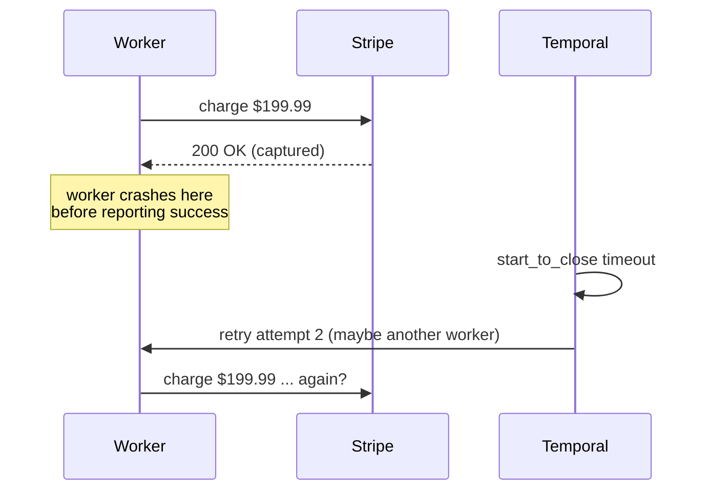

# 07 — Activities, retries, timeouts and idempotency

Workflows decide. Activities do. This chapter is about doing things in an
unreliable world without doing them twice.

## Anatomy of an activity

```python
@activity.defn
async def charge_payment(req: ChargeRequest) -> PaymentReceipt:
    info = activity.info()                       # attempt, workflow_id, activity_id, heartbeat details...
    activity.logger.info("Charging ... attempt %d", info.attempt)
    if req.payment_token == "tok_decline":
        raise ApplicationError("Card was declined", type="PaymentDeclined", non_retryable=True)
    ...
    return PaymentReceipt(...)
```

* **One dataclass argument.** Temporal supports several positional
  arguments, but one dataclass is far easier to evolve: adding a field with a
  default is backwards compatible with histories already recorded.
* **`async def` or plain `def`.** Async activities run on the worker's event
  loop, so they must never block it — that's why this project wraps every
  SQLite call in `asyncio.to_thread`. Sync activities run in a thread pool you
  pass as `activity_executor=` to the Worker; that's often simpler for code
  that uses blocking client libraries.
* **Return plain data.** The result goes into history. Small is good; history
  has limits (chapter 14).
* **`activity.info()`** gives you the attempt number, the workflow ID and run
  ID, the activity ID, the task queue and any heartbeat details from a
  previous attempt. These are the raw material for idempotency keys.

## The four timeouts

```mermaid
gantt
    dateFormat ss
    axisFormat %S s
    title One activity, two attempts
    section Schedule-to-close (whole thing, all attempts)
    total budget                :a0, 00, 40s
    section Attempt 1
    waiting in queue (schedule-to-start) :a1, 00, 3s
    running (start-to-close)             :a2, 03, 12s
    backoff                              :a3, 15, 2s
    section Attempt 2
    waiting in queue                     :b1, 17, 2s
    running (start-to-close)             :b2, 19, 9s
```



| Timeout | Measures | Use it to |
|---|---|---|
| **start_to_close** | one attempt, from a worker picking it up to finishing | detect a crashed or hung worker. **Always set this.** Make it a bit longer than the slowest legitimate attempt |
| **schedule_to_close** | the whole activity, all attempts and backoff included | cap the total time you're willing to wait ("give up on the gateway after 10 minutes") |
| **schedule_to_start** | time spent waiting in the task queue before a worker takes it | rarely useful; it fires when there are no workers, and retrying onto the same queue doesn't help. Monitor the latency metric instead |
| **heartbeat** | max gap between heartbeats from a running attempt | detect a dead worker quickly on long activities without a huge start_to_close |

You must set at least `start_to_close_timeout` or `schedule_to_close_timeout`.
The SDK raises if you set neither.

A common mistake is setting only `schedule_to_close` to something long like an
hour. If a worker crashes mid-attempt, nobody notices for that full hour,
because there's no per-attempt limit. Set `start_to_close` too.

## Retry policy

```python
RetryPolicy(
    initial_interval=timedelta(seconds=1),     # first backoff
    backoff_coefficient=2.0,                   # 1s, 2s, 4s, 8s ...
    maximum_interval=timedelta(seconds=30),    # ... capped at 30s
    maximum_attempts=8,                        # 0 = unlimited
    non_retryable_error_types=["PaymentDeclined"],
)
```

Defaults if you pass nothing: initial 1 s, coefficient 2.0, maximum interval
100 × initial, **unlimited attempts**. Unlimited is less scary than it sounds
when combined with `schedule_to_close_timeout`, and it's what you want for
things that must eventually succeed, like compensations
(`COMPENSATION_RETRY` in this project).

### Classifying errors

This is where you encode business knowledge:

| Error | Retry? | How this project signals it |
|---|---|---|
| Gateway 503, connection reset, timeout | yes | any plain exception (`GatewayUnavailable`) |
| Card declined | no | `ApplicationError(type="PaymentDeclined", non_retryable=True)` |
| Out of stock | no | `ApplicationError(type="OutOfStock", non_retryable=True)` |
| Unknown SKU (bad input) | no | `ApplicationError(type="UnknownSku", non_retryable=True)` |
| Rate limited (429) with Retry-After | yes, later | `ApplicationError(..., next_retry_delay=timedelta(seconds=retry_after))` |

Two ways to make an error non-retryable, and they compose:

* the **activity** raises `ApplicationError(non_retryable=True)` — the
  activity author knows this can never succeed;
* the **workflow** lists the error `type` in `non_retryable_error_types` — the
  caller decides, for this call site, not to retry it.

The order workflow does both for `PaymentDeclined`, which is belt and braces.

### What the workflow sees

During retries, nothing. The `await` stays pending. When the activity finally
succeeds, the workflow gets the result. When it finally fails (non-retryable
error, attempts exhausted, or schedule-to-close hit), the `await` raises
`ActivityError`, whose `.cause` is the underlying `ApplicationError`,
`TimeoutError` or `CancelledError`. This project's `_root_cause` helper walks
that chain.

## Heartbeating

`create_shipping_label` simulates a slow, multi-step carrier call:

```python
@activity.defn
async def create_shipping_label(inp: ShipmentInput) -> ShippingLabel:
    steps = ["rate-shop", "validate-address", "purchase-label", "schedule-pickup"]
    done = 0
    details = activity.info().heartbeat_details
    if details:
        done = int(details[0])            # resume where the last attempt got to
    for idx in range(done, len(steps)):
        await asyncio.sleep(0.3)
        activity.heartbeat(idx + 1)       # "I'm alive, and I've finished step idx+1"
    ...
```

and the workflow calls it with:

```python
start_to_close_timeout=timedelta(minutes=2),
heartbeat_timeout=timedelta(seconds=10),
```

Heartbeats do three things:

1. **Fast failure detection.** If the worker dies at step 2, Temporal notices
   within 10 seconds (heartbeat timeout) instead of 2 minutes.
2. **Progress checkpointing.** The value passed to `heartbeat()` is saved and
   given to the next attempt as `heartbeat_details`. Long jobs — processing
   10,000 rows, downloading a large file — resume instead of restarting.
3. **Cancellation delivery.** An activity only learns that it has been
   cancelled when it heartbeats. If your workflow might cancel a long
   activity, the activity must heartbeat or it will run to completion.

Heartbeats are throttled by the SDK (it won't send one per call if you call it
in a tight loop), so call it as often as is convenient.

## Idempotency: the part that's actually your job

Temporal guarantees that once an activity's **success** is recorded, the
workflow never runs it again. It cannot guarantee that the side effect
happened only once, because of this timeline:



There is no general solution to this at the infrastructure level — it's the
two generals problem. The solution is that the *receiving* side recognises a
duplicate. Every activity in this project is written that way:

| Activity | Idempotency key | Mechanism |
|---|---|---|
| `reserve_inventory` | `order_id` | reservations table has `order_id` as primary key; a second call sees `RESERVED` and returns |
| `release_inventory` | `order_id` | only releases if status is `RESERVED`; second call is a no-op |
| `charge_payment` | `order_id` | `payments.order_id UNIQUE`; second call returns the existing payment |
| `refund_payment` | `order_id` | `refunds.order_id UNIQUE`; second call returns `already_refunded=True` |
| `create_shipping_label` | `order_id` | existing label returned |
| `send_notification` | `workflow_id + run_id + activity_id` | `INSERT OR IGNORE` on that key |
| `save_order_snapshot` | `order_id` | upsert — naturally idempotent |
| `award_loyalty_points` | `order_id` | ledger keyed by order; points only added on first insert |
| `create_purchase_orders` | `run_id + sku` | deterministic PO id |

With a real payment provider you'd pass the key to the provider: Stripe's
`Idempotency-Key` header, Adyen's `idempotencyKey`. Good keys are
**deterministic** (the same on every retry) and **specific** (different for
genuinely different operations). Typical sources:

* a business ID that already exists (`order_id`) — best, because it also
  dedupes across workflow re-runs;
* `activity.info().workflow_id + activity_id` — unique per activity call in a
  workflow run, stable across its retries;
* never `uuid4()` generated inside the activity — that's different on every
  attempt, which defeats the point.

Our `test_worker_crash_mid_order_is_invisible_to_the_customer` asserts exactly
one payment row after two different workers worked on the same order.

## Local activities

```python
await workflow.execute_local_activity(fn, arg, start_to_close_timeout=timedelta(seconds=5))
```

A local activity runs in the same worker as the workflow, without a round
trip through the task queue. Its result is recorded as a marker event. They
cut latency for short, cheap operations (a cache read, a quick computation
you can't do in the workflow).

The trade-offs: no heartbeats, retries happen inside the workflow task (long
retries extend it), and they can't be routed to other workers. Use them for
things that take milliseconds. This project doesn't use them — every activity
here either talks to a "remote" system or is slow on purpose.

## Asynchronous completion

Sometimes the work finishes outside the worker: a human clicks a link in an
email, a partner system calls back hours later. An activity can say "I'm not
done, someone else will report the result":

```python
@activity.defn
async def request_manager_signoff(req) -> str:
    token = activity.info().task_token
    await email_manager(req, callback_token=token)
    activity.raise_complete_async()
```

and later, anywhere:

```python
await client.get_async_activity_handle(task_token=token).complete("approved")
```

In practice a signal to the workflow (this project's review flow) is usually
simpler and easier to observe. Async completion is handy when you want the
retry and timeout semantics of an activity around the external callback.

## Activity cancellation

When a workflow cancels an activity (or the workflow itself is cancelled), the
activity sees `asyncio.CancelledError` at its next heartbeat or await. Choose
the cancellation type on the call:

* `TRY_CANCEL` (default) — request cancellation, and the workflow immediately
  treats the activity as cancelled;
* `WAIT_CANCELLATION_COMPLETED` — wait for the activity to acknowledge, so you
  know cleanup finished;
* `ABANDON` — don't even tell the activity.

## Rate limiting and concurrency

Three knobs, at three scopes:

* `max_concurrent_activities` on a Worker — how many run at once in that
  process. The AI worker uses 8 to stay under the LLM provider's limits.
* `max_activities_per_second` on a Worker — per-worker rate.
* `max_task_queue_activities_per_second` — a limit across *all* workers on the
  task queue, enforced by the server. This is the one for "Stripe allows 100
  requests per second in total".

Excess work simply waits in the task queue. No 429s, no retry storms, and the
backlog is visible in metrics.

## Checklist for every new activity

* [ ] One dataclass argument, plain-data return
* [ ] `start_to_close_timeout` set to slightly more than the slowest normal run
* [ ] Retry policy considered; business errors are non-retryable
* [ ] Idempotency key chosen and used
* [ ] Heartbeats if it can run longer than ~30 s or needs cancellation
* [ ] No blocking calls inside `async def`
* [ ] Client libraries' own retries turned off or kept small (Temporal is
      already retrying; nested retries multiply)
