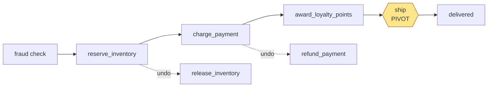

# 08 — The saga pattern

An order touches three systems that don't share a transaction: inventory,
payments and the carrier. If step 3 fails, steps 1 and 2 have already
happened in the real world. You can't roll them back; you can only perform
new actions that undo their effects. A **saga** is a sequence of steps where
each step that changes the world has a matching **compensation**, and on
failure you run the compensations for completed steps in reverse order.

The idea dates from a 1987 database paper. What Temporal adds is that the
saga's own bookkeeping — "which steps have I done, which undos do I owe?" —
is durable for free, because it's just a Python list in a workflow.

## The project's saga



```python
@dataclass
class _Compensation:
    name: str
    fn: Callable[[], Awaitable[object]]

self._compensations: list[_Compensation] = []

async def _compensate(self) -> None:
    for comp in reversed(self._compensations):
        try:
            await comp.fn()
            self._event(self._status, f"Compensated: {comp.name}")
        except ActivityError as err:
            workflow.logger.error("Compensation %s failed: %s", comp.name, err)
            self._event(self._status, f"COMPENSATION FAILED: {comp.name} - needs manual action")
    self._compensations.clear()
```

Every `except` branch in `run()` calls `_compensate()`. Because the list lives
in workflow memory and workflow memory is rebuilt by replay, a worker crash
in the middle of compensating is harmless: the next worker replays, sees which
compensation activities already completed (they're in history), and runs the
rest.

## Register before or after?

Look carefully at the two steps:

```python
# inventory: register AFTER the step succeeds
await workflow.execute_activity(reserve_inventory, ...)
self._compensations.append(_Compensation("release_inventory", ...))

# payment: register BEFORE the step runs
self._compensations.append(_Compensation("refund_payment", ...))
receipt = await workflow.execute_activity(charge_payment, ...)
```

Why the difference? Think about what you know when each activity *fails*.

`reserve_inventory` is a single local transaction that fails cleanly: if it
raises, nothing was reserved. Registering afterwards is precise.

`charge_payment` talks to a remote gateway. If it times out, you genuinely
don't know whether the card was charged — maybe the response was lost. If you
only register the refund after success, a timeout followed by exhausted
retries leaves the customer possibly charged with no refund scheduled. So the
refund is registered first, and `refund_payment` is written to be a no-op
when there's no payment:

```python
if payment is None:
    # Nothing was ever charged - refund is a no-op, not an error.
    return RefundReceipt("NONE", req.order_id, 0.0, already_refunded=True)
```

You can see the result in the declined-card history: `refund_payment` runs
(and does nothing) before `release_inventory`. Slightly wasteful, always
correct. The general rule:

> If a step can fail in a way that leaves its outcome unknown, register its
> compensation before the step and make the compensation safe to run when the
> step didn't happen.

## The pivot point

Some steps can't be undone. Once the parcel is on a truck, "release the
reservation" would put stock back on the shelf that isn't on the shelf.
That step is the **pivot**: before it, the saga can be rolled back; after it,
the saga can only go forward (or be fixed with a different kind of
compensation, like a refund).

```python
async def _ship(self) -> None:
    self._shipment_started = True
    # Stock has physically left the building: releasing it is no longer a valid undo.
    self._compensations = [c for c in self._compensations if c.name != "release_inventory"]
    ...
    result = await workflow.execute_child_workflow(ShipmentWorkflow.run, ...)
    self._compensations.clear()  # delivered: nothing left to undo
```

After the pivot, the only remaining compensation is the refund. If the
shipment child fails with `ShipmentLost`, the customer gets their money back
and the stock stays decremented — which is correct, because the box is gone.

Also notice that the pivot closes other doors: the `cancel` signal handler and
the address update validator both check `_shipment_started`. Designing the
pivot explicitly is the most useful thing you can do when modelling a saga.

## Compensations must eventually succeed

A compensation that gives up is worse than useless: it leaves the system in a
half-state and nobody knows. So compensations here use:

```python
COMPENSATION_RETRY = RetryPolicy(initial_interval=timedelta(seconds=1), maximum_interval=timedelta(minutes=1))
```

with no `maximum_attempts`, meaning retry forever with backoff capped at a
minute. If the payment provider is down for six hours, the refund lands six
hours later, automatically, and the UI shows the pending activity with its
attempt count the whole time.

What about a compensation that can *never* succeed — say a non-retryable
error from a bug? The loop records `COMPENSATION FAILED ... needs manual
action` in the timeline and keeps unwinding the others. In production you'd
also emit an alert (an activity that pages someone), or block in a
`wait_condition` for an operator signal that says "I fixed it manually,
continue."

## Semantic vs exact undo

Compensations are rarely exact inverses:

| Step | Compensation | Not quite the inverse because... |
|---|---|---|
| reserve stock | release stock | someone may have looked at "only 1 left!" in between |
| charge card | refund | the customer sees two lines on their statement; fees may not come back |
| send "order confirmed" email | send "order cancelled" email | you can't unsend an email |
| ship parcel | (none — pivot) | physics |

That's fine. A saga promises **eventual business consistency**, not
isolation. Design compensations with the customer's experience in mind, not
just the database's.

## Parallel steps

If steps are independent you can run them concurrently and still compensate
correctly:

```python
reserve = workflow.start_activity(reserve_inventory, ..., start_to_close_timeout=...)
fraud = workflow.start_child_workflow("FraudAssessmentWorkflow", ...)
results = await asyncio.gather(reserve, fraud, return_exceptions=True)
# register compensations only for the ones that succeeded,
# then raise if any failed so the except block unwinds them
```

`asyncio.gather` is deterministic inside a workflow, because the commands are
issued in source order and results are delivered from history.

## Orchestration vs choreography

There are two ways to build sagas:

* **Choreography** — each service listens for events and reacts ("payment
  service hears OrderReserved, charges, emits PaymentCaptured"). No central
  brain. Compensation logic is spread across services, each listening for
  failure events.
* **Orchestration** — one coordinator tells each service what to do and
  handles failures centrally.

Temporal is an orchestrator. The order workflow is the single place where
the whole saga, including every failure path, can be read top to bottom.
Choreography still has its place (loosely coupled teams, broadcast events),
and the two mix well: a Kafka event can start a workflow, and an activity can
publish an event.

## Testing a saga

Each failure path deserves a test. This project has:

* `test_declined_card_runs_compensation` — failure after reservation; asserts
  stock returns to its previous level and the timeline shows the
  compensation;
* `test_out_of_stock_fails_fast` — failure *at* reservation; nothing to
  compensate;
* `test_fraud_reject_never_touches_money` — failure before any step;
* `test_customer_cancel_while_in_review` — cancel path;
* `test_lost_parcel_refunds_but_keeps_stock_decremented` — failure *after*
  the pivot: the shipment child fails with `ShipmentLost` (tiny
  `delivery_sla_seconds`, no carrier scans), the refund runs, and stock is
  deliberately *not* released.

A good exercise: add a test where the customer cancels *after* payment but
before shipping, and assert both compensations ran in the right order.
