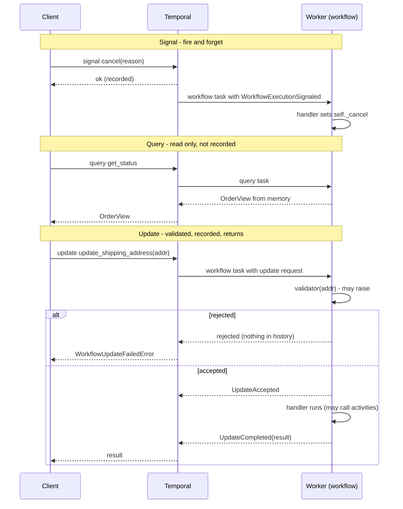

# 09 — Signals, queries and updates

A running workflow isn't a sealed box. The outside world needs to tell it
things ("the customer cancelled"), ask it things ("where's my order?") and
ask it to do things and wait for the answer ("change the address — did that
work?"). Temporal has one primitive for each.

## Side by side

| | Signal | Query | Update |
|---|---|---|---|
| Direction | in | out | in, then out |
| Changes state? | yes | **never** | yes |
| Caller waits for | the server to accept it | the answer | the handler to finish (or just acceptance) |
| Returns a value | no | yes | yes |
| Recorded in history | yes (`WorkflowExecutionSignaled`) | no | yes (`UpdateAccepted`, `UpdateCompleted`) |
| Can be rejected before recording | no | n/a | **yes, with a validator** |
| Handler may `await` activities/timers | yes (async handler) | no | yes |
| Works when no worker is running | yes — buffered in history | no — needs a worker | accepted only when a worker runs the validator |
| Used in this project for | cancel, analyst review, carrier scans, child→parent progress, closing a chat | order status, support session state | address change, every chat message, supervisor decision |



## Signals

```python
@workflow.signal
def cancel(self, req: CancelRequest) -> None:
    if self._shipment_started or self._status in TERMINAL_STATUSES:
        self._event(self._status, f"Cancel ignored (already {self._status.value}): {req.reason}")
        return
    self._cancel = req
```

Client side:

```python
await client.get_workflow_handle(f"order-{order_id}").signal(
    OrderFulfillmentWorkflow.cancel, CancelRequest(body.reason)
)
```

Properties that matter:

* **Durable and ordered.** A signal is written to history before the client
  call returns. Signals from one sender arrive in order.
* **Delivered even when nothing is running.** The crash test signals the
  approval while no worker exists; it's picked up when one starts.
* **No result.** The client only learns that the signal was *recorded*, not
  what the workflow did with it. That's why the API returns `202 Accepted` for
  cancel. If you need to know the outcome, use an update.

### Keep signal handlers small

The pattern used throughout this project: the handler records the message,
and `run()` reacts at well-defined points.

```python
@workflow.signal
def carrier_event(self, event: CarrierEvent) -> None:
    self._inbox.append(event)     # that's all

# in run():
await workflow.wait_condition(lambda: len(self._inbox) > 0, timeout=sla)
while self._inbox:
    event = self._inbox.pop(0)
    ...
```

This keeps all the decision logic in one place and avoids handlers racing
with the main flow. You can see why it matters in the shipment history:
three carrier signals arrived *while* `create_shipping_label` was still
running. They queued up in `_inbox` and were processed in order once the label
existed.

### Signal-with-start

"Send this signal to workflow X, and start X first if it isn't running" in
one atomic call:

```python
await client.start_workflow(
    CartWorkflow.run, cart_input, id=f"cart-{customer_id}", task_queue=...,
    start_signal="add_item", start_signal_args=[item],
)
```

Perfect for entity workflows like a shopping cart where the first
interaction creates the entity.

## Queries

```python
@workflow.query
def get_status(self) -> OrderView:
    return self._view()
```

Queries are answered by a worker running the handler against the workflow's
current in-memory state (after replaying if it's not cached). They're cheap,
not recorded, and can be called as often as you like.

Rules:

* **Must not mutate state.** No assignments to `self`, no activities, no
  timers. A query that changed state would make the workflow's state depend
  on whether someone happened to query it, which breaks replay.
* **Must be fast.** Keep it to building a view from fields you already have.
* **Need a worker.** If no worker is polling the queue, queries fail (or time
  out). For a dashboard that must work even during a worker outage, either
  publish state to a read model (`save_order_snapshot`) or use search
  attributes and memos, which live on the server.

## Updates

Updates are the newest of the three and the most useful for request/response
APIs. The address change:

```python
@workflow.update
async def update_shipping_address(self, address: Address) -> OrderView:
    old = self._address
    self._address = address
    self._event(self._status, f"Address changed from {old.city} to {address.city}")
    await self._snapshot()        # handlers can run activities
    return self._view()

@update_shipping_address.validator
def _validate_address(self, address: Address) -> None:
    if self._shipment_started or self._status in TERMINAL_STATUSES:
        raise ValueError(f"Too late to change the address: order is {self._status.value}")
    if not address.postal_code.strip():
        raise ValueError("postal_code is required")
```

and in the API:

```python
try:
    view = await handle.execute_update(OrderFulfillmentWorkflow.update_shipping_address, Address(...))
except WorkflowUpdateFailedError as err:
    raise HTTPException(409, str(err.cause.message))
```

### Validators

The validator runs first. If it raises, the update is **rejected** and leaves
no trace in history — the demo's "late address update -> 409" is exactly that.
Validators must be synchronous, fast, and must not change state. They're
your guard clause.

If the validator passes, the update is **accepted** (recorded), and the
handler runs. If the *handler* raises an `ApplicationError` after acceptance,
the caller gets a failure, but the acceptance is in history.

### Wait stages

`execute_update` waits for completion. `start_update(...,
wait_for_stage=WorkflowUpdateStage.ACCEPTED)` returns once accepted, giving
you a handle to fetch the result later. Use it when the handler is slow
(the support agent's chat handler calls an LLM several times).

### Update-with-start

Like signal-with-start but with a result: "start this workflow if needed,
send it this update, give me the update's result." The SDK exposes it as
`client.execute_update_with_start_workflow(...)` with a
`WithStartWorkflowOperation`. It's the natural fit for "add to cart and return
the new cart total" or "open a support session and return the first reply"
in one round trip.

### Updates as RPC into an entity

The support session is a workflow whose entire public API is updates:

```python
@workflow.update
async def chat(self, turn: ChatTurn) -> ChatReply: ...

@chat.validator
def _validate_chat(self, turn: ChatTurn) -> None:
    if self._closed:
        raise ValueError("Session is closed")
    if self._pending is not None:
        raise ValueError("A supervisor decision is pending; try again once it's resolved")

@workflow.update
async def decide(self, decision: ApprovalDecision) -> ChatReply: ...
```

The validator enforces a protocol: you can't chat while a refund is waiting
for approval, and you can't approve when nothing is pending. Those are
business rules expressed as validators, and rejected calls don't pollute
history. `test_refund_requires_supervisor_approval` checks the rejection.

## Handler concurrency

Handlers interleave with `run()` and with each other at every `await`. If two
chat messages arrive together, both `chat` handlers could be inside
`agent.ainvoke(...)` at once, interleaving their LLM calls. The support
workflow prevents that with a lock:

```python
self._lock = asyncio.Lock()       # created in @workflow.init

@workflow.update
async def chat(self, turn: ChatTurn) -> ChatReply:
    async with self._lock:
        ...
```

`asyncio.Lock` is deterministic inside a workflow, so this is safe. Two other
tools:

* `workflow.wait_condition(workflow.all_handlers_finished)` before returning
  from `run()` — don't complete while a handler is mid-flight.
* `@workflow.update(unfinished_policy=...)` / `@workflow.signal(unfinished_policy=...)`
  to change the warning the SDK emits if a workflow does finish with handlers
  still running.

## Messages to workflows from workflows

Inside a workflow you can signal another workflow with
`workflow.get_external_workflow_handle(id).signal(...)`. The shipment child
uses it to report progress to its parent. (Queries and updates are client-side
operations; workflow-to-workflow request/response is usually done with a
signal each way, or with child workflows and their results.)

## Choosing

* The caller needs to know the outcome → **update**.
* The caller doesn't care, or the sender is a webhook that must return
  instantly → **signal**.
* Reading state → **query** (or a read model if it must work without workers).
* The workflow might not exist yet → **signal-with-start** or
  **update-with-start**.
* High-frequency streaming of tokens or progress → none of these alone;
  see Workflow Streams in chapter 12.

## A note on history size

Every signal and update is an event. An entity workflow that receives
thousands of messages will hit history limits eventually. That's what
continue-as-new is for — next chapter.
