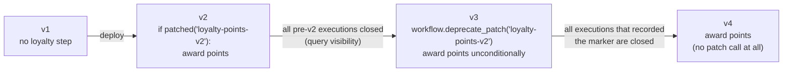

# 11 — Versioning: changing code while workflows run

On a normal web service, a deploy replaces old code with new code and every
request after that uses the new code. On Temporal, a deploy replaces the code
that will *replay* workflows that started under the old code. Orders that
began on Monday will be replayed by Thursday's code. If Thursday's code makes
different decisions given Monday's history, you get non-determinism errors
(chapter 05).

So you need a versioning strategy. There are four, and teams typically use
a mix.

## Do you even need to version?

Many changes are safe without any versioning:

| Change | Safe? |
|---|---|
| Change an **activity's implementation** (new SQL, new API endpoint, bug fix) | **yes** — activity code isn't replayed |
| Change activity timeouts or retry policy | yes for the matcher; new values apply to new schedules |
| Add a new signal/query/update handler | yes |
| Add a field with a default to an input dataclass | yes |
| Change log messages, comments, variable names | yes |
| Add, remove or reorder **activities, timers or child workflows** in workflow code | **no** |
| Change a condition that decides which of those run | **no**, if any in-flight workflow could take a different path |
| Rename an activity or workflow type | **no** |

The rule of thumb: if the change could alter the sequence of commands for a
workflow that's already running, you need versioning.

## Strategy 1: patching

The SDK's built-in branch-on-version. This project's order workflow has one:

```python
if workflow.patched("loyalty-points-v2"):
    points = await workflow.execute_activity(award_loyalty_points, ...)
```

How `patched(id)` decides:

* **Not replaying** (fresh execution, or past the end of history): records a
  marker `core_patch` with the id, returns `True`. New code path.
* **Replaying, and history has the marker here**: returns `True`.
* **Replaying, and history has no marker here**: this execution started before
  the patch existed → returns `False`. Old code path.

It also adds the patch id to the `TemporalChangeVersion` search attribute (we
confirmed this in the real history: event 62), so you can find executions by
path:

```
TemporalChangeVersion = 'loyalty-points-v2'                         -- on the new path
ExecutionStatus = 'Running' AND TemporalChangeVersion IS NULL       -- still on the old path
```

### The full lifecycle of a patch



1. **Patch**: wrap the new code in `if workflow.patched(...)`, keep the old
   behaviour in the `else`.
2. **Wait** until no execution that started before the patch is still running
   (and none needs to be replayed — mind your retention window and any replay
   tests that use old histories).
3. **Deprecate**: replace with `workflow.deprecate_patch("loyalty-points-v2")`
   followed by the new code unconditionally. This keeps replay of
   marker-carrying histories working.
4. **Remove** the deprecate call once those are gone too.

Patching is precise and works on any server. Its cost is code clutter: a
workflow with five live patches is hard to read. Clean up.

## Strategy 2: Worker Versioning

Patching handles compatibility *inside* the code. Worker Versioning handles it
in *routing*: each worker declares which version of the code it runs, and
the server makes sure an execution is processed by a compatible worker.

The current model is built around **Worker Deployments**. A worker declares a
deployment name and build ID:

```python
from temporalio.common import WorkerDeploymentVersion, VersioningBehavior
from temporalio.worker import Worker, WorkerDeploymentConfig

Worker(
    client,
    task_queue="shopsphere-orders",
    workflows=[OrderFulfillmentWorkflow],
    activities=ORDER_ACTIVITIES,
    deployment_config=WorkerDeploymentConfig(
        version=WorkerDeploymentVersion(deployment_name="shopsphere-orders", build_id="2026.10.10-a1b2c3"),
        use_worker_versioning=True,
        default_versioning_behavior=VersioningBehavior.PINNED,
    ),
)
```

and each workflow type chooses a behaviour (here via the default, or per
workflow with `@workflow.defn(versioning_behavior=...)`):

* **PINNED** — an execution stays on the build it started on until it
  finishes. You run old and new workers side by side ("rainbow deploy") and
  retire old ones once their workflows drain. No patches needed for
  short-to-medium-lived workflows. Ideal for the order workflow, which lives
  for days.
* **AUTO_UPGRADE** — an execution moves to the current version on its next
  workflow task. Use for long-lived entity workflows (the support session, a
  subscription), which then still need patching for incompatible changes, or
  continue-as-new onto the new version.

You then promote versions with the CLI (`temporal worker deployment ...`) —
set a new version as current, or ramp a percentage of new executions to it.

Worker Versioning is newer than patching and has evolved over several
server releases (an earlier "build ID compatibility sets" API is deprecated),
so check the docs for your server or Temporal Cloud version before relying on
a specific feature. The ideas — pin short workflows, auto-upgrade and patch
long ones — are stable.

## Strategy 3: new workflow type or new task queue

The bluntest tool. Copy the workflow to `OrderFulfillmentWorkflowV2`, start
new orders on it, and leave the old type running until its executions drain.
Or keep the type name but put the new version on a new task queue
(`shopsphere-orders-v2`) and point new starts there.

Simple to reason about, needs no special server support, and good for large
rewrites. Costs: duplicated code during the transition, and every caller that
starts or signals the workflow must know which one to use.

## Strategy 4: reset

When a bug has already done damage — say a bad deploy made some orders take a
wrong branch — `temporal workflow reset` rewinds an execution to an earlier
workflow task. Everything after that point is discarded from the new run's
history, and the workflow re-executes from there with the current code.

```bash
temporal workflow reset -w order-ORD-1001 --event-id 41 --reason "re-run after fix #1234"
# batch: every order that hit the bug
temporal workflow reset --query "OrderStatus='FAILED' AND StartTime > '2026-10-09T00:00:00Z'" \
    --type LastWorkflowTask --reason "fix #1234"
```

Activities after the reset point run again — idempotency (chapter 07) is
what makes reset safe to use.

## Make it testable

Whatever strategy you use, the safety net is the same: **replay real
histories against new code in CI**.

```python
# tests/test_replay_production.py
@pytest.mark.parametrize("path", glob("tests/histories/*.json"))
async def test_replay(path):
    history = WorkflowHistory.from_json("order", open(path).read())
    await Replayer(workflows=[OrderFulfillmentWorkflow, ShipmentWorkflow]).replay_workflow(history)
```

Refresh the fixture folder periodically with
`temporal workflow show -w <id> -o json` from production, choosing executions
that cover each code path (approved, reviewed, cancelled, failed, compensated).
This project's `test_histories_replay_deterministically` does the same with
histories produced during the test run.

## A practical playbook

* Order workflow (lives days): Worker Versioning with PINNED, or patches if
  you can't use Worker Versioning yet.
* Support session (lives weeks, continues-as-new): AUTO_UPGRADE plus patches;
  continue-as-new is a natural point to move onto new code.
* Replenishment (lives seconds, started by a schedule): no versioning needed
  in practice — just deploy; in-flight runs finish within moments.
* Activities: change freely, keep inputs backwards compatible.
* Always: replay tests in CI, and dashboards for non-determinism errors
  (`temporal_workflow_task_execution_failed` metrics with the NDE cause).
