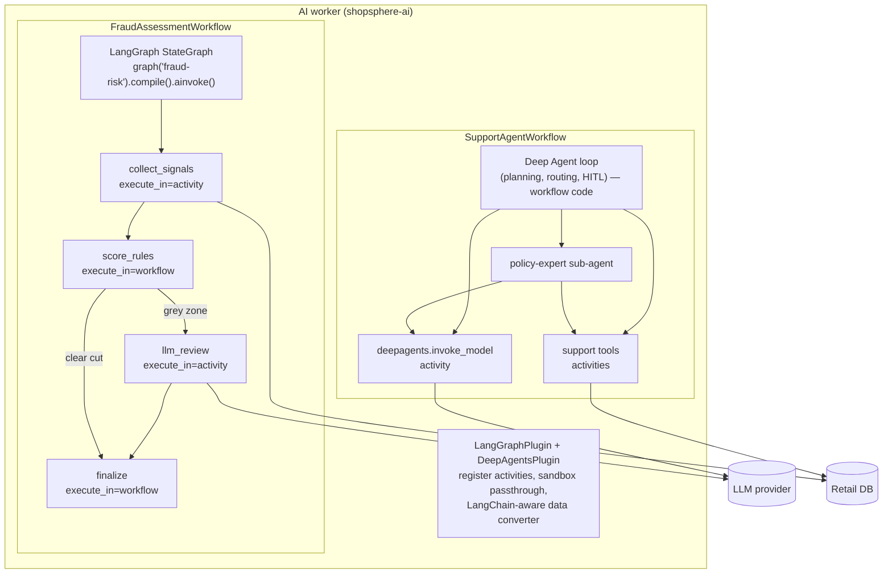
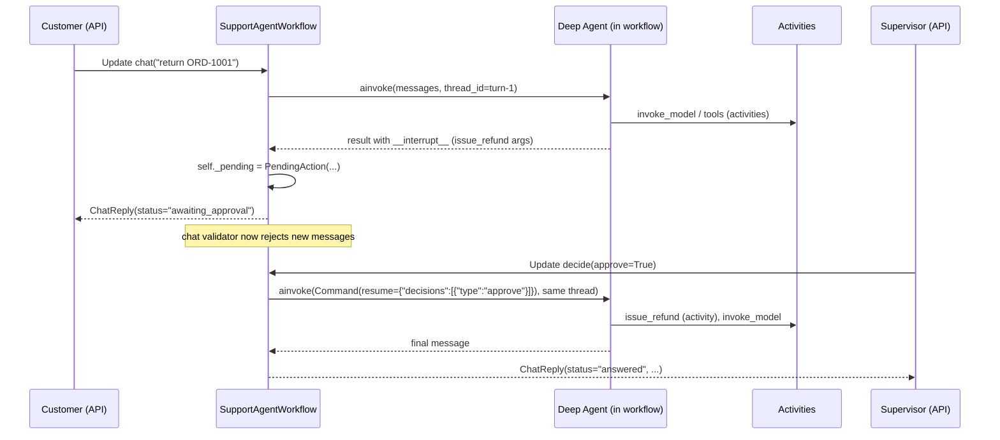

# 12 — AI agents on Temporal: LangGraph, LangChain and Deep Agents

An AI agent is a loop: ask the model what to do, do it, show the model the
result, repeat until done. Written down, that's a workflow. This chapter is
about taking that observation seriously.

## Why agents need durable execution

Agents have every property that made the order workflow hard:

* **They're long.** A research or support agent might make 20–100 model calls
  and run for minutes. A coding agent can run for hours.
* **Every step is expensive.** A crash at step 37 of a plain Python agent
  means paying for steps 1–36 again, and possibly getting different answers
  the second time.
* **Their tools have side effects.** `issue_refund` moved money. If the agent
  process dies after the refund but before recording it, a naive restart
  refunds twice.
* **They fail in new ways.** Rate limits (429), overloaded models (529),
  timeouts on long generations, malformed tool calls.
* **They need humans.** "A supervisor must approve refunds over $X" means
  pausing the agent for minutes or days, across deploys.
* **They're non-deterministic by nature.** Same prompt, different answer.

Here's the mapping that makes it all fit:

| Agent concept | Temporal concept |
|---|---|
| The agent loop / graph traversal | workflow code (deterministic *given* recorded model outputs) |
| One LLM call | one activity — its output is recorded in history |
| A tool that does I/O | an activity — retried, timed out, idempotent |
| A tool that only changes agent state (planning, scratchpad) | workflow code — free, replayed |
| Waiting for human approval | `wait_condition` + signal/update |
| Agent memory within a run | workflow state |
| A very long conversation | continue-as-new with a carried-over transcript |
| Token streaming to a UI | Workflow Streams (activity → workflow → subscriber) |
| A sub-agent | the same workflow (Deep Agents) or a child workflow |

The key insight from chapter 05: an LLM call is the most non-deterministic
thing there is, and that's *fine*, because it's an activity. Its first answer
is written to history. On replay the workflow reads that answer instead of
calling the model, so every decision the agent made downstream replays
identically. Durability for agents falls out of the same mechanism that makes
the card charge happen once.

## The two official integrations

Temporal's Python SDK (1.34) ships two experimental plugins this project uses:

* `temporalio.contrib.langgraph.LangGraphPlugin` — runs a LangGraph
  `StateGraph` (or Functional API `@entrypoint`/`@task`) inside a workflow,
  with each node executed either as an activity or inline in the workflow,
  your choice per node.
* `temporalio.contrib.deepagents.DeepAgentsPlugin` — makes a LangChain Deep
  Agent durable: every model call and every I/O tool call becomes an
  activity; the agent's control loop, planning, sub-agent routing and
  human-in-the-loop interrupts run as workflow code.

Install with `pip install "temporalio[langgraph,deepagents]"`. Both are marked
experimental, so pin your versions (see `requirements.txt`).



## Part 1 — LangGraph: the fraud graph

### Building the graph

```python
# ai/fraud_graph.py
g = StateGraph(FraudState)
g.add_node("collect_signals", collect_signals, metadata={
    "execute_in": "activity",
    "start_to_close_timeout": timedelta(seconds=10),
    "retry_policy": RetryPolicy(maximum_attempts=5),
    "summary": "Fetch customer risk signals",
})
g.add_node("score_rules", score_rules, metadata={"execute_in": "workflow"})
g.add_node("llm_review", llm_review, metadata={
    "execute_in": "activity",
    "start_to_close_timeout": timedelta(seconds=60),
    "retry_policy": RetryPolicy(initial_interval=timedelta(seconds=2), backoff_coefficient=2.0, maximum_attempts=4),
    "summary": "LLM fraud review",
})
g.add_node("finalize", finalize, metadata={"execute_in": "workflow"})
g.add_edge(START, "collect_signals")
g.add_edge("collect_signals", "score_rules")
g.add_conditional_edges("score_rules", route_after_rules, ["llm_review", "finalize"])
g.add_edge("llm_review", "finalize")
g.add_edge("finalize", END)
```

Every node **must** declare `execute_in`. The plugin refuses to guess, and it
can't be set as a default for all nodes — you make the call deliberately for
each node, which is the right amount of friction. Everything else in the
metadata (`start_to_close_timeout`, `retry_policy`, `heartbeat_timeout`,
`summary`...) is passed straight to `workflow.execute_activity`.

How to decide:

| Node does... | `execute_in` |
|---|---|
| DB / HTTP / file I/O | `activity` |
| an LLM call | `activity` |
| anything slow, or that needs a library that isn't sandbox-safe | `activity` |
| pure transformation of state | `workflow` |
| routing decisions | `workflow` (conditional-edge functions always run in the workflow) |

### Registering and running it

The graph is registered on the **worker**, by name:

```python
# worker.py
LangGraphPlugin(
    graphs={FRAUD_GRAPH: build_fraud_graph()},
    default_activity_options={"start_to_close_timeout": timedelta(seconds=60)},
)
```

and fetched by name in the **workflow**:

```python
# workflows/fraud_workflow.py
@workflow.defn
class FraudAssessmentWorkflow:
    @workflow.run
    async def run(self, inp: FraudInput) -> FraudResult:
        app = graph(FRAUD_GRAPH).compile()
        final = await app.ainvoke({"order": asdict(inp)})
        return FraudResult(decision=final["decision"], ...)
```

The plugin turns each activity-node into an activity type named
`<graph>.<node>`. Here are the two real histories side by side:

```
### clear cut (Alice, score 0.0)            ### grey zone (Bob, laptop, score 0.45)
 5  ACTIVITY_TASK_SCHEDULED                  5  ACTIVITY_TASK_SCHEDULED
       fraud-risk.collect_signals                  fraud-risk.collect_signals
 6  ACTIVITY_TASK_STARTED                    6  ACTIVITY_TASK_STARTED
 7  ACTIVITY_TASK_COMPLETED                  7  ACTIVITY_TASK_COMPLETED
 ...                                        ...
11  WORKFLOW_EXECUTION_COMPLETED            11  ACTIVITY_TASK_SCHEDULED
                                                   fraud-risk.llm_review
                                            12  ACTIVITY_TASK_STARTED
                                            13  ACTIVITY_TASK_COMPLETED
                                            ...
                                            17  WORKFLOW_EXECUTION_COMPLETED
```

`score_rules`, `route_after_rules` and `finalize` leave **no events at all**.
They ran inside workflow tasks, cost nothing, and will be re-run identically
on replay. Only the ambiguous orders pay for an LLM call, and if `llm_review`
gets a 429, it's retried with backoff without re-reading the customer's
history.

### The async rule (learned the hard way)

LangGraph executes synchronous functions through `run_in_executor`. That
includes nodes **and conditional-edge routers**. A workflow's event loop has
no executor, so a sync workflow-side function fails with `NotImplementedError`.
All workflow-side functions in `fraud_graph.py` are `async def` for this
reason. Activity-side nodes can be sync or async (async is used here
throughout).

### Other things to know about the LangGraph plugin

* **Checkpointers.** If you use interrupts, compile with
  `InMemorySaver()`. Temporal is the durable layer; a Postgres or Redis
  checkpointer would be doing I/O from workflow code, and is unnecessary.
* **Stores are not supported.** LangGraph `Store` objects can't cross the
  activity boundary; `runtime.store` is `None` in activity-nodes. Keep
  per-run memory in graph state or workflow state, and cross-run memory in
  your own database accessed from activities.
* **Runtime context.** `context_schema` values are passed to activity-nodes,
  so they must be serializable.
* **Streaming.** Setting `streaming_topic` on the plugin publishes
  `get_stream_writer()` output from nodes to a Workflow Stream that clients
  can subscribe to. Delivery is at-least-once per activity attempt, so
  subscribers should tolerate duplicates.
* **Summaries.** `summary` / `summary_fn` in node metadata label activities in
  the UI, which helps a lot when a graph has many similar nodes.

## Part 2 — Deep Agents: the support agent

Deep Agents (the `deepagents` package from LangChain) is an agent harness built
on LangChain's `create_agent`: a model, tools, optional planning, a virtual
filesystem, sub-agents through a `task` tool, and human-in-the-loop
interrupts. The Temporal plugin makes the whole thing durable.

### Building the agent

```python
# ai/support_agent.py
def build_support_agent(model_name: str):
    order_tool = activity_as_tool(get_order_details, start_to_close_timeout=_TOOL_TIMEOUT, retry_policy=_TOOL_RETRY)
    eligibility_tool = activity_as_tool(check_return_eligibility, ...)
    label_tool = activity_as_tool(create_return_label, ...)
    refund_tool = activity_as_tool(issue_refund, ...)
    policy_tool = activity_as_tool(lookup_return_policy, ...)

    return create_temporal_deep_agent(
        model=model_name,                          # a NAME, e.g. "openai:gpt-4.1-mini"
        system_prompt=SYSTEM_PROMPT,
        tools=[order_tool, eligibility_tool, label_tool, refund_tool],
        subagents=[{
            "name": "policy-expert",
            "description": "Answers questions about the return and refund policy.",
            "system_prompt": POLICY_EXPERT_PROMPT,
            "tools": [policy_tool],
        }],
        middleware=[TodoListMiddleware()],         # planning: write_todos
        interrupt_on={"issue_refund": True},       # human approval before money moves
        checkpointer=InMemorySaver(),
        activity_options={"start_to_close_timeout": timedelta(minutes=2), "retry_policy": ...},
    )
```

This function is called **inside the workflow**. With the plugin on the worker:

* `model="openai:gpt-4.1-mini"` is wrapped in a `TemporalModel`. The workflow
  only ships the model **name** to the `deepagents.invoke_model` activity; on
  the worker, your `model_provider` builds the real client. API keys never
  enter workflow code or history.
* `activity_as_tool(...)` turns an existing `@activity.defn` into a LangChain
  tool whose schema mirrors the activity's parameters. When the model calls
  it, the tool runs `workflow.execute_activity` with the timeout and retry
  policy you gave.
* Built-in, state-only tools (`write_todos`, the default state-backed file
  tools, the `task` tool that routes to sub-agents) run **in the workflow**.
* Sub-agents inherit the parent's model and tool wiring, so their LLM calls
  and tool calls are activities too, with no extra configuration.

A note on versions: in `deepagents` 0.7.x the default toolset is the virtual
filesystem tools plus `task`. Planning (`write_todos`) is an opt-in LangChain
middleware, which is why `TodoListMiddleware()` is passed explicitly.

### The worker side

```python
DeepAgentsPlugin(
    model_provider=model_provider,      # name -> chat model, runs inside the model activity
    model_activity_options={"start_to_close_timeout": timedelta(minutes=2)},
    tool_activity_options={"start_to_close_timeout": timedelta(seconds=30)},
)
```

```python
# ai/llm.py
def model_provider(model_name: str):
    if is_fake(model_name):
        return RetailSupportFakeModel()          # offline, deterministic, for demos and tests
    from langchain.chat_models import init_chat_model
    return init_chat_model(model_name, max_retries=0)
```

`max_retries=0` matters. LangChain's model clients retry by default. Inside a
Temporal activity that already retries, nested retries multiply: 5 Temporal
attempts × 6 client attempts = 30 calls, with backoff Temporal can't see. Let
Temporal own retries; the plugin's default provider does the same.

### What a refund conversation records

The customer writes "I want to return ORD-1001, it rattles". This is the real
history of that session (abridged; full version in appendix A), annotated:

```
   5  WORKFLOW_EXECUTION_UPDATE_ACCEPTED     chat          <- customer message (Update)
   8  ACTIVITY_TASK_SCHEDULED                deepagents.invoke_model
                                                           -> model returns write_todos(plan)
                                                           -> write_todos runs IN the workflow: no event
  15  ACTIVITY_TASK_SCHEDULED                deepagents.invoke_model
                                                           -> model calls check_return_eligibility
  21  ACTIVITY_TASK_SCHEDULED                check_return_eligibility
  27  ACTIVITY_TASK_SCHEDULED                deepagents.invoke_model
                                                           -> model calls create_return_label
  33  ACTIVITY_TASK_SCHEDULED                create_return_label
  39  ACTIVITY_TASK_SCHEDULED                deepagents.invoke_model
                                                           -> model calls issue_refund
                                                           -> interrupt_on fires: graph pauses
  45  WORKFLOW_EXECUTION_UPDATE_COMPLETED                  <- reply: "awaiting_approval"

          ... minutes or days pass; workers can restart freely ...

  49  WORKFLOW_EXECUTION_UPDATE_ACCEPTED     decide        <- supervisor approves (Update)
  50  ACTIVITY_TASK_SCHEDULED                issue_refund  <- the paused tool call now runs
  58  ACTIVITY_TASK_SCHEDULED                deepagents.invoke_model
                                                           -> model writes the final answer
  64  WORKFLOW_EXECUTION_UPDATE_COMPLETED                  <- reply: "All set. I've refunded $199.99..."
```

If the AI worker is killed at any point in that sequence, a new worker
replays: four model calls and two tool calls are read from history, the
planning step and the interrupt are re-executed in-workflow, and the session
ends up parked at exactly the same pending approval. Nothing is called twice.

### Human-in-the-loop, end to end



The pieces:

1. `interrupt_on={"issue_refund": True}` makes LangChain's human-in-the-loop
   middleware pause before that tool runs.
2. `ainvoke` returns normally, with the pending action under `__interrupt__`.
   The workflow stores it and answers the chat update with
   `awaiting_approval`.
3. The `decide` update resumes the same LangGraph thread with
   `Command(resume={"decisions": [...]})`. Decisions can be `approve`,
   `reject` (with a message the model sees), or `edit` (change the arguments,
   e.g. lower the amount).
4. `InMemorySaver` holds the paused graph state. It's in workflow memory, so
   it's rebuilt by replay after a crash — that's why no external checkpointer
   is needed.

A rejection reaches the model as a tool result explaining the decision, and
the model writes an apology. `test_refund_rejected_by_supervisor` covers that
path.

### Tools: activity_as_tool vs tool_as_activity

* `activity_as_tool(my_activity, ...)` — you already have (or want) a
  Temporal activity; expose it to the model. Used for every tool here, because
  the same activities could be called by other workflows too.
* `tool_as_activity(my_langchain_tool, ...)` — you already have a LangChain
  `@tool` (maybe from a toolkit); move its execution into an activity. The
  plugin registers it on the worker for you.

A non-builtin tool that you *don't* wrap runs in the workflow, and the plugin
warns when you build the agent, so you can't accidentally do I/O from
workflow code without being told.

### Long conversations

Each message, tool call and model response adds events. The support workflow
watches `workflow.info().is_continue_as_new_suggested()` and continues-as-new
with the transcript in its input when there's no pending approval (chapter
10). The plugin also provides `run_deep_agent(agent, input, state_snapshot=...)`,
which snapshots agent state and continues-as-new automatically at the end of
a turn — handy for single long autonomous runs.

Two size limits to plan around: individual payloads (default 2 MB per blob)
and total history (50 MB). LLM conversations with big tool outputs hit these
faster than you'd think. Keep tool outputs compact (return IDs and
summaries, not documents), and store large artifacts outside Temporal with a
reference in the payload.

### Streaming tokens to a UI

Set `DeepAgentsPlugin(streaming_topic="agent-stream")`. Model calls then run
through a streaming activity that publishes chunk batches to a Workflow
Stream topic; clients subscribe with `WorkflowStreamClient`. The final
aggregated message still returns to the workflow, so the durable result is the
same as without streaming. As with LangGraph streaming, delivery is
at-least-once per activity attempt.

## Part 3 — Patterns and pitfalls for agentic workflows

**Make tools idempotent.** The model may call `issue_refund` twice in a
conversation; the activity may be retried. `refunds.order_id UNIQUE` makes
both harmless. Treat every tool as an API that will be called by a
well-meaning but forgetful client.

**Put guardrails in code, not prompts.** "Never refund without approval" in
the system prompt is a suggestion. `interrupt_on` plus a validator is a
guarantee. Same for amounts: `check_return_eligibility` computes the
refundable amount; the model only passes it through.

**Budget in workflow state.** Count model calls or tokens in the workflow
(each `invoke_model` result is recorded, so the count is deterministic) and
stop or escalate to a human when a budget is exceeded.

**Rate limits are queueing, not errors.** `max_concurrent_activities=8` on the
AI worker and/or `max_task_queue_activities_per_second` on the queue turn a
burst of 500 fraud checks into a queue that drains at the provider's pace.

**Fallback models via retries.** A model activity can read
`activity.info().attempt` and switch to a backup model after N failures, all
inside one activity's retry policy. (With the plugin, do it in your
`model_provider` or a custom model wrapper.)

**Separate AI workers.** This project runs AI workflows on their own task
queue. The orders fleet keeps processing payments even when the LLM provider
is having a bad day; the order workflow degrades to manual review if the
fraud child times out.

**Keep prompts and model names in inputs or code, never read from env in
the workflow.** The model name travels in `OrderInput.ai_model` and
`SupportSessionInput.ai_model`.

**Test without a model.** `RetailSupportFakeModel` in `ai/llm.py` is a
rule-based chat model that emits real tool calls. It drives the actual Deep
Agent loop, so tests exercise planning, sub-agents, interrupts and
resumption. The plugin also ships `temporalio.contrib.deepagents.testing`
with `FakeModel`, `mock_model_provider` and `MockTool` for scripted replies.

**Observe it.** Compose either plugin with
`temporalio.contrib.langsmith` (LangSmith traces of workflows, activities and
model calls) or `temporalio.contrib.opentelemetry`.

## Part 4 — Doing it by hand (no plugins)

The plugins are conveniences. The underlying pattern is simple enough to
write yourself, and knowing it helps when debugging:

```python
@activity.defn
async def call_llm(req: LLMRequest) -> LLMResponse:
    model = init_chat_model(req.model, max_retries=0).bind_tools(req.tool_schemas)
    msg = await model.ainvoke(req.messages)
    return LLMResponse(content=msg.content, tool_calls=msg.tool_calls)

@workflow.defn
class ManualAgent:
    @workflow.run
    async def run(self, task: str) -> str:
        messages = [{"role": "user", "content": task}]
        for _ in range(20):                                   # step budget
            resp = await workflow.execute_activity(call_llm, LLMRequest(MODEL, messages, TOOL_SCHEMAS),
                                                   start_to_close_timeout=timedelta(minutes=2))
            messages.append({"role": "assistant", "content": resp.content, "tool_calls": resp.tool_calls})
            if not resp.tool_calls:
                return resp.content
            for call in resp.tool_calls:
                result = await workflow.execute_activity(TOOLS[call["name"]], call["args"],
                                                         start_to_close_timeout=timedelta(seconds=30))
                messages.append({"role": "tool", "tool_call_id": call["id"], "content": result})
        raise ApplicationError("step budget exhausted", non_retryable=True)
```

That's the whole idea: LLM call = activity, tool call = activity, loop =
workflow. The plugins add the LangChain object serialization, the
LangGraph/Deep Agents integration, interrupts, streaming and sandbox setup.

## Status and caveats

Both plugins are experimental in SDK 1.34. While building this project:

* they worked as documented, including interrupts, sub-agents and replay of
  agent histories (`test_histories_replay_deterministically` replays every
  support and fraud history);
* LangChain emits a couple of beta/deprecation warnings from the plugin's
  serializer, filtered in `pyproject.toml`;
* the LangGraph plugin's interceptor occasionally logs an "unraisable
  exception" while evicted workflows are garbage-collected at worker shutdown.
  It doesn't affect results (see chapter 13).

Pin versions, keep replay tests in CI, and read the plugin READMEs in
`temporalio/contrib/langgraph` and `temporalio/contrib/deepagents` when you
upgrade.
