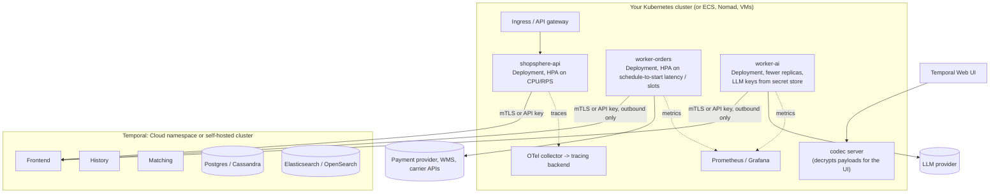

# 14 — Production

Everything so far ran on a laptop. This chapter is about running the same
code for real customers: where the server lives, how to deploy and scale
workers, how to secure payloads, what to watch, and what to do at 3 a.m.

## Reference deployment



## Temporal Cloud or self-hosted?

| | Temporal Cloud | Self-hosted |
|---|---|---|
| What you run | only workers and clients | workers, clients, 4 Temporal services, a primary DB, a visibility store, upgrades |
| Scaling the service | managed (namespaces scale on demand) | you size history shards up front, then scale hosts and the database |
| Multi-region | managed replication options | your own setup (multi-cluster replication is possible but complex) |
| Security | mTLS or API keys, SSO, audit logs, private connectivity options | you configure TLS, authorizer and claim mapper plugins |
| Cost model | consumption-based (actions, storage) | infrastructure + people |
| Your code and data | runs in your infrastructure either way; payloads can be end-to-end encrypted with your own codec | same |

For most teams the honest advice is: start on Cloud unless you have a strong
reason (regulation, cost at very large scale, an existing Cassandra team).
Operating the History service and its database at scale is a real job.

If you self-host, the official Helm chart (`temporalio/helm-charts`) and the
`temporalio/docker-compose` examples are the starting points. Decide
`numHistoryShards` carefully at creation time — it can't be changed later.
Common choices are 512 or more for production clusters.

## Connecting securely

```python
# Temporal Cloud with an API key
client = await Client.connect(
    "orders-prod.a1b2c.tmprl.cloud:7233",
    namespace="orders-prod.a1b2c",
    api_key=os.environ["TEMPORAL_API_KEY"],
    tls=True,
)

# mTLS (Cloud or self-hosted)
client = await Client.connect(
    address, namespace=ns,
    tls=TLSConfig(client_cert=cert_bytes, client_private_key=key_bytes),
)
```

Put this in one helper and use it from the API, the workers and scripts.

## Encrypting payloads

By default, workflow inputs, activity results and signal payloads are stored
in plaintext JSON on the Temporal service. For customer data (addresses,
emails, card tokens) you usually want them encrypted with keys only you hold.
A **payload codec** does that transparently:

```python
class EncryptionCodec(PayloadCodec):
    async def encode(self, payloads): return [encrypt(p) for p in payloads]
    async def decode(self, payloads): return [decrypt(p) for p in payloads]

converter = dataclasses.replace(DataConverter.default, payload_codec=EncryptionCodec(key_id="k1"))
client = await Client.connect(..., data_converter=converter)
```

Everything that talks to the namespace (API, workers, scripts) must use the
same codec. To keep the Web UI usable, run a small **codec server** that the
UI calls to decode payloads for authorised users.

Note for AI workers: the Deep Agents plugin installs its own payload
converter for LangChain messages. Compose the two by setting
`payload_converter_class=DeepAgentsPayloadConverter` together with your
`payload_codec` on one `DataConverter`; the plugin refuses to silently
override a custom converter.

## Limits to design around

| Limit (defaults) | Value | What to do |
|---|---|---|
| Single payload (input, result, signal arg) | 2 MB | pass IDs and references, store blobs in S3/GCS |
| gRPC message | 4 MB | same; also don't batch hundreds of large commands |
| History length | warning at ~10k events, hard limit 51,200 | continue-as-new; split into children |
| History size | 50 MB | same |
| Pending activities / children / signals per workflow | a few thousand each | batch fan-outs, use children |
| Workflow task timeout | 10 s | keep workflow code fast; no heavy CPU in workflows |

These are server defaults; Cloud and self-hosted deployments can differ.
`workflow.info().is_continue_as_new_suggested()` and the history-size fields
on `workflow.info()` let a workflow react before it hits a wall.

## Workers in production

### Sizing and tuning

* **Slots** — `max_concurrent_activities`, `max_concurrent_workflow_tasks`,
  `max_concurrent_local_activities`. Or a resource-based `tuner` that adds
  slots while CPU and memory allow.
* **Cache** — `max_cached_workflows`. Bigger cache = fewer replays = less CPU,
  more memory. Watch the sticky cache hit rate.
* **Pollers** — usually fine at defaults; increase if schedule-to-start
  latency is high while slots are free.
* **Rate limits** — `max_task_queue_activities_per_second` for downstream
  APIs with global quotas.

### Autoscaling

Scale workers on what Temporal tells you, not just CPU:

* `temporal_workflow_task_schedule_to_start_latency` and
  `temporal_activity_schedule_to_start_latency` (SDK metrics) — tasks waiting
  for a worker. Rising = add workers.
* Free slots (`temporal_worker_task_slots_available`) — near zero = workers
  saturated.
* Task queue backlog (`temporal task-queue describe`, or the server/Cloud
  metrics for approximate backlog count).

### Deploys

* **Graceful shutdown**: set `graceful_shutdown_timeout` on the Worker so
  in-flight activities get time to finish when Kubernetes sends SIGTERM.
  Anything not finished will be retried elsewhere anyway.
* **Versioning**: chapter 11. Use Worker Versioning (pinned) for the orders
  fleet, or patches.
* **Replay tests** in CI before every deploy that touches workflow code.

### Separate fleets

This project already splits orders and AI. Other common splits: a fleet for
slow batch activities so they can't starve latency-sensitive ones; a fleet per
downstream dependency with its own rate limit; a GPU fleet for model
inference activities.

## Observability

### Metrics

```python
from temporalio.runtime import PrometheusConfig, Runtime, TelemetryConfig

runtime = Runtime(telemetry=TelemetryConfig(metrics=PrometheusConfig(bind_address="0.0.0.0:9464")))
client = await Client.connect(address, runtime=runtime)
```

Worth a dashboard:

| Metric | Alert when |
|---|---|
| `temporal_workflow_task_execution_failed` | any sustained rate — often a bug or a non-determinism error |
| `temporal_activity_execution_failed` (by activity type) | spikes; correlate with the downstream |
| `temporal_activity_schedule_to_start_latency` | p95 rising → under-provisioned workers |
| `temporal_workflow_task_schedule_to_start_latency` | same, for workflow tasks |
| `temporal_sticky_cache_hit` vs misses, `temporal_workflow_task_replay_latency` | low hit rate / lots of replay → cache too small or workers churning |
| `temporal_worker_task_slots_used` / `_available` | used ≈ max for long periods → raise slots or add workers |
| `temporal_request_failure` / `temporal_long_request_failure` | connectivity to the service |
| `temporal_workflow_endtoend_latency` (by workflow type) | business SLOs, e.g. order-to-delivery |
| your own business metrics from activities | orders stuck in PENDING_REVIEW, refunds per hour |

These names come from scraping a worker of this project. Failure counters
only appear in the scrape after they've been incremented at least once, so
don't be surprised when `..._failed` metrics are missing on a healthy worker.

### Tracing

`temporalio.contrib.opentelemetry` (install `opentelemetry-sdk`) adds an
interceptor or plugin that creates spans for starting workflows, running
activities, signals and so on, and propagates context from the API request
through the workflow into each activity. For the AI side, the LangSmith plugin
(`temporalio.contrib.langsmith`) traces model and tool calls in LangSmith with
the workflow structure preserved.

### Logs

Use `workflow.logger` and `activity.logger`. They attach workflow ID, run ID,
activity type and attempt to each record, and `workflow.logger` skips
duplicate logs during replay.

### Search

Custom search attributes (`OrderStatus`, `CustomerId`) make the UI an
operations tool: "all orders stuck in PENDING_REVIEW for more than a day"
is one query. Keep them few, small and stable.

## Retention and archival

Closed workflow histories are kept for the namespace's **retention period**
(configurable per namespace, typically days to a few weeks), then deleted.
If you need them longer — audits, disputes — enable **archival** to an object
store, or export what you need to your own systems from activities while the
workflow runs (that's another reason for `save_order_snapshot`).

## Runbook: things that go wrong

**"Orders are stuck in FRAUD_CHECK."**
Check the AI worker is running and polling `shopsphere-ai`
(`temporal task-queue describe --task-queue shopsphere-ai`). Look at a stuck
fraud child in the UI: pending activity `fraud-risk.llm_review` with attempt
count climbing → the LLM provider is failing; check the last failure message.
The order workflow will route to manual review after 10 minutes on its own.

**"A workflow shows Workflow Task Failed."**
Open it in the UI; the failure message says why. A Python exception → fix
and deploy; it resumes on its own. A non-determinism error → roll back or add
a `patched()` branch (chapter 11), or reset.

**"An activity keeps retrying forever."**
Pending activities panel → last failure. If it can never succeed (bad
input), the right fix is usually making that error type non-retryable and
deploying; for the stuck instance, cancel or reset the workflow, or fix the
data so the next attempt succeeds.

**"We deployed a bug that made 2,000 orders take the wrong branch."**
Fix forward with a patch so new runs are correct, then batch-reset affected
executions to before the bad decision:
`temporal workflow reset --query "..." --type LastWorkflowTask` (or to a
specific event). Make sure activities after that point are idempotent —
they will run again.

**"We need to stop everything now."**
Pause the schedule (`temporal schedule toggle --pause`), scale workers to
zero. Workflows don't fail when no worker runs; they simply wait. Scaling
back up resumes them. Terminate only as a last resort.

**"The payment provider was down for three hours."**
Nothing to do. Charges retried with backoff (capped at 30 s intervals,
8 attempts in this project — consider unlimited attempts plus a
`schedule_to_close_timeout` for payments), refunds retried forever. Check
for orders that failed with "attempts exhausted" and decide whether to retry
them.

## Security checklist

* [ ] mTLS or API keys for every client and worker; least-privilege namespace permissions
* [ ] payload codec for PII; codec server behind your SSO for the UI
* [ ] secrets (LLM keys, PSP keys) only in worker environments, never in workflow inputs
* [ ] separate namespaces per environment
* [ ] audit who can signal, cancel, terminate and reset in production
* [ ] activity inputs validated (the model chooses tool arguments!)
* [ ] human approval (`interrupt_on`) on any agent tool that moves money or deletes data
