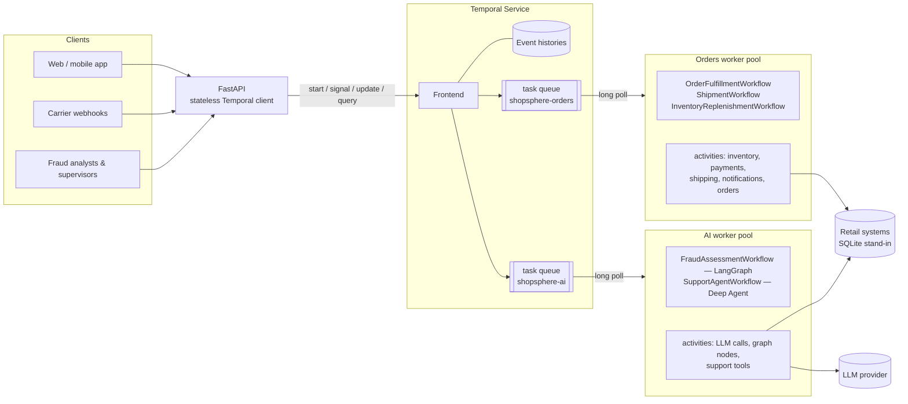

# Temporal, zero to hero — the ShopSphere guide

This guide teaches Temporal by building something real: a retail order
system that charges cards, reserves stock, ships parcels, screens for fraud
with a LangGraph graph, and runs a LangChain Deep Agent for customer support
that can issue refunds once a human signs off.

You don't need to know Temporal before you start. You should be comfortable
with Python and `async`/`await`, and you should have at least once been woken
up by a system that half-finished something.

## How to read it

The chapters build on each other. If you're brand new, read 01 to 06 in order
with the code open next to you, then run the project (chapter 04) and poke at
it in the Temporal UI before going further. After that the chapters can be
read in any order.

| # | Chapter | What you'll get out of it |
|---|---------|---------------------------|
| 01 | [Why durable execution exists](01-why-durable-execution.md) | The problem Temporal solves, told through a failed order |
| 02 | [Core concepts](02-core-concepts.md) | Workflows, activities, workers, task queues, history — the vocabulary |
| 03 | [Architecture: what actually happens](03-architecture.md) | Server internals, the task lifecycle, replay, step by step |
| 04 | [Running it](04-running-it.md) | Install, run, demo, the UI and CLI tour |
| 05 | [Determinism and replay](05-determinism-and-replay.md) | The one rule you must never break, and why |
| 06 | [The order workflow, line by line](06-order-workflow-walkthrough.md) | The project's main workflow next to its real event history |
| 07 | [Activities, retries, timeouts, idempotency](07-activities-retries-timeouts.md) | Making side effects safe on at-least-once execution |
| 08 | [The saga pattern](08-saga.md) | Compensations, pivot points, and what to do when undo fails |
| 09 | [Signals, queries and updates](09-signals-queries-updates.md) | Talking to running workflows |
| 10 | [Timers, child workflows, continue-as-new, schedules](10-timers-children-schedules.md) | Long-running and structured work |
| 11 | [Versioning](11-versioning.md) | Changing code while workflows are still running |
| 12 | [AI agents on Temporal](12-ai-agents-on-temporal.md) | LangGraph and Deep Agents plugins, LLM calls as activities, human-in-the-loop |
| 13 | [Testing](13-testing.md) | Real-server tests, replay tests, crash tests |
| 14 | [Production](14-production.md) | Deploying, scaling, securing and operating Temporal |
| 15 | [Hero checklist](15-hero-checklist.md) | Exercises, common mistakes, interview questions, cheat sheet |
| A | [Real event histories](A-real-event-histories.md) | Unedited histories captured from this project |

## The project at a glance

The code is in `src/shopsphere/`. Every file starts with a comment that says
what it demonstrates, so reading the source is part of the course.
